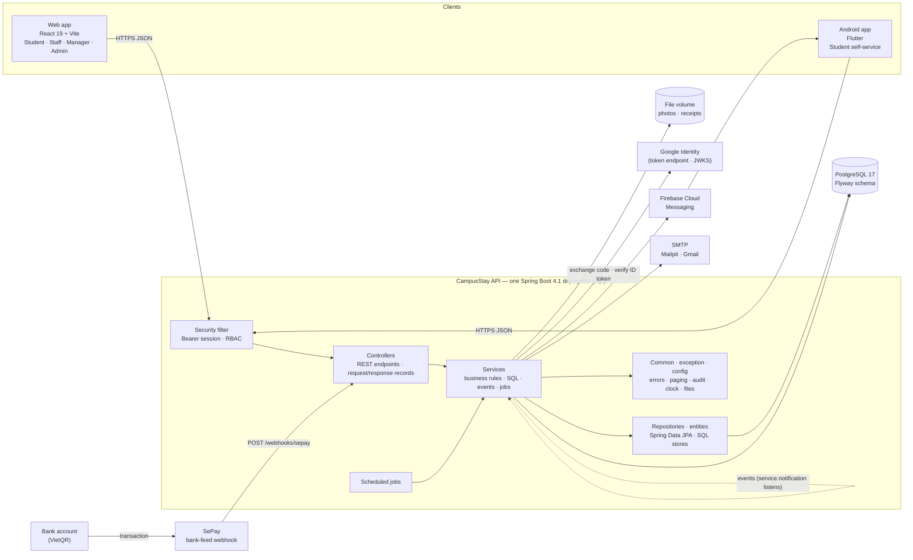
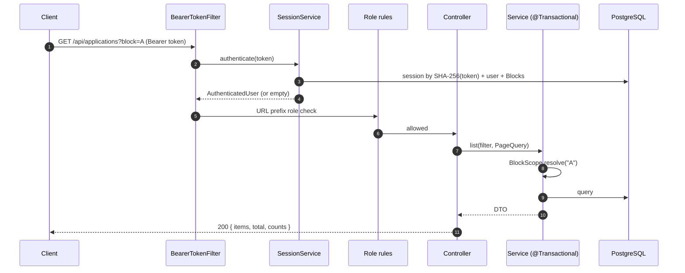
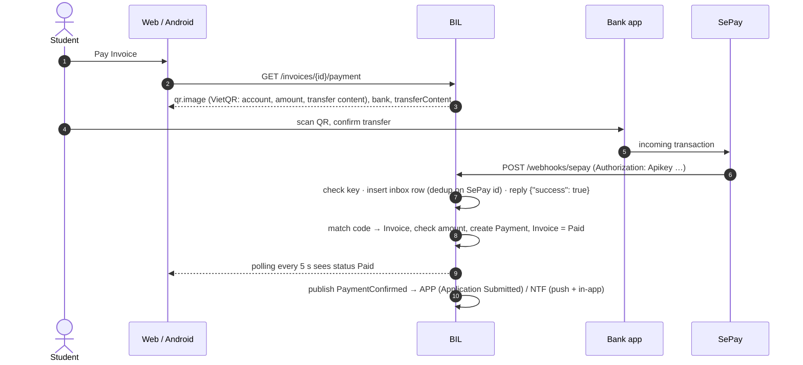
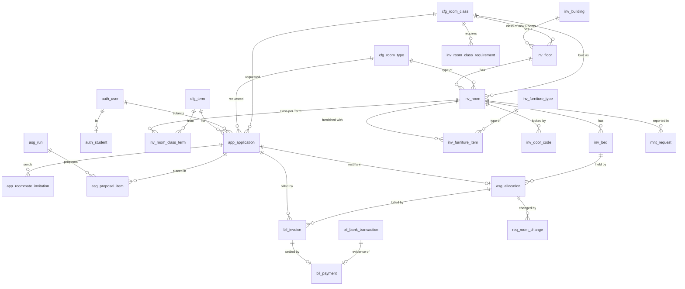
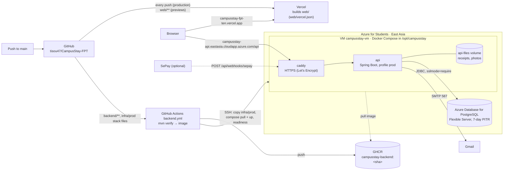

# CampusStay FPT — Backend Architecture

| Field | Value |
|---|---|
| Version | 1.6 (Change Specification v2 phase 4 "Registration periods", in `main` since 26/10/2026: registration-period requests, the Term wizard with prices, Blocks, Rooms and rules fixed per Term, announcements and the dormitory board, configuration grouped by subject, rules screens, Term dashboard; ADR-20). 1.5 (Change Specification v2 phase 3 "Inventory", in `main` since 25/10/2026: Room Class per Room per Term, furniture and Room Class requirements, door codes; ADR-23, ADR-24). 1.4: phase 2 "Accounts" (Google sign-up, verification, the student list and its import, Staff accounts by Managers, email redirect for fictional accounts only; ADR-26) |
| Date | 26/10/2026 (Week 7, Sprint 4) |
| Owner | Tisou (Leader, PM, BA, Full-stack) |
| Status | Approved by Tisou on 20/10/2026 |
| Feeds | Report 4 (SDD) §1 System Design and §2 Database Design; Report 3 §4 Non-Functional Requirements |
| Related | `docs/00_Project_Brief.md` (ADRs), `02_Endpoint_Map.md`, `03_API_Contract_Changes.md`, `04_Test_Catalog.md`, `docs/api-contract.md`, `infra/prod/README.md` (production runbook) |

---

## 1. Scope

This document describes how the CampusStay FPT backend is built: the architecture style, layers and features, security, integrations (VietQR via SePay, Google sign-in, Firebase Cloud Messaging, SMTP email), consistency guarantees, the assignment engine, the database and operations. It is written so that a council member can follow every design choice back to a reason, and so that Claude Code can implement the remaining slices without re-deciding anything.

## 2. Architecture overview



| Component | Responsibility |
|---|---|
| Web app | All four roles. Talks only to `/api`; in development through the Vite proxy (same origin). The proxy drops the browser's `Origin` header: with `changeOrigin` the API would otherwise see a cross-origin POST and its CORS check (closed unless `CORS_ALLOWED_ORIGINS` is set) answers `403 Invalid CORS request`. A web app served from another origin needs `CORS_ALLOWED_ORIGINS`. |
| Android app | Student tracking, push notifications, check-in pass. Uses the same API. |
| Security filter | Resolves the bearer token to a session, applies role rules by URL prefix. |
| Controllers | REST endpoints: validate input, call one service, return the contract records (§5). |
| Services | Business rules and transactions, one sub-package per feature (§4); SQL through `JdbcClient`. |
| Repositories · entities | Spring Data JPA for users, sessions, tokens, Terms, Room Types and Classes; SQL stores for the larger tables. |
| Common · exception · config | Error model, list/paging DTOs, Audit Log, clock, files, configuration. No business rules. |
| Scheduled jobs | Expiry of Deposit windows and invitations, overdue Invoices, SLA timers, email outbox, housekeeping (§11). |
| PostgreSQL | Single database, schema owned by Flyway; constraints enforce the critical invariants (§9). |
| SePay | Watches the receiving bank account and posts each incoming transfer to the webhook (§10). |
| Google Identity | Issues ID tokens for `@fpt.edu.vn` accounts (directly to Android, or in exchange for the web's authorization code); the API verifies them with Google's public keys. |
| FCM / SMTP | Push to Android; email through an outbox table. |

## 3. Key decisions

Full entries are in the Brief's Decision Log. Summary with the argument for the council:

| ADR | Decision | Argument |
|---|---|---|
| ADR-01 | Monolith (one deployable, one database) | One developer, 16 weeks, three clients on one API, and Allocation + Payment need ACID transactions. Microservices would add distributed transactions, service discovery and several deployments for no functional gain. The package-by-module layout it started with is replaced by ADR-17. |
| ADR-04 | Spring Boot 4.1.x, Java 21, Maven | Spring Boot 3.5 left open-source support on 30/06/2026; 4.1 is GA (4.1.0 on 10/06/2026, 4.1.1 on 20/08/2026). No backend code existed, so starting on 4.1 has no migration cost. |
| ADR-06 | Room Type + Room Class choice only; no Room/Bed self-selection | Matches the UI; lets the engine guarantee gender/Block rules and fairness; removes the "two students click the same Bed" race entirely. |
| ADR-07 | Opaque server-side sessions; password + Google (`hd = fpt.edu.vn`) | The contract has one bearer token and "401 signs out". Opaque tokens can be revoked instantly (sign-out, password change, disabled account) and need no key management. JWT would need refresh tokens (a contract change) and a deny-list for revocation. |
| ADR-08 | VietQR through SePay webhook + mock + manual confirmation | Automatic confirmation without a merchant contract; money goes straight to the bank account; manual Staff confirmation keeps the demo working if the feed is down. |
| ADR-09 | Email via SMTP behind a port (Mailpit dev, Gmail demo) | Free. A personal Gmail account allows 500 messages per rolling 24 hours, enough for a demo; the provider can be swapped without touching the services. |
| ADR-10 | ~~Spring Modulith verifies module boundaries~~ (superseded by ADR-17 on 22/10/2026) | Turned "strict boundaries" into a failing test; removed with the module packages. |
| ADR-11 | PostgreSQL 17 + Flyway SQL; JPA for writes, SQL for reads/reports | Constraints and partial indexes carry the critical invariants; migrations are the "Database Script(s)" deliverable. |
| ADR-13 | Password sign-in by email with CampusStay's own password | CampusStay cannot check FPT Wi-Fi credentials (no SIS access, ADR-02), so asking for that username would invite users to type their FPT password into another system. Reset and invitation links go to the email anyway. |
| ADR-14 | Google sign-in by authorization code (web) or ID token (Android) | The web keeps the custom Google button of the approved design (code flow); Android's Google Sign-In returns an ID token. The code exchange needs a client secret, which stays on the server; both paths end in the same ID-token checks. |
| ADR-15 | IDs are JSON strings | URL parameters, `<select>` values and browser storage are strings, so clients compare IDs without conversion. Java and the database keep `long`/`BIGINT`; the change is only in the contract DTOs. |
| ADR-16 | Web on Vercel; API on one VM with Docker Compose and Caddy; GitHub Actions → GHCR → SSH deploy (live on Azure for Students since 23/10/2026, with Azure Database for PostgreSQL) | A VM never sleeps, so the 30-second email outbox, the file volume, SMTP and a stable HTTPS webhook URL work as designed; Vercel cannot run a long-lived Spring Boot process; free PaaS tiers sleep, block SMTP or expire their database (§14). |
| ADR-17 | Layered Spring MVC packages (22/10/2026) | The team and the council find code faster in the standard Controller → Service → Repository layout than in ten module packages with hidden `internal`/`web` folders. Classes moved without behaviour changes (all tests pass); the single deployable, the database and its invariants stay. Spring Modulith and `ModularityTests` are removed; `LayeringTest` checks that calls go one way (§5). |
| ADR-18 | The production server runs as a demo: payment simulator (A-08) and email redirect switched on by settings; every push to `main` that passes its checks deploys | No bank account or SePay contract is needed to show payments; the 6,200 fictional seed accounts never receive real email and the council can follow every email in one inbox; nobody deploys by hand (§10, §14). |

## 4. Features

Each feature has a sub-package in the layers that need one (`controller.<feature>`, `service.<feature>`, `repository.<feature>`, §5). Its short code is the prefix of its tables and of its test case ids (`TC-APP-001`); a feature's tables are written only by its own services (§5).

| Feature (code → package) | Responsibility | Owns tables | Interfaces other features use (`service.<feature>`) and events (`event`) |
|---|---|---|---|
| AUTH → `auth` | Sign-in (password, Google) and Google sign-up of students, sessions and the account setup gate, users and roles, Block scope, the student directory with its verification and the student list import, Staff accounts created by Managers, staff profiles, invitations, password reset | `auth_*` | In `security`: `CurrentUser`, `AuthenticatedUser`, `Role`, `Permission` (role-by-action table, also the Admin permission matrix), `BlockScope`, `AccountSetupGate`. In `service.auth`: `UserDirectory` (names, student profiles with their directory sync time and verification, staff of Blocks, priority-group counts, which addresses belong to fictional accounts), ports `BlockDirectory` (INV), `AuditLogSettings` (CFG), `StaffHandles` (CFG: labels of the Staff handles list), `StaffWorkload` (MNT and REQ: open and recently finished work per person, added up on Block Manager › Staff) and `StudentRecords` (APP, ASG, BIL and REQ: a student's Applications, Allocations, Invoices and requests for the student hub); reads residents through ASG's `Residences`; events `PasswordResetRequested`, `StudentVerificationRequested`, `StudentVerified` |
| CFG → `setting` | Terms (built in a step-by-step wizard and fixed when published: Term prices, Deposit, Utility Deposit, Blocks and Rooms used, the rules it opened with), registration-period requests from Managers, Room Types, Room Classes, fee policy, refund rules, utility policy, eligibility, priority groups, matching snapshots, option lists, system parameters, settings grouped by subject, Block settings | `cfg_*` | `TermCatalog` (also the Blocks and Rooms of a Term), `TermSummary`, `Catalog` (Room Types, Room Classes), `FeePolicy` (the Term's price, Deposit and Utility Deposit, the defaults of new Terms, refund rules, the rule list), `EligibilityRules` (rules and priority-group order, per Term), `MatchingCriteria` (snapshots for the engine; the one a Term opened with), `BlockSettings` (desk hours, house rules), `UtilityPolicy` (utility prices, rounding, whether an overdue Invoice blocks changes), `Parameters`, `Lookups`, ports `RoomUsage` and `TermSupply` (INV), `StudentTerms` and `EligibilityCounts` (APP), `TermInvoices` (BIL) and `MatchingPreviewer` (ASG), implements AUTH's `AuditLogSettings` and `StaffHandles`, events `RoomTypeBedsChanged`, `TermRequestSubmitted`, `TermRequestCommented`, `TermRequestDecided`, `TermPublished`, `PolicyChanged` |
| INV → `inventory` | Buildings, Floors, Rooms, Beds, out-of-service, bulk room creation; the Room Class of each Room per Term; furniture types, Room Class requirements, furniture items, their moves and history; door codes and their rotation | `inv_*` | Implements `BlockDirectory` and CFG's `RoomUsage` and `TermSupply` (the Beds a Term offers per Room Type × Room Class × gender, with furniture conformance); port `BedOccupancy` (ASG: who holds or lives in a Bed, the Beds already promised for a Term, a student's stay); `Buildings` (active Blocks for a gender, genders of Blocks); `Inventory` (assignable Beds of a Term: only its Blocks, without the Rooms it leaves out; Beds by id, Beds of a Room or of a Building, each with its Room's class in the Term asked for); listens to `ResidentLeftRoom` (ASG); events `DoorCodeToSet`, `DoorCodeChanged` |
| APP → `application` | Application wizard, eligibility check, roommate invitations and code check, Application review, Round-2 offers | `app_*` | `Applications` (approved candidates, the Allocated / Waitlisted transitions and Round-2 offers used by ASG, applicants of a Term for NTF email groups), ports `StudentAllocations` and `Round2Placements` (ASG), implements CFG's `StudentTerms` (also live Applications per choice) and `EligibilityCounts` (students failing each eligibility check now), events `ApplicationCreated`, `ApplicationSubmitted`, `RoommateInvited`, `ApplicationRejected`, `Round2Offered` |
| ASG → `assignment` | Assignment runs (dry-run, real, Round-2), proposals, conflicts, Manager approval, per-Block commit, Allocation, Check-in, Check-out, late check-ins | `asg_*` | Implements INV's `BedOccupancy`, APP's `StudentAllocations` and `Round2Placements`, CFG's `MatchingPreviewer` and BIL's `RoomStays`; `Residences` (a student's current Bed, residents of a Room, who is checked in to which Bed, the residents of a Term), `Moves` (free Beds, moving and swapping students during the stay, for REQ); events `AllocationCreated`, `LateCheckInDecided`, `ResidentLeftRoom` (check-out, a move to another Room) |
| BIL → `billing` | Invoices, Payments, VietQR/SePay, manual confirmation, refunds, meter readings and Utility Invoices, overdue reminders, receipts | `bil_*` | `Billing` (issue a Deposit or a Balance with the Term's Utility Deposit, void, refund by rule, Invoices and Deposits of Applications, due summary, overdue check, what blocks check-in, the Utility Deposit settlement at check-out, charge Invoices and credits for room changes and swaps, students with an unpaid Invoice), implements CFG's `TermInvoices` (a Term's money locks with its first Invoice); port `RoomStays` (ASG: who lived in a Room and when, to split its meter by time between meter cuts), events `PaymentConfirmed`, `InvoiceIssued`, `InvoiceOverdue`, `RefundDecided` |
| REQ → `request` | Room-Change Requests, swaps and swap board, routing rules, SLA timers, escalations | `req_*` | events `RoomChangeDecided`, `SwapInvited`, `SwapDecided`, `EscalationAssigned`; implements AUTH's `StaffWorkload`. Routes new Maintenance Requests (listens to `MaintenanceReported`, assigns through `MaintenanceRequests`) and Room-Change Requests; the SLA scan keeps its own copy of what an escalation shows (code, title, Room) so it never reads MNT tables |
| MNT → `maintenance` | Maintenance Requests, photos, updates, inspection checklists, schedules and runs | `mnt_*` | `MaintenanceRequests` (a student's requests, open requests and assignment, for REQ's requests screen, routing and escalations), implements AUTH's `StaffWorkload`, events `MaintenanceUpdated`, `MaintenanceReported`, `InspectionScheduled`. A failed inspection item creates a Maintenance Request, routed like any other |
| NTF → `notification` | In-app notifications, FCM devices and push, templates, email outbox, campaigns, announcements and the dormitory board | `ntf_*` | Listens to events (registration-period requests and publications notify Admins and Managers; `TermPublished` and `PolicyChanged` write announcements); every in-app notification whose template has push on is pushed to the user's Android devices after commit (FCM HTTP v1). Admin campaigns pick their recipients through APP, ASG and BIL public APIs |
| RPT → `report` | Dashboards (also the Term dashboard), reports, exports | none (reads `rpt_v_*` views owned by the other features) | `GET /exports/{report}` writes CSV for every `ReportExport` (each feature exports its own screens with their filters and scope) and for its own reports; every export is audited |
| `common`, `exception`, `config`, `security`, `dto` | Error model (`exception`), `ListResponse`/`PageQuery` (`dto`), `AuditLog`, `RequestInfo` (`common`), `TimeConfig` (`config`), `Tokens` (`security`), `FileStore` (uploads: type sniffed from the bytes, stored on disk, metadata in `shared_file`), `FileLinks` (short-lived signed links, `GET /files/{id}`), `ReportExport` (a screen's export, implemented by the feature that owns the screen) | `shared_file`, `shared_audit_log` | Used by every layer |

## 5. Package structure and dependency rules

```
vn.fpt.campusstay
├── CampusStayApplication
├── controller/<feature>/   REST controllers with their request and response records
├── service/<feature>/      business rules (@Transactional), SQL through JdbcClient, interfaces other features
│                           call (Billing, Inventory, Moves …) and their Jdbc… implementations, jobs, listeners, exports
├── repository/             Spring Data JPA repositories; repository/<feature>/ SQL stores (ApplicationStore, InvoiceStore …)
├── entity/                 JPA entities: users, sessions, action tokens, Terms, Room Types, Room Classes
├── dto/                    records shared by several layers (ListResponse, PageQuery, dto.setting.TermSummary)
├── event/                  domain events (ApplicationSubmitted, PaymentConfirmed, MaintenanceReported …)
├── config/                 Spring configuration and @ConfigurationProperties (clock, mail, push, payment, auth)
├── security/               SecurityConfig, BearerTokenFilter, CurrentUser, BlockScope, Role, Permission, Tokens
├── exception/              ApiException, ApiError, GlobalExceptionHandler, ConstraintMessages, FieldErrors
└── common/                 audit log, the CSV export contract, file store and signed links, request info
```

Features: `auth`, `setting` (CFG), `inventory` (INV), `application` (APP), `assignment` (ASG), `billing` (BIL), `request` (REQ), `maintenance` (MNT), `notification` (NTF), `report` (RPT).

Rules (`LayeringTest` checks rule 1; the others are checked in review):

1. Calls go one way: controller → service → repository / entity. Controllers never use `JdbcClient`, repositories or entities; nothing below the controllers imports them.
2. A service uses another feature through that feature's interface (`Billing`, `Inventory`, `Moves`, `TermCatalog` …), never through its store or SQL. Where two features need each other, one of them declares the interface and the other implements it (`BlockDirectory` in auth, implemented in inventory), so no Spring bean cycle appears.
3. A table is written only by the services of the feature whose prefix it carries (`bil_*` by billing). Cross-feature foreign keys exist for referential integrity only. Reports read the `rpt_v_*` views that each owning feature defines in its own migration (V23–V31, V38). One read crosses a feature in SQL, by design: INV's function `inv_room_class_in(room, term)` (V38) orders Terms by `cfg_term.stay_start` and `status` to find the class in effect, so every Bed lookup, the Room screens and the report view `rpt_v_room_class` resolve a Room's class per Term in one query; it only reads `cfg_term` and writes nothing.
4. Side effects in other features go through **domain events** (`event/`, `ApplicationEventPublisher`). Notification listeners that write the email outbox run in the publisher's transaction (`@EventListener`), so the business change and its email commit together.
5. Controllers are thin: validate input (Bean Validation), call one service method, return the contract record. Transactions start at the service layer.

## 6. API conventions (implementation)

| Contract rule | Implementation |
|---|---|
| Base URL `/api` | `server.servlet.context-path=/api`. Controllers map paths without `/api`. |
| Errors `{ message, code?, details? }` | `ApiException` + `GlobalExceptionHandler`. `message` is written for end users. Unexpected errors return `INTERNAL_ERROR` with an `errorId` that is also in the log. DB constraint names map to friendly messages (`ConstraintMessages`). |
| Lists `{ items, total }` | `ListResponse<T>`, or an endpoint-specific record with `items`, `total` first. `PageQuery.of(page, pageSize)`: 1-based, default 20, max 100. |
| Scope `termId`, `block` | `BlockScope.resolve(block)` on every Staff/Manager endpoint: blank = all Blocks the user may see; a Block outside scope = `403 BLOCK_OUT_OF_SCOPE`. Staff see the Blocks linked to their account (`auth_user_block`); Managers and Admins see every active Block (ADR-19). |
| Language (ADR-25) | The web sends `Accept-Language: vi` or `en` with every request. `LocalizedErrors` (a `ResponseBodyAdvice`) turns the English `message` and field messages of an error into Vietnamese through `common.i18n.Messages` (catalog `i18n/messages_vi.txt`, one `English ⟶ Vietnamese` pair per line, `{0}` for values); without the header the API answers in English. Other API texts (labels, dashboard lines) stay English and the web translates them with its own dictionary. The account language is `auth_user.locale` (`PUT /auth/me/locale`, V33). |
| IDs are strings (ADR-15) | Contract records expose every `id` / `…Id` component as `String` (`String.valueOf(entity.getId())`); services, entities and SQL keep `long`. Request records may keep IDs as `long`: Jackson 3.1 accepts both `"42"` and `42` there (checked 20/10/2026). Never register a global `Long` → string serializer: amounts and counts are `long` too. |
| Optional request fields | Jackson 3 rejects a missing or `null` value for a primitive (`FAIL_ON_NULL_FOR_PRIMITIVES` is on by default) with `400 BAD_REQUEST_BODY`. Optional fields use wrapper types (`Boolean remember`, missing = `false`); the feature stays on, so a missing required amount is never silently 0. |
| Dates ISO 8601 UTC | `Instant` for fields ending in `At`, `LocalDate` (`YYYY-MM-DD`) for calendar days (`stayStart`, `checkOutBy`, `deadline` …); JDBC time zone UTC; campus zone `Asia/Ho_Chi_Minh` only for "today" logic and email texts. |
| Money integer VND | `long` / `BIGINT` everywhere; never `double`. Rounding steps come from `cfg_parameter`. |
| Rates fractions | `NUMERIC(5,4)` / `BigDecimal`. |
| Statuses | DB stores `UPPER_SNAKE`; each feature's status enum has a `@JsonValue` label equal to the contract text. |
| Exports | `GET /exports/{report}` streams CSV/XLSX with `Content-Disposition`; every export is written to the Audit Log. |

## 7. Request lifecycle



## 8. Security

### 8.1 Authentication
| Topic | Design |
|---|---|
| Accounts | Students sign up with Google (ADR-26, below) or come from the student list a Manager imports (CSV or XLSX, previewed line by line, matched on the student code; `auth_student_import` and its rows); the base data's directory stands for the mock SIS (ADR-02). A student's directory record is **Verified** (base directory or imported list), **Pending verification** (sent by the student on the sign-up form, then verified or rejected by a Manager) or **Rejected** (the account is disabled; sign-in shows the reason); only a Verified student may apply. Staff accounts are created by Managers (Manager › Staff accounts), Managers and Admins by the Admin; both get a one-time `INVITE` link to `/set-password?token=…` (72 h). |
| Account setup | An account without a CampusStay password (Google sign-up) must set one first (`POST /auth/password/set`), and a student without a directory record must then send the sign-up form. Until then `security.AccountSetupGate` (a Spring MVC interceptor, so the error goes through the exception handler and its translation) answers every other endpoint with `403 PASSWORD_REQUIRED` / `403 PROFILE_REQUIRED`; the web's route guard shows the step. |
| Fictional accounts | `auth_user.demo` marks the base data's accounts (set by `db/seed`) and later the demo scenarios. The base data uses student codes of the real form, so a real student who needs a code a fictional account holds takes it and the fictional account continues as `DEMO-<code>` (`StudentCodes`, audited); imports never match or mark fictional accounts. Only their emails go to the demo mailbox (spec O-3, §14). |
| Password sign-in | By **email** and CampusStay's own password (ADR-13); never the FPT Wi-Fi credentials. BCrypt (cost 10). Unknown email and wrong password return the same `401 INVALID_CREDENTIALS` and take similar time (dummy hash). |
| Lockout | 5 consecutive failures lock the account for 15 minutes. Counters are updated atomically in their own transaction. |
| Google sign-in | `POST /auth/google` takes either `code` or `credential` (ADR-14). **Web:** the Google Identity Services popup (`initCodeClient`, `ux_mode: popup`) returns an authorization code; the API exchanges it at Google's token endpoint (`grant_type=authorization_code`, `redirect_uri=postmessage`, client secret `GOOGLE_CLIENT_SECRET`) and takes the returned `id_token`. When the browser blocks the popup, the web falls back to Google's redirect flow (`ux_mode: redirect`, a random `state` kept in `sessionStorage`): Google returns to `{WEB_BASE_URL}/signin?code&state`, and the API exchanges that code with `redirect_uri` = that page, the only one it accepts (A-22; the page must be an authorized redirect URI of the OAuth client). **Android:** Google Sign-In returns the ID token, sent as `credential`. Either way the API verifies signature (Google JWKS), `iss`, `aud` (our client id), `exp`, `email_verified` and `hd = fpt.edu.vn`, as Google recommends. The account is matched by Google `sub`, else by email (then linked). An unknown address signs up (`StudentSignUp`, ADR-26): when it ends with the student code of an imported account that was never used (`…se190421@fpt.edu.vn`), that account is linked and its email becomes the Google one; otherwise a student account without a directory record is created in the language of the sign-in page. |
| Sessions | 256-bit random token, only its SHA-256 stored. Idle timeout 12 h (30 days with "remember me"), sliding, hard cap 30 days. Revoked on sign-out; all sessions revoked on password reset; other sessions revoked on password change. |
| Password rules | 8–64 characters, a letter and a digit, not containing the email name, ≤ 72 bytes (BCrypt limit). |
| Reset links | Web page `/reset-password?token=…`; 30 minutes, single use (row lock), max 3 per hour per account, older links invalidated. The endpoint always answers `204`. |

### 8.2 Authorization
Three layers, each one checked on the server:

| Layer | Rule | Where |
|---|---|---|
| Role by URL | `/students/**` → Student; `/admin/**` → Admin; webhooks and sign-in endpoints public; everything else signed in | `SecurityConfig` |
| Role by action | e.g. review Applications, run and commit the assignment, confirm payments, decide refunds and late check-ins = Manager; check-in desk, maintenance and same-Block room changes = Staff or Manager; student accounts (import, verify, lock, edit) and Staff accounts = Manager or Admin, reading students = also Staff (residents of their Blocks) | `@PreAuthorize` / `CurrentUser.require` in services (`security.Permission`) |
| Data scope | Staff see only their Blocks; Managers work for every Block (ADR-19, V32), so a move to another Block is decided by a Manager (`CROSS_BLOCK`); students see only their own records (every student query filters by `currentUser.id()`); never trust ids from the client alone | Services and SQL (`BlockScope`) |

The Admin › Permissions matrix (`GET /admin/permissions`) is generated from the same rule table in code so it cannot drift from what is enforced.

### 8.3 Protections
| Threat (OWASP 2021) | Control |
|---|---|
| A01 Broken access control | Three layers above; integration tests for "student reads another student's Invoice → 404" and "Staff outside Block → 403". |
| A02 Cryptographic failures | HTTPS at the proxy/tunnel; BCrypt; token hashes; webhook keys compared in constant time; secrets only in environment variables. |
| A03 Injection | Parameterized JPA/JdbcClient queries only; no string-built SQL; HTML-escaped email templates. |
| A04 Insecure design | DB constraints for double booking and duplicates; privacy-safe roommate check; idempotent webhook. |
| A05 Misconfiguration | No stack traces or messages from Spring's error page; only `health` and `info` actuator endpoints exposed; CORS closed unless configured. |
| A07 Identification failures | Lockout, generic errors, session revocation, Google `hd` check. |
| A08 Integrity | SePay webhook authenticated (API key), deduplicated by SePay transaction id, amounts re-checked against the Invoice. |
| A09 Logging | Audit Log for business actions, sign-ins, failures and exports; `errorId` in error responses. |
| Door codes (ADR-23) | Stored encrypted: AES-256-GCM, a random 96-bit nonce per code, key `DOOR_CODE_KEY` (base64 of 32 random bytes, generated on the server, never printed or logged); without the key the door-code endpoints answer `503 DOOR_CODES_DISABLED` and the API still starts. A code is shown only on request (`…/reveal`), every view is written to the Audit Log, and notification texts never contain it. |
| Uploads | Size and count limits; content type checked by magic bytes, not the file name; files stored under random keys outside the web root and served only through authorized endpoints or through links signed after the access check (HMAC-SHA256 of id and expiry, 30 minutes, `nosniff`). |
| CSRF | Not applicable: no cookies, bearer token in a header. |

### 8.4 Personal data (Vietnam)
The legal basis is the **Personal Data Protection Law 91/2025/QH15** (effective 01/01/2026, replacing Decree 13/2023/NĐ-CP) and **Decree 356/2025/NĐ-CP** (OI-12). Design measures:

| Principle | Measure |
|---|---|
| Consent, separate per purpose | Application stores `consent_matching` and `consent_rules` with `consented_at`; the DB rejects an Application without both. Roommate preferences are an optional, separately chosen service. |
| Data minimization | Roommate check returns only `{ valid, checksLeft }`, the same answer for every unusable code, limited attempts; the inviter never sees partner data before acceptance. Contact details are copied into the Application only for that Term. |
| Access limited to purpose | Block scope for staff; students only see their own data; roommates see names and Beds only. |
| Accountability | Audit Log of who saw/changed/exported what; exports are logged. |
| Retention | Audit Log retention parameter (24 months default); expired sessions purged nightly. |
| No personal data in URLs | URL paths carry ids, never student codes (contract change B-01, `/check-out/{allocationId}`). Search values (`q`, check-in lookup) can hold names or student codes, so the API never logs query strings and the reverse proxy / tunnel access log is configured without them (C-14). |

## 9. Consistency and concurrency

| Invariant | Guarantee |
|---|---|
| One active Allocation per Bed per Term | Partial unique index `ux_alloc_bed_term`; commit/room-change/swap lock affected Beds with `SELECT … FOR UPDATE` in one transaction. |
| One active Allocation per student per Term | Partial unique index `ux_alloc_student_term`. |
| One live Application per student per Term | Partial unique index `ux_app_one_live_per_term`. |
| Published Terms never overlap | Exclusion constraint `ex_term_no_overlap` on the stay date range. |
| A Bed held by at most one Round-2 option | Partial unique index `ux_round2_bed_held`. |
| One live assignment run per Term | Partial unique index `ux_asg_one_live_run`. |
| An Invoice is paid once | Partial unique index `ux_payment_one_confirmed`; webhook dedup `ux_bank_txn`. |
| Concurrent edits | `version` column + JPA `@Version` on mutable aggregates → `409 STALE_DATA`. |
| Email not lost or duplicated | Outbox row written in the business transaction; dispatcher uses `FOR UPDATE SKIP LOCKED`. |
| A Room's class never changes under a price already given | `PUT /inventory/room-classes` locks the Rooms and refuses Rooms whose Beds an active Allocation, a live run or a Round-2 option holds in the Term or later (`ROOM_CLASS_LOCKED`); one class row per Room and Term (primary key). |
| One current and one waiting door code per Room | Partial unique indexes `ux_door_code_active`, `ux_door_code_proposed`; one open rotation task per Room (`ux_door_task_open`, `ON CONFLICT … DO NOTHING` when two residents leave at once). |
| One open registration-period request per Term | Partial unique index `ux_term_request_open` on the lower-case Term name while Submitted, In progress or Needs changes; one request per built Term (`ux_term_request_term`). |
| A Term's price never changes under an Invoice | Publishing copies the price table, Deposit and Utility Deposit into the Term (`cfg_term_price`, `cfg_term.deposit_percent`, `utility_deposit`); every reader asks `FeePolicy` for the Term; the wizard refuses money changes once BIL reports an Invoice of the Term (`409 PRICES_LOCKED`); an Application and an Invoice keep their own amounts. |
| One planned move per furniture item | Partial unique index `ux_furniture_planned_move`; items locked in id order while they move. |

Services check rules first and return a clear `ApiException`; the constraint is the safety net for the race between two requests.

## 10. Payment: VietQR through SePay



| Topic | Design |
|---|---|
| QR | The VietQR image URL is built from the receiving account, bank, exact amount and the Invoice's `transfer_content` (unique: prefix `CSTAY` + the Invoice id, e.g. `CSTAY000123`, written in the same INSERT as the row), using SePay's VietQR image service. The QR carries no secret. |
| Matching | SePay extracts the payment code from the memo using the prefix configured in the SePay account; we match `code` (fallback: search `content`) to `bil_invoice.transfer_content`. |
| Webhook auth | SePay API-key mode: header `Authorization: Apikey <key>`; compared in constant time with `SEPAY_WEBHOOK_API_KEY`. HTTPS only. |
| Response | SePay counts a delivery as successful only for `200/201` with body `{"success": true}` within 30 s; we store the raw payload first and reply immediately, then process. |
| Idempotency | SePay's `id` stays the same across retries and replays → unique `(provider, provider_txn_id)`. |
| Exact amount | Paid only if amount = Invoice amount. Less, more, or an Invoice already paid → inbox status `AMOUNT_MISMATCH` / `ALREADY_PAID`, Invoice `Awaiting confirmation`, shown to Staff on Payments. Refund of overpayments is handled manually. |
| Late transfer | A transfer after the QR expired is still accepted; the QR expiry only refreshes the image. An Application whose Deposit window expired but whose money arrived goes to Staff. |
| Unmatched transfer | Inbox `UNMATCHED`; Staff can link it to an Invoice by manual confirmation. |
| Fallbacks | Manual confirmation by Staff with the bank reference and a receipt (`POST /payments/{invoiceId}/confirm`); the payment simulator `POST /dev/invoices/{id}/simulate-payment` (A-08) pays an Invoice as if SePay had reported the exact transfer. The simulator exists only with `campusstay.payment.simulator=true` (always in the dev profile; `PAYMENT_SIMULATOR=true` on a demo server; never in a real deployment) and only for the Invoice's student or the Admin. |
| Demo setup | ADR-18: the production server runs with the simulator on (and `VITE_PAYMENT_SIMULATOR=true` on Vercel, which shows "Simulate bank transfer" on Invoice Payment), so no bank account is needed (OI-13 closed). The SePay webhook is ready at `https://<API_DOMAIN>/api/webhooks/sepay` and stays off until `SEPAY_WEBHOOK_API_KEY` and the receiving account are set (runbook §3.2). |

## 11. Notifications and scheduled jobs

Announcements (`ntf_announcement`) are stored once with a category, an audience (all students, all residents, residents of Blocks, applicants of a Term) and a validity, and a read state per user (`ntf_announcement_read`); a student's board and bell show those whose audience includes them, worked out from ASG's `Residences` and APP's `Applications`. The system writes one when a Term is published and for every money or policy change (`PolicyChanged`, old → new values, both languages).

Events → NTF: in-app row (`ntf_notification`), FCM push to the user's Android devices (invalid tokens are disabled), email through `ntf_email_outbox`. Templates hold both languages (titles and bodies, V34) and are Admin data; each notification is stored in both, the web shows the one of the request language, and push and email follow the account language (`auth_user.locale`, ADR-25). Push runs after the business transaction commits, on a virtual thread, so a slow FCM never delays the response; without `FIREBASE_CREDENTIALS_FILE` push is skipped. The service-account JWT is signed with the JDK (no Firebase SDK).

| Job | Schedule | Feature |
|---|---|---|
| Expire Applications whose Deposit window passed | every 5 min | APP |
| Expire roommate invitations, Round-2 offers, swap invitations | every 5 min | APP, REQ |
| Mark Invoices overdue and send reminders | hourly | BIL |
| SLA check → escalations | every 15 min | REQ |
| Process pending bank transactions (retry matching) | every 1 min | BIL |
| Email outbox dispatch | every 30 s | NTF |
| Purge sessions ended > 30 days | 03:15 daily | AUTH |
| Start inspection runs from schedules | 06:00 daily | MNT |

All jobs are idempotent (status conditions in the `WHERE` clause), so running twice is harmless.

## 12. Assignment engine (ASG)

A deterministic, rule-based batch job, run per Term by Staff (`POST /assignment-runs`, `dryRun` for preview). The run records the matching snapshot it used, so results can be explained later.

| Stage | Name | What happens |
|---|---|---|
| 0 | Queued | Run row created; the unique index blocks a second live run. |
| 1 | Eligibility | Input = Applications `Approved` for the Term; re-check enrollment and outstanding Invoices. |
| 2 | Ordering | Sort by the snapshot's ordered criteria (priority group, then Deposit time). |
| 3 | Placement | Per Block of the student's gender: invited pairs first into an empty 2-bed Room of the requested Room Class; then each student into the free Bed with the highest fit among Rooms of the requested Room Type + Room Class. A Room's class is its class in the run's Term (ADR-24, `Inventory.assignableBeds(termId)`). Beds out of service or held by Round-2 are skipped. |
| 4 | Conflicts | No Bed of the requested type/class → `NO_BED` (options: waitlist, other Room Class, other Room Type); partner not ready → `PARTNER_NOT_READY`; low fit → `LOW_FIT` (info). Nothing is resolved silently. |
| 5 | Proposal | Counts, average fit; per-Block review by Staff → submit → Manager approves or returns → commit creates Allocations, Balance Invoices and notifications in one transaction per Block. |

Fit of a student in a Room = weighted share of matching attributes (major, cohort, region; Admin weights) with the other occupants, averaged; multiplied by the boost (Admin, e.g. 1.2) when the student opted into Roommate preferences (region, semester, major) and they match; capped at 1. Ties break on the lowest Room code → identical input gives an identical proposal.

Implementation (S3): `asg.internal.AssignmentEngine` is pure (no database) and unit-tested alone; `EngineFactory` feeds it from the public APIs (`Applications`, `Inventory`, `UserDirectory`, `Billing`, `MatchingCriteria`) and the Term's active Allocations. A run stores one `asg_proposal_item` per Application and one `asg_run_block` per Block; an item without a Bed is listed under the lowest-code Block of the student's gender so its Staff can resolve it. A NOT_ELIGIBLE item can only go to the waitlist; NO_BED and PARTNER_NOT_READY may also be placed in another Room Class / Room Type or alone, recomputed against the run's other placements. The Manager's approval is the commit: it inserts the Allocations (the unique index `ux_alloc_bed_term` is the race guard), moves the Applications to Allocated or Waitlisted, issues the Balance Invoices and publishes `AllocationCreated` in one transaction per Block. The same engine answers Admin › Matching Criteria › dry run (`cfg.MatchingPreviewer`) without storing anything.

## 13. Database design

Conventions: feature prefix; `BIGINT` identity keys; money `BIGINT` VND; `TIMESTAMPTZ` in UTC; statuses as `UPPER_SNAKE` text with `CHECK`; `version` for optimistic locking; JSONB only for snapshots and display payloads (contact snapshot, Invoice lines, matching snapshot), never for data that is filtered or joined.

Migrations (`backend/src/main/resources/db/migration`): `V1` shared + AUTH, `V2` CFG, `V3` INV (+ Block-scoped AUTH/CFG tables), `V4` APP, `V5` ASG, `V6` BIL, `V7` REQ, `V8` MNT, `V9` NTF, `V10` reference data, `V11` parameter `inventory.max_floor` (bulk Room generation), `V12` Invoice `reference` and a wider `bil_refund.source_type`, `V13` student snapshot (name, code, gender) on Applications and Invoices and the Invoice's Block, so APP and BIL search and scope their lists without reading AUTH tables, `V14` the check-out settlement snapshot, `V15` the Block and Room code on Maintenance Requests, `V16` the Block on Room-Change Requests, swaps and board posts and the swap status To Manager, `V17` the student snapshot on refunds, `V18` notification templates for swaps, late check-ins and refunds, `V19` the Admin limits a Block Manager works within (`sla.*` timers, `block.*` visitor and quiet hours, `sla.unassigned_max_hours`), `V20` what an escalation shows (request code and start, subtitle, Room, link), `V21` the notification template for an escalated request handed to staff, `V22` the templates for inspections and Admin emails with push, `V23`–`V30` the reporting views (`rpt_v_*`) of INV, APP, ASG, BIL, MNT, REQ, AUTH and CFG, each defined by its owner, `V31` the student's gender on the refund view (refunds without a Bed count for the Blocks of that gender); Change Specification v2: `V32` Managers without Block links (ADR-19), `V33` the account language, `V34` notifications and emails in both languages, `V35` texts that named "the Block Manager", `V36` accounts (fictional-account flag, student verification and source, "Not enrolled", the student list import and its rows), `V37` the demo-recipient flag of queued emails and the verification notifications; phase 3: `V38` the Room Class per Room per Term (`inv_room.room_class_id` is the class a Room was built with, `inv_room_class_term` sets it from a Term on, `inv_room_class_in` and the view `rpt_v_room_class`; the Floor's class becomes the default of new Rooms), `V39` furniture types (seven to start with), Room Class requirements, items, moves and their history, `V40` door codes (encrypted) and rotation tasks, `V41` the door-code notifications; phase 4: `V42` registration periods (renewal milestones M1–M7 of a Term, its share for new students, Deposit, Utility Deposit, the rules it opened with, its information for students and the wizard step; Drafts without windows; `cfg_term_price`, `cfg_term_block`, `cfg_term_room_excluded`; Managers' requests and their history; grouped settings in `cfg_parameter`; three refund triggers; existing Terms keep today's prices; report views `rpt_v_term`, `rpt_v_term_price`, `rpt_v_term_room`, `rpt_v_term_request`), `V43` announcements and the request and publication notifications. Uploaded files live on disk under `campusstay.files.dir` (env `FILES_DIR`, default `data/files`). Base data: `db/seed/R__dev_seed.sql` (profile `dev`; a fresh system ready to sign in: 8 Blocks, 960 Rooms, 3,680 Beds, Room Types and Classes, the furniture of every Room (a bed, wardrobe and desk per Bed and what its Room Class requires: 12,768 items) and spares in each Block store (80), 1 Admin, 8 Managers, 16 Staff and 6,200 students, no Term or history; emails `<account>@fpt.edu.vn` and `<student code>@fpt.edu.vn`, password `12321321`; idempotent). Test data: `src/test/resources/db/test-seed/R__test_seed.sql` (profile `test`; 2 Blocks, 100 Rooms, 360 Beds, 2 Terms, 48 students, 7 back-office users).

### 13.1 Core entities



### 13.2 Table catalog

| Feature | Tables |
|---|---|
| shared | `shared_file` (uploaded files metadata), `shared_audit_log` |
| AUTH | `auth_user` (with `demo` for fictional accounts), `auth_student` (directory + contact + verification), `auth_staff_profile` (handles, on duty), `auth_session`, `auth_action_token` (invite/reset), `auth_user_block` (Block scope), `auth_staff_account_request`, `auth_student_import`, `auth_student_import_row` |
| CFG | `cfg_term` (with its milestones, money and rules once published), `cfg_term_price`, `cfg_term_block`, `cfg_term_room_excluded`, `cfg_term_request`, `cfg_term_request_event`, `cfg_room_type`, `cfg_room_class`, `cfg_fee_policy` (singleton), `cfg_refund_rule`, `cfg_utility_policy` (singleton), `cfg_eligibility_criterion`, `cfg_priority_group`, `cfg_matching_snapshot`, `cfg_lookup` (option lists), `cfg_parameter`, `cfg_block_settings` |
| INV | `inv_building`, `inv_floor` (the class of its new Rooms), `inv_floor_layout`, `inv_room` (with the class it was built with), `inv_room_class_term` (class from a Term on), `inv_bed`, `inv_furniture_type`, `inv_room_class_requirement` (named `cfg_…` in spec §12; INV owns it because it joins furniture types and is checked against each Room's items), `inv_furniture_item`, `inv_furniture_move`, `inv_furniture_event`, `inv_door_code`, `inv_door_code_task` |
| APP | `app_application`, `app_application_event`, `app_roommate_invitation`, `app_roommate_check`, `app_round2_offer`, `app_round2_option` |
| ASG | `asg_run`, `asg_run_block`, `asg_proposal_item`, `asg_allocation` (incl. Check-in fields), `asg_check_out`, `asg_late_check_in` |
| BIL | `bil_invoice`, `bil_payment`, `bil_bank_transaction` (webhook inbox), `bil_refund`, `bil_meter_period`, `bil_meter_reading`, `bil_meter_cut` |
| REQ | `req_room_change`, `req_swap_post`, `req_swap`, `req_routing_rule`, `req_sla_policy`, `req_escalation`, `req_escalation_event` |
| MNT | `mnt_request`, `mnt_request_photo`, `mnt_request_event`, `mnt_checklist`, `mnt_checklist_item`, `mnt_inspection_schedule`, `mnt_inspection_run`, `mnt_inspection_room`, `mnt_inspection_result` |
| NTF | `ntf_notification`, `ntf_announcement`, `ntf_announcement_block`, `ntf_announcement_read`, `ntf_device`, `ntf_template`, `ntf_email_template`, `ntf_email_campaign`, `ntf_email_outbox` |

Verified on PostgreSQL (20/10/2026): all migrations and the seed apply cleanly, the seed is idempotent (22/10/2026: the base data and the test seed are idempotent), and negative tests confirm the overlap exclusion, one-live-Application, Bed double-booking, consent and Room/Floor/Building constraints.

## 14. Configuration and environments

| Profile | Use | Database | Mail | Seed |
|---|---|---|---|---|
| `dev` (default) | IntelliJ / Docker Compose | local Postgres 17 | Mailpit (`localhost:1025`, inbox `http://localhost:8025`) | base data (`db/seed`) |
| `test` | `mvn verify` | Testcontainers Postgres 17 | log sender | test data (`db/test-seed`) |
| `prod` | production (run as a demo, ADR-18) | `DB_URL` (Azure Database for PostgreSQL) | Gmail SMTP (App Password, 500/day) once `SPRING_MAIL_HOST` is set, otherwise only logged (the state on 24/10/2026, §14.1); `MAIL_REDIRECT_TO` sends the emails of fictional accounts to the team mailbox (spec O-3: real accounts receive their own; each queued email carries `demo_recipient`) | base data only when `SPRING_FLYWAY_LOCATIONS` adds `db/seed` (on the demo server: yes, runbook §1.10) |

Secrets only in environment variables: `DB_PASSWORD`, `GOOGLE_CLIENT_ID`, `GOOGLE_CLIENT_SECRET`, `SPRING_MAIL_PASSWORD`, `SEPAY_WEBHOOK_API_KEY`, `FIREBASE_CREDENTIALS_FILE`, `FILES_LINK_SECRET`, `DOOR_CODE_KEY` (the dev and test profiles carry fixed keys of their own; a changed key makes stored codes unreadable, so Staff set new ones). The receiving bank account (`PAYMENT_BANK_NAME`, `PAYMENT_BANK_CODE`, `PAYMENT_ACCOUNT_NUMBER`, `PAYMENT_ACCOUNT_NAME`) is operations configuration too. Business values live in the database (Admin screens), never in YAML.

Deployment (ADR-16): Docker image (multi-stage, non-root); `infra/docker-compose.yml` locally; in production `infra/prod/` (API + Caddy HTTPS, plus Postgres with the Compose profile `local-db` when there is no managed database) on one Ubuntu VM, deployed by `.github/workflows/backend.yml`. Health: `/api/actuator/health` (liveness/readiness probes). Step-by-step setup and operations: `infra/prod/README.md`.

### 14.1 Production (live since 23/10/2026)



| Topic | Production |
|---|---|
| Web | Vercel project `campusstay-fpt`, Root Directory `web/`, https://campusstay-fpt-ten.vercel.app; `VITE_*` variables are baked in at build time (runbook §2) |
| API | https://campusstay-api.eastasia.cloudapp.azure.com/api on the Azure for Students VM `campusstay-vm` (B2ats v2, 1 GB RAM + swap, `API_MEMORY=700m`), user `deploy`, stack in `/opt/campusstay` (runbook appendix A) |
| Database | Azure Database for PostgreSQL Flexible Server `campusstay-db-0eb9` (PostgreSQL 17, Burstable B1ms, 32 GB, East Asia); the stack's `db` service stays off; Flyway migrates on every start of a new image |
| Settings | `/opt/campusstay/.env` on the VM (`infra/prod/.env.example` lists every variable); Vercel holds `VITE_API_BASE_URL`, `VITE_PAYMENT_SIMULATOR` and `VITE_GOOGLE_CLIENT_ID`; secrets never in Git |
| Demo switches (ADR-18), checked 24/10/2026 | On: `PAYMENT_SIMULATOR=true` and Vercel `VITE_PAYMENT_SIMULATOR=true`; base data with 6,200 fictional students (`SPRING_FLYWAY_LOCATIONS` keeps `db/seed`). Not set yet: `MAIL_REDIRECT_TO` |
| Google sign-in, since 25/10/2026 | `GOOGLE_CLIENT_ID` and `GOOGLE_CLIENT_SECRET` in the VM's `.env`, `VITE_GOOGLE_CLIENT_ID` in Vercel (production and previews); the OAuth client's JavaScript origins are the production web URL and `http://localhost:5173`, so previews sign in with email and password only (spec P-1) |
| Door codes, since 25/10/2026 | `DOOR_CODE_KEY` in the VM's `.env`, generated on the VM with `openssl rand -base64 32` and never printed (spec P-3); keep it for the life of the database (runbook §1.7) |
| Not configured yet, checked 25/10/2026 | **SMTP** (`SPRING_MAIL_*`, `MAIL_FROM`, then `MAIL_REDIRECT_TO`): emails are only logged, so password-reset links, invitations and email notifications do not arrive. **SePay** (`SEPAY_WEBHOOK_API_KEY` and the receiving account): webhook off, payments by simulator or Staff confirmation. **Firebase** (`FIREBASE_CREDENTIALS_FILE`): no push until the Android app exists. Steps: runbook §3 |
| Delivery | Every push to `main` deploys itself: Vercel builds the web; `backend.yml` runs `mvn verify`, pushes the image to GHCR, copies `infra/prod/` and restarts with the new tag, then waits for `/api/actuator/health/readiness`. A failing check stops before the image; roll back with `API_TAG=<older sha>` or Vercel → Promote (runbook §6.1) |
| Backups | Database: Azure, 7 days point-in-time restore; uploaded files: `backup.sh` by cron on the VM (runbook §1.11, A.4) |
| Monitoring | Actions run, Vercel deployment and `GET /api/actuator/health` after each push; external uptime monitor; weekly disk, memory, logs, cost and CPU credits (runbook §6.2) |

## 15. Testing strategy (feeds Report 5)

| Level | Tool | Scope | Naming |
|---|---|---|---|
| Unit | JUnit 5, AssertJ, hand-written fakes, `MockRestServiceServer` | Pure rules and outbound adapters: assignment engine, utility split, CSV export, Google code exchange, FCM sender, email redirect, CORS origins | `*Test.java`, `TC-<CODE>-NNN` |
| Integration | Spring Boot test + Testcontainers PostgreSQL 17 + MockMvc, test seed `db/test-seed` | Every endpoint: happy path, validation, permission/scope, the main business rule | `*IT.java`, `TC-<CODE>-NNN` |
| Architecture | JUnit (source scan) | Calls go controller → service → repository (§5 rule 1) | `LayeringTest` |
| Concurrency | — (not automated yet, R-18) | Same Bed or Invoice changed by two requests at once: covered by the constraints and locks of §9; a repeated SePay delivery is tested in sequence (TC-BIL-003) | — |
| System / UAT | Web app against the dev stack or the demo server | End-to-end flows per role, by hand | Test Report workbook |

On 26/10/2026 (v2 phase 4 in `main`): 51 test classes, 203 tests, 202 test case ids (27 unit, 174 integration, 2 architecture; `main` with phase 3: 45 classes, 189 tests), listed one by one in `04_Test_Catalog.md`, which `node docs/tools/generate-catalogs.mjs` regenerates from the tests' Javadoc. GitHub Actions runs `mvn verify` for every push and pull request that touches the backend; a failure stops the deploy. The web app has no automated tests (`npm run build` must pass).

## 16. Risks and technical debt

| ID | Item | Impact | Response |
|---|---|---|---|
| R-11 | Backend code was written in a sandbox without access to Maven Central, so it was not compiled there | First build may need small fixes (mainly Spring Boot 4 package names) | **Closed 20/10/2026:** the skeleton compiles; `mvn verify` passes after one fix (Jackson 3 rejects a missing primitive, see §6) |
| R-12 | Spring Boot 4 ecosystem still settling (e.g. springdoc 3.x targets Boot 4.0) | OpenAPI UI may lag | Add springdoc only after checking compatibility; the endpoint map is the API reference meanwhile |
| R-13 | Scope: 159 endpoints for about 9 remaining weeks | Should/Could items at risk | **Closed 22/10/2026:** every endpoint of the map is built (S0–S7), 161 of 162 verified by integration tests |
| R-14 | SePay depends on a real bank account and public HTTPS | Payment demo fails | **Mitigated 24/10/2026 (ADR-18):** the demo server uses the payment simulator (A-08) and Staff manual confirmation; the webhook has a stable HTTPS URL on the VM and waits for its API key |
| R-15 | Domain events are in-memory (no event publication registry yet) | An async listener could miss an event on a crash | Emails already go through the outbox in the same transaction; add a transactional event registry (e.g. an outbox table) when async listeners appear |
| R-16 | Cross-feature foreign keys | Harder future split into services | Accepted for integrity; documented in §5 |
| R-17 | Gmail SMTP limit 500/day, App Password revoked on password change | Campaign emails fail | Campaigns are Could; switch provider behind `EmailSender` if needed; `MAIL_REDIRECT_TO` keeps demo mail in one mailbox |
| R-18 | No automated test runs two requests at once | A race on a Bed, an Invoice or a run could slip past a missing lock | Partial unique indexes and row locks (§9) stop double booking and double payment at the database; add multi-thread `*IT` tests for commit vs Room-Change and duplicate webhook deliveries |
| R-19 | Production is one small VM (1 GB RAM + 2 GB swap, B-series CPU credits) | Long assignment runs or exports can exhaust CPU credits; a VM outage stops the API | `API_MEMORY=700m`; weekly CPU-credit and memory checks and an external uptime monitor (runbook §6.2); the database is managed with 7-day point-in-time restore |
| R-20 | Production email, SePay and Firebase are not configured (25/10/2026; Google sign-in is, since 25/10/2026) | Password-reset and invitation emails do not arrive | Set the variables of runbook §3 on the VM and in Vercel before Review 2; until then set passwords with the SQL of runbook §1.10 through the psql of appendix A.4 |
