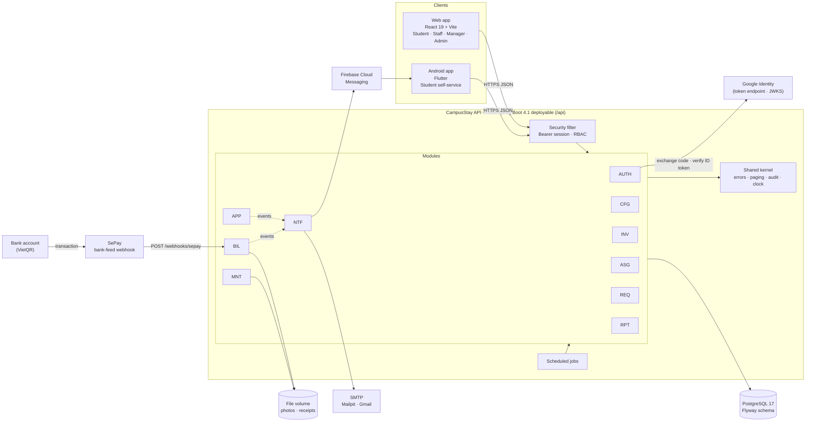
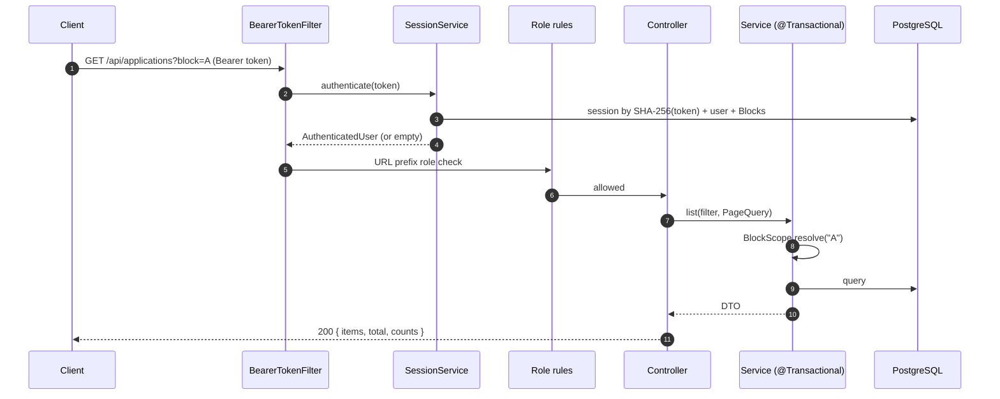
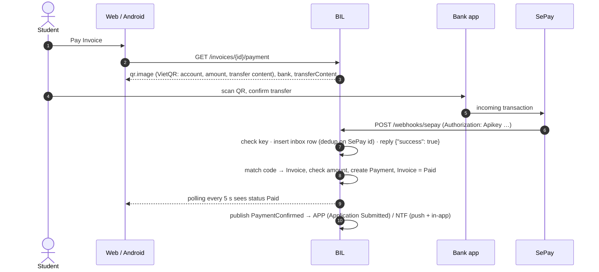
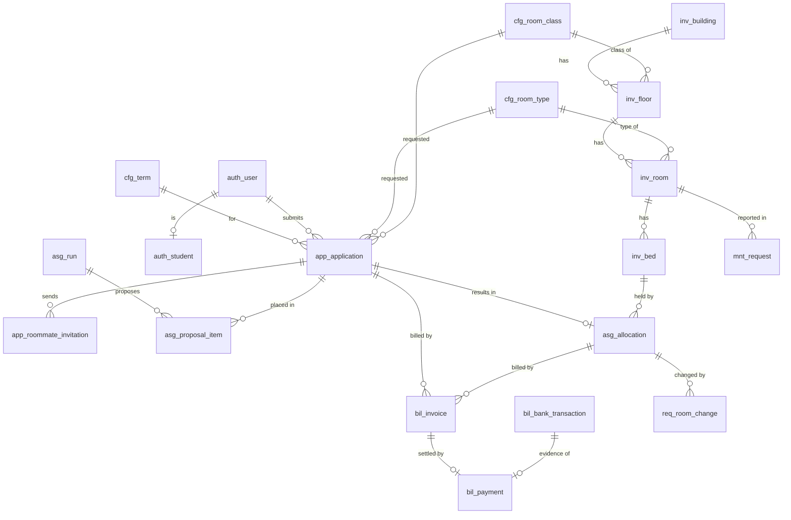

# CampusStay FPT — Backend Architecture

| Field | Value |
|---|---|
| Version | 1.1 (adds ADR-13…15: email sign-in, Google code or ID token, string IDs) |
| Date | 20/10/2026 (Week 7, Sprint 4) |
| Owner | Tisou (Leader, PM, BA, Full-stack) |
| Status | Approved by Tisou on 20/10/2026 |
| Feeds | Report 4 (SDD) §1 System Design and §2 Database Design; Report 3 §4 Non-Functional Requirements |
| Related | `docs/00_Project_Brief.md` (ADRs), `02_Endpoint_Map.md`, `03_API_Contract_Changes.md`, `docs/api-contract.md` |

---

## 1. Scope

This document describes how the CampusStay FPT backend is built: the architecture style, modules, security, integrations (VietQR via SePay, Google sign-in, Firebase Cloud Messaging, SMTP email), consistency guarantees, the assignment engine, the database and operations. It is written so that a council member can follow every design choice back to a reason, and so that Claude Code can implement the remaining slices without re-deciding anything.

## 2. Architecture overview



| Component | Responsibility |
|---|---|
| Web app | All four roles. Talks only to `/api`; in development through the Vite proxy (same origin). |
| Android app | Student tracking, push notifications, check-in pass. Uses the same API. |
| Security filter | Resolves the bearer token to a session, applies role rules by URL prefix. |
| Modules | Business logic, one package per module code (§4). |
| Shared kernel | Error model, list/paging DTOs, Audit Log, clock, token utilities. No business rules. |
| Scheduled jobs | Expiry of Deposit windows and invitations, overdue Invoices, SLA timers, email outbox, housekeeping (§11). |
| PostgreSQL | Single database, schema owned by Flyway; constraints enforce the critical invariants (§9). |
| SePay | Watches the receiving bank account and posts each incoming transfer to the webhook (§10). |
| Google Identity | Issues ID tokens for `@fpt.edu.vn` accounts (directly to Android, or in exchange for the web's authorization code); the API verifies them with Google's public keys. |
| FCM / SMTP | Push to Android; email through an outbox table. |

## 3. Key decisions

Full entries are in the Brief's Decision Log. Summary with the argument for the council:

| ADR | Decision | Argument |
|---|---|---|
| ADR-01 | Modular monolith | One developer, 16 weeks, three clients on one API, and Allocation + Payment need ACID transactions. Microservices would add distributed transactions, service discovery and several deployments for no functional gain. Module boundaries keep a later split possible. |
| ADR-04 | Spring Boot 4.1.x, Java 21, Maven | Spring Boot 3.5 left open-source support on 30/06/2026; 4.1 is GA (4.1.0 on 10/06/2026, 4.1.1 on 20/08/2026). No backend code existed, so starting on 4.1 has no migration cost. |
| ADR-06 | Room Type + Room Class choice only; no Room/Bed self-selection | Matches the UI; lets the engine guarantee gender/Block rules and fairness; removes the "two students click the same Bed" race entirely. |
| ADR-07 | Opaque server-side sessions; password + Google (`hd = fpt.edu.vn`) | The contract has one bearer token and "401 signs out". Opaque tokens can be revoked instantly (sign-out, password change, disabled account) and need no key management. JWT would need refresh tokens (a contract change) and a deny-list for revocation. |
| ADR-08 | VietQR through SePay webhook + mock + manual confirmation | Automatic confirmation without a merchant contract; money goes straight to the bank account; manual Staff confirmation keeps the demo working if the feed is down. |
| ADR-09 | Email via SMTP behind a port (Mailpit dev, Gmail demo) | Free. A personal Gmail account allows 500 messages per rolling 24 hours, enough for a demo; the provider can be swapped without touching modules. |
| ADR-10 | Spring Modulith verifies module boundaries | Turns "strict boundaries" into a failing test, and generates the package diagrams for Report 4. |
| ADR-11 | PostgreSQL 17 + Flyway SQL; JPA for writes, SQL for reads/reports | Constraints and partial indexes carry the critical invariants; migrations are the "Database Script(s)" deliverable. |
| ADR-13 | Password sign-in by email with CampusStay's own password | CampusStay cannot check FPT Wi-Fi credentials (no SIS access, ADR-02), so asking for that username would invite users to type their FPT password into another system. Reset and invitation links go to the email anyway. |
| ADR-14 | Google sign-in by authorization code (web) or ID token (Android) | The web keeps the custom Google button of the approved design (code flow); Android's Google Sign-In returns an ID token. The code exchange needs a client secret, which stays on the server; both paths end in the same ID-token checks. |
| ADR-15 | IDs are JSON strings | URL parameters, `<select>` values and browser storage are strings, so clients compare IDs without conversion. Java and the database keep `long`/`BIGINT`; the change is only in the contract DTOs. |

## 4. Modules

Table prefix = owning module. Only the owning module reads or writes its tables (§5).

| Module | Responsibility | Owns tables | Public API (top-level package) |
|---|---|---|---|
| AUTH | Sign-in (password, Google), sessions, users and roles, Block scope, student directory (mock SIS), staff profiles, invitations, password reset | `auth_*` | `CurrentUser`, `AuthenticatedUser`, `Role`, `BlockScope`, `BlockDirectory` (port), events `PasswordResetRequested` |
| CFG | Terms, Room Types, Room Classes, fee policy, refund rules, utility policy, eligibility, priority groups, matching snapshots, option lists, system parameters, Block settings | `cfg_*` | `TermCatalog`, `TermSummary` (more added per slice: `Catalog`, `FeePolicy`, `Parameters`) |
| INV | Buildings, Floors, Rooms, Beds, out-of-service, bulk room creation | `inv_*` | Implements `BlockDirectory`; `Inventory` queries (Bed availability, Room of a Bed) |
| APP | Application wizard, eligibility check, roommate invitations and code check, Application review, Round-2 offers | `app_*` | `Applications` (status transitions used by BIL/ASG), events `ApplicationCreated`, `ApplicationSubmitted`, `ApplicationRejected` |
| ASG | Assignment runs (dry-run, real, Round-2), proposals, conflicts, Manager approval, per-Block commit, Allocation, Check-in, Check-out, late check-ins | `asg_*` | `Allocations` queries, events `AllocationsCommitted`, `CheckedIn`, `CheckedOut` |
| BIL | Invoices, Payments, VietQR/SePay, manual confirmation, refunds, meter readings and Utility Invoices, overdue reminders, receipts | `bil_*` | `Billing` (issue Invoice, outstanding balance), events `PaymentConfirmed`, `InvoiceOverdue` |
| REQ | Room-Change Requests, swaps and swap board, routing rules, SLA timers, escalations | `req_*` | `Routing` (assignee for a request type), events `RoomChangeDecided`, `SwapApproved` |
| MNT | Maintenance Requests, photos, updates, inspection checklists, schedules and runs | `mnt_*` | events `MaintenanceUpdated` |
| NTF | In-app notifications, FCM devices and push, templates, email outbox, campaigns | `ntf_*` | Listens to events; `Notifications` for direct sends |
| RPT | Dashboards, reports, exports | none (reads `rpt_v_*` views owned by the other modules) | — |
| shared | Error model, `ListResponse`/`PageQuery`, `AuditLog`, `TimeConfig`, `Tokens`, `RequestInfo` | `shared_file`, `shared_audit_log` | Open module |

## 5. Package structure and dependency rules

```
vn.fpt.campusstay
├── CampusStayApplication
├── shared/            open module: error, web, audit, security, time
├── auth/              Role, CurrentUser, BlockScope ...   ← public API
│   ├── internal/      entities, repositories, services   ← hidden
│   ├── security/      SecurityConfig, BearerTokenFilter  ← hidden
│   └── web/           controllers                         ← hidden
├── cfg/ inv/ app/ asg/ bil/ req/ mnt/ ntf/ rpt/   same layout
```

Rules (checked by `ModularityTests` with Spring Modulith; the build fails on a violation):

1. A module may use another module's **top-level package only**. `internal`, `web` and `security` sub-packages are private.
2. No dependency cycles between modules. When AUTH needs INV data (Block codes), AUTH declares a port (`BlockDirectory`) and INV implements it.
3. No SQL against another module's tables. Cross-module foreign keys exist for referential integrity only. Reports read `rpt_v_*` views that each owning module defines in its own migration (its read contract).
4. Side effects in other modules go through **domain events** (`ApplicationEventPublisher`). NTF listeners that write the email outbox run in the publisher's transaction (`@EventListener`), so the business change and its email commit together.
5. Controllers are thin: validate input (Bean Validation), call one service method, map to the contract DTO. Transactions start at the service layer.

## 6. API conventions (implementation)

| Contract rule | Implementation |
|---|---|
| Base URL `/api` | `server.servlet.context-path=/api`. Controllers map paths without `/api`. |
| Errors `{ message, code?, details? }` | `ApiException` + `GlobalExceptionHandler`. `message` is written for end users. Unexpected errors return `INTERNAL_ERROR` with an `errorId` that is also in the log. DB constraint names map to friendly messages (`ConstraintMessages`). |
| Lists `{ items, total }` | `ListResponse<T>`, or an endpoint-specific record with `items`, `total` first. `PageQuery.of(page, pageSize)`: 1-based, default 20, max 100. |
| Scope `termId`, `block` | `BlockScope.resolve(block)` on every Staff/Manager endpoint: blank = all Blocks the user may see; a Block outside scope = `403 BLOCK_OUT_OF_SCOPE`. |
| IDs are strings (ADR-15) | Contract records expose every `id` / `…Id` component as `String` (`String.valueOf(entity.getId())`); services, entities and SQL keep `long`. Request records may keep IDs as `long`: Jackson 3.1 accepts both `"42"` and `42` there (checked 20/10/2026). Never register a global `Long` → string serializer: amounts and counts are `long` too. |
| Optional request fields | Jackson 3 rejects a missing or `null` value for a primitive (`FAIL_ON_NULL_FOR_PRIMITIVES` is on by default) with `400 BAD_REQUEST_BODY`. Optional fields use wrapper types (`Boolean remember`, missing = `false`); the feature stays on, so a missing required amount is never silently 0. |
| Dates ISO 8601 UTC | `Instant` for fields ending in `At`, `LocalDate` (`YYYY-MM-DD`) for calendar days (`stayStart`, `checkOutBy`, `deadline` …); JDBC time zone UTC; campus zone `Asia/Ho_Chi_Minh` only for "today" logic and email texts. |
| Money integer VND | `long` / `BIGINT` everywhere; never `double`. Rounding steps come from `cfg_parameter`. |
| Rates fractions | `NUMERIC(5,4)` / `BigDecimal`. |
| Statuses | DB stores `UPPER_SNAKE`; each module's status enum has a `@JsonValue` label equal to the contract text. |
| Exports | `GET /exports/{report}` streams CSV/XLSX with `Content-Disposition`; every export is written to the Audit Log. |

## 7. Request lifecycle



## 8. Security

### 8.1 Authentication
| Topic | Design |
|---|---|
| Accounts | No self sign-up. Students come from the seeded student directory (mock SIS, ADR-02); Staff/Managers are invited by the Admin (one-time `INVITE` link to the web page `/set-password?token=…`, 72 h). |
| Password sign-in | By **email** and CampusStay's own password (ADR-13); never the FPT Wi-Fi credentials. BCrypt (cost 10). Unknown email and wrong password return the same `401 INVALID_CREDENTIALS` and take similar time (dummy hash). |
| Lockout | 5 consecutive failures lock the account for 15 minutes. Counters are updated atomically in their own transaction. |
| Google sign-in | `POST /auth/google` takes either `code` or `credential` (ADR-14). **Web:** the Google Identity Services popup (`initCodeClient`, `ux_mode: popup`) returns an authorization code; the API exchanges it at Google's token endpoint (`grant_type=authorization_code`, `redirect_uri=postmessage`, client secret `GOOGLE_CLIENT_SECRET`) and takes the returned `id_token`. **Android:** Google Sign-In returns the ID token, sent as `credential`. Either way the API verifies signature (Google JWKS), `iss`, `aud` (our client id), `exp`, `email_verified` and `hd = fpt.edu.vn`, as Google recommends. The account must already exist (matched by Google `sub`, else by email, then linked). |
| Sessions | 256-bit random token, only its SHA-256 stored. Idle timeout 12 h (30 days with "remember me"), sliding, hard cap 30 days. Revoked on sign-out; all sessions revoked on password reset; other sessions revoked on password change. |
| Password rules | 8–64 characters, a letter and a digit, not containing the email name, ≤ 72 bytes (BCrypt limit). |
| Reset links | Web page `/reset-password?token=…`; 30 minutes, single use (row lock), max 3 per hour per account, older links invalidated. The endpoint always answers `204`. |

### 8.2 Authorization
Three layers, each one checked on the server:

| Layer | Rule | Where |
|---|---|---|
| Role by URL | `/students/**` → Student; `/admin/**` → Admin; webhooks and sign-in endpoints public; everything else signed in | `SecurityConfig` |
| Role by action | e.g. approve assignment = Manager; review Application = Staff/Manager | `@PreAuthorize` / `CurrentUser.require` in services |
| Data scope | Staff/Manager see only their Blocks (`BlockScope`); students see only their own records (every student query filters by `currentUser.id()`); never trust ids from the client alone | Services and SQL |

The Admin › Permissions matrix (`GET /admin/permissions`) is generated from the same rule table in code so it cannot drift from what is enforced.

### 8.3 Protections
| Threat (OWASP 2021) | Control |
|---|---|
| A01 Broken access control | Three layers above; integration tests for "student reads another student's Invoice → 404" and "Staff outside Block → 403". |
| A02 Cryptographic failures | HTTPS at the proxy/tunnel; BCrypt; token hashes; webhook keys compared in constant time; secrets only in environment variables. |
| A03 Injection | Parameterized JPA/JdbcClient queries only; no string-built SQL; HTML-escaped email templates. |
| A04 Insecure design | DB constraints for double booking and duplicates; privacy-safe roommate check; idempotent webhook. |
| A05 Misconfiguration | No stack traces or messages from Spring's error page; only `health` and `info` actuator endpoints exposed; CORS closed unless configured. |
| A07 Identification failures | Lockout, generic errors, session revocation, Google `hd` check. |
| A08 Integrity | SePay webhook authenticated (API key), deduplicated by SePay transaction id, amounts re-checked against the Invoice. |
| A09 Logging | Audit Log for business actions, sign-ins, failures and exports; `errorId` in error responses. |
| Uploads | Size and count limits; content type checked by magic bytes, not the file name; files stored under random keys outside the web root and served only through authorized endpoints. |
| CSRF | Not applicable: no cookies, bearer token in a header. |

### 8.4 Personal data (Vietnam)
The legal basis is the **Personal Data Protection Law 91/2025/QH15** (effective 01/01/2026, replacing Decree 13/2023/NĐ-CP) and **Decree 356/2025/NĐ-CP** (OI-12). Design measures:

| Principle | Measure |
|---|---|
| Consent, separate per purpose | Application stores `consent_matching` and `consent_rules` with `consented_at`; the DB rejects an Application without both. Roommate preferences are an optional, separately chosen service. |
| Data minimization | Roommate check returns only `{ valid, checksLeft }`, the same answer for every unusable code, limited attempts; the inviter never sees partner data before acceptance. Contact details are copied into the Application only for that Term. |
| Access limited to purpose | Block scope for staff; students only see their own data; roommates see names and Beds only. |
| Accountability | Audit Log of who saw/changed/exported what; exports are logged. |
| Retention | Audit Log retention parameter (24 months default); expired sessions purged nightly. |
| No personal data in URLs | URL paths carry ids, never student codes (contract change B-01, `/check-out/{allocationId}`). Search values (`q`, check-in lookup) can hold names or student codes, so the API never logs query strings and the reverse proxy / tunnel access log is configured without them (C-14). |

## 9. Consistency and concurrency

| Invariant | Guarantee |
|---|---|
| One active Allocation per Bed per Term | Partial unique index `ux_alloc_bed_term`; commit/room-change/swap lock affected Beds with `SELECT … FOR UPDATE` in one transaction. |
| One active Allocation per student per Term | Partial unique index `ux_alloc_student_term`. |
| One live Application per student per Term | Partial unique index `ux_app_one_live_per_term`. |
| Published Terms never overlap | Exclusion constraint `ex_term_no_overlap` on the stay date range. |
| A Bed held by at most one Round-2 option | Partial unique index `ux_round2_bed_held`. |
| One live assignment run per Term | Partial unique index `ux_asg_one_live_run`. |
| An Invoice is paid once | Partial unique index `ux_payment_one_confirmed`; webhook dedup `ux_bank_txn`. |
| Concurrent edits | `version` column + JPA `@Version` on mutable aggregates → `409 STALE_DATA`. |
| Email not lost or duplicated | Outbox row written in the business transaction; dispatcher uses `FOR UPDATE SKIP LOCKED`. |

Services check rules first and return a clear `ApiException`; the constraint is the safety net for the race between two requests.

## 10. Payment: VietQR through SePay



| Topic | Design |
|---|---|
| QR | The VietQR image URL is built from the receiving account, bank, exact amount and the Invoice's `transfer_content` (unique, e.g. `CSTAY12345`), using SePay's VietQR image service. The QR carries no secret. |
| Matching | SePay extracts the payment code from the memo using the prefix configured in the SePay account; we match `code` (fallback: search `content`) to `bil_invoice.transfer_content`. |
| Webhook auth | SePay API-key mode: header `Authorization: Apikey <key>`; compared in constant time with `SEPAY_WEBHOOK_API_KEY`. HTTPS only. |
| Response | SePay counts a delivery as successful only for `200/201` with body `{"success": true}` within 30 s; we store the raw payload first and reply immediately, then process. |
| Idempotency | SePay's `id` stays the same across retries and replays → unique `(provider, provider_txn_id)`. |
| Exact amount | Paid only if amount = Invoice amount. Less, more, or an Invoice already paid → inbox status `AMOUNT_MISMATCH` / `ALREADY_PAID`, Invoice `Awaiting confirmation`, shown to Staff on Payments. Refund of overpayments is handled manually. |
| Late transfer | A transfer after the QR expired is still accepted; the QR expiry only refreshes the image. An Application whose Deposit window expired but whose money arrived goes to Staff. |
| Unmatched transfer | Inbox `UNMATCHED`; Staff can link it to an Invoice by manual confirmation. |
| Fallbacks | `MockPaymentGateway` (dev: a "simulate payment" admin call), manual confirmation with receipt upload (`POST /payments/{invoiceId}/confirm`). |
| Demo setup | SePay account linked to Tisou's bank account (OI-13); webhook URL must be public HTTPS (Cloudflare Tunnel in the demo, OI-07). |

## 11. Notifications and scheduled jobs

Events → NTF: in-app row (`ntf_notification`), FCM push to the user's Android devices (invalid tokens are disabled), email through `ntf_email_outbox`. Templates (EN/VI titles) are Admin data.

| Job | Schedule | Module |
|---|---|---|
| Expire Applications whose Deposit window passed | every 5 min | APP |
| Expire roommate invitations, Round-2 offers, swap invitations | every 5 min | APP, REQ |
| Mark Invoices overdue and send reminders | hourly | BIL |
| SLA check → escalations | every 15 min | REQ |
| Process pending bank transactions (retry matching) | every 1 min | BIL |
| Email outbox dispatch | every 30 s | NTF |
| Purge sessions ended > 30 days | 03:15 daily | AUTH |
| Start inspection runs from schedules | 06:00 daily | MNT |

All jobs are idempotent (status conditions in the `WHERE` clause), so running twice is harmless.

## 12. Assignment engine (ASG)

A deterministic, rule-based batch job, run per Term by Staff (`POST /assignment-runs`, `dryRun` for preview). The run records the matching snapshot it used, so results can be explained later.

| Stage | Name | What happens |
|---|---|---|
| 0 | Queued | Run row created; the unique index blocks a second live run. |
| 1 | Eligibility | Input = Applications `Approved` for the Term; re-check enrollment and outstanding Invoices. |
| 2 | Ordering | Sort by the snapshot's ordered criteria (priority group, then Deposit time). |
| 3 | Placement | Per Block of the student's gender: invited pairs first into an empty 2-bed Room of the requested Room Class; then each student into the free Bed with the highest fit among Rooms of the requested Room Type + Room Class. Beds out of service or held by Round-2 are skipped. |
| 4 | Conflicts | No Bed of the requested type/class → `NO_BED` (options: waitlist, other Room Class, other Room Type); partner not ready → `PARTNER_NOT_READY`; low fit → `LOW_FIT` (info). Nothing is resolved silently. |
| 5 | Proposal | Counts, average fit; per-Block review by Staff → submit → Manager approves or returns → commit creates Allocations, Balance Invoices and notifications in one transaction per Block. |

Fit of a student in a Room = weighted share of matching attributes (major, cohort, region; Admin weights) with the other occupants, averaged; multiplied by the boost (Admin, e.g. 1.2) when the student opted into Roommate preferences (region, semester, major) and they match; capped at 1. Ties break on the lowest Room code → identical input gives an identical proposal.

## 13. Database design

Conventions: module prefix; `BIGINT` identity keys; money `BIGINT` VND; `TIMESTAMPTZ` in UTC; statuses as `UPPER_SNAKE` text with `CHECK`; `version` for optimistic locking; JSONB only for snapshots and display payloads (contact snapshot, Invoice lines, matching snapshot), never for data that is filtered or joined.

Migrations (`backend/src/main/resources/db/migration`): `V1` shared + AUTH, `V2` CFG, `V3` INV (+ Block-scoped AUTH/CFG tables), `V4` APP, `V5` ASG, `V6` BIL, `V7` REQ, `V8` MNT, `V9` NTF, `V10` reference data. Dev/demo data: `db/seed/R__dev_seed.sql` (profiles `dev` and `test` only; 2 Blocks, 100 Rooms, 360 Beds, 2 Terms, 48 students, 7 back-office users).

### 13.1 Core entities



### 13.2 Table catalog

| Module | Tables |
|---|---|
| shared | `shared_file` (uploaded files metadata), `shared_audit_log` |
| AUTH | `auth_user`, `auth_student` (directory + contact), `auth_staff_profile` (handles, on duty), `auth_session`, `auth_action_token` (invite/reset), `auth_user_block` (Block scope), `auth_staff_account_request` |
| CFG | `cfg_term`, `cfg_room_type`, `cfg_room_class`, `cfg_fee_policy` (singleton), `cfg_refund_rule`, `cfg_utility_policy` (singleton), `cfg_eligibility_criterion`, `cfg_priority_group`, `cfg_matching_snapshot`, `cfg_lookup` (option lists), `cfg_parameter`, `cfg_block_settings` |
| INV | `inv_building`, `inv_floor` (Room Class per Floor), `inv_floor_layout`, `inv_room`, `inv_bed` |
| APP | `app_application`, `app_application_event`, `app_roommate_invitation`, `app_roommate_check`, `app_round2_offer`, `app_round2_option` |
| ASG | `asg_run`, `asg_run_block`, `asg_proposal_item`, `asg_allocation` (incl. Check-in fields), `asg_check_out`, `asg_late_check_in` |
| BIL | `bil_invoice`, `bil_payment`, `bil_bank_transaction` (webhook inbox), `bil_refund`, `bil_meter_period`, `bil_meter_reading`, `bil_meter_cut` |
| REQ | `req_room_change`, `req_swap_post`, `req_swap`, `req_routing_rule`, `req_sla_policy`, `req_escalation`, `req_escalation_event` |
| MNT | `mnt_request`, `mnt_request_photo`, `mnt_request_event`, `mnt_checklist`, `mnt_checklist_item`, `mnt_inspection_schedule`, `mnt_inspection_run`, `mnt_inspection_room`, `mnt_inspection_result` |
| NTF | `ntf_notification`, `ntf_device`, `ntf_template`, `ntf_email_template`, `ntf_email_campaign`, `ntf_email_outbox` |

Verified on PostgreSQL (20/10/2026): all migrations and the seed apply cleanly, the seed is idempotent, and negative tests confirm the overlap exclusion, one-live-Application, Bed double-booking, consent and Room/Floor/Building constraints.

## 14. Configuration and environments

| Profile | Use | Database | Mail | Seed |
|---|---|---|---|---|
| `dev` (default) | IntelliJ / Docker Compose | local Postgres 17 | Mailpit (`localhost:1025`, inbox `http://localhost:8025`) | yes |
| `test` | `mvn verify` | Testcontainers Postgres 17 | log sender | yes |
| `prod` | demo server | env `DB_URL` … | Gmail SMTP (App Password, 500/day) | no (one-off flag) |

Secrets only in environment variables: `DB_PASSWORD`, `GOOGLE_CLIENT_ID`, `GOOGLE_CLIENT_SECRET`, `SPRING_MAIL_PASSWORD`, `SEPAY_WEBHOOK_API_KEY`, `FIREBASE_CREDENTIALS_FILE`. Business values live in the database (Admin screens), never in YAML.

Deployment: Docker image (multi-stage, non-root), `infra/docker-compose.yml`; public HTTPS for the webhook via Cloudflare Tunnel until a free VM is chosen (OI-07). Health: `/api/actuator/health` (liveness/readiness probes).

## 15. Testing strategy (feeds Report 5)

| Level | Tool | Scope | Naming |
|---|---|---|---|
| Unit | JUnit 5, AssertJ | Pure rules: pricing, proration, fit score, password policy, template rendering | `TC-<MODULE>-NNN` in the Unit Test workbook |
| Integration | Spring Boot test + Testcontainers PostgreSQL + MockMvc | Every endpoint: happy path, validation, permission/scope, concurrency where relevant | `*IT.java`, `TC-<MODULE>-NNN` |
| Architecture | Spring Modulith `verify()` | Module boundaries, no cycles; diagrams for Report 4 | `ModularityTests` |
| Concurrency | Integration tests with two threads | Commit vs Room-Change on the same Bed; double webhook delivery | `*ConcurrencyIT.java` |
| System / UAT | Web app against the dev stack | End-to-end flows per role | Test Report workbook |

## 16. Risks and technical debt

| ID | Item | Impact | Response |
|---|---|---|---|
| R-11 | Backend code was written in a sandbox without access to Maven Central, so it was not compiled there | First build may need small fixes (mainly Spring Boot 4 package names) | **Closed 20/10/2026:** the skeleton compiles; `mvn verify` passes after one fix (Jackson 3 rejects a missing primitive, see §6) |
| R-12 | Spring Boot 4 ecosystem still settling (e.g. springdoc 3.x targets Boot 4.0) | OpenAPI UI may lag | Add springdoc only after checking compatibility; the endpoint map is the API reference meanwhile |
| R-13 | Scope: 159 endpoints for about 9 remaining weeks | Should/Could items at risk | Build by slice (Must first). An endpoint not built yet answers `404 NOT_FOUND` and the web shows its error state with Retry (C-12); `GET /notifications`, which every layout calls, is built early (S1) |
| R-14 | SePay depends on a real bank account and public HTTPS | Payment demo fails | Mock gateway + manual confirmation; test the tunnel before each review |
| R-15 | Domain events are in-memory (no event publication registry yet) | An async listener could miss an event on a crash | Emails already go through the outbox in the same transaction; add Spring Modulith's JDBC event registry when async listeners appear |
| R-16 | Cross-module foreign keys | Harder future split into services | Accepted for integrity; documented in §5 |
| R-17 | Gmail SMTP limit 500/day, App Password revoked on password change | Campaign emails fail | Campaigns are Could; switch provider behind `EmailSender` if needed |
