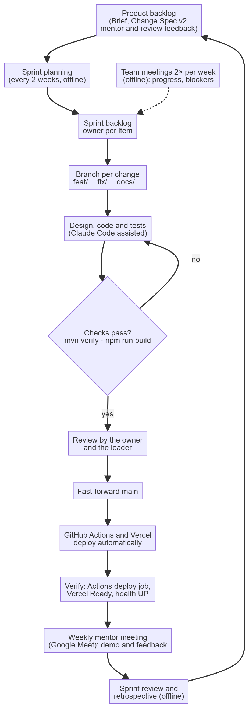

# II. Project Management Plan

## 1. Overview

### 1.1 Scope & Estimation

The scope is the registration form version 2.0 (Record of Changes BM03) and the functional requirements of Report 3. Complexity: *Simple* = one screen or endpoint with plain validation (2 man-days); *Medium* = several screens or rules, one state machine (4 man-days); *Complex* = cross-feature rules, jobs, money or the assignment engine (7–10 man-days). Effort includes design, code, automated tests and review.

| # | WBS Item | Complexity | Est. Effort (man-days) |
|---|---|---|---|
| 1 | **Project management, requirements and documents** | | **40** |
| 1.1 | Planning, tracking, meetings, reviews | Medium | 12 |
| 1.2 | Requirements (Brief, Change Specification v2), Reports 1–5, Review 2 forms | Complex | 18 |
| 1.3 | Reports 6–7, defense slides | Medium | 10 |
| 2 | **Accounts and access (AUTH)** | | **27** |
| 2.1 | Sign-in with password and Google, sessions, lockout, password reset | Complex | 7 |
| 2.2 | Student verification, student list import (CSV, XLSX) | Complex | 7 |
| 2.3 | Users, roles, permission matrix, Staff accounts, Audit Log | Medium | 6 |
| 2.4 | Enrollment reconciliation | Complex | 7 |
| 3 | **Registration periods and configuration (CFG)** | | **25** |
| 3.1 | Room Types, Room Classes, fees, Utility, parameters | Medium | 4 |
| 3.2 | Rules: eligibility, priority, matching, deadlines, refunds, stay | Complex | 7 |
| 3.3 | Registration-period requests | Medium | 4 |
| 3.4 | Term wizard and publication, change announcements | Complex | 10 |
| 4 | **Inventory (INV)** | | **19** |
| 4.1 | Blocks, Floors, Rooms, Beds, out of service, bulk generation | Medium | 4 |
| 4.2 | Room Class per Room per Term | Medium | 4 |
| 4.3 | Furniture types, items, moves, QR labels | Medium | 4 |
| 4.4 | Door codes (encrypted, rotation, release) | Complex | 7 |
| 5 | **Applications (APP)** | | **19** |
| 5.1 | Eligibility and the Application wizard with the Deposit Invoice | Complex | 7 |
| 5.2 | Roommate invitations | Medium | 4 |
| 5.3 | Review, cancellation, expiry | Medium | 4 |
| 5.4 | Round 2 | Medium | 4 |
| 6 | **Assignment and residence (ASG)** | | **36** |
| 6.1 | Assignment engine, runs, conflicts, approval | Complex | 10 |
| 6.2 | Balance, forfeit, residence, door-code release | Complex | 7 |
| 6.3 | Check-in and check-out desk, settlement, damage per item | Complex | 7 |
| 6.4 | Late check-in, terminations | Medium | 4 |
| 6.5 | Operational moves, turnover | Complex | 8 |
| 7 | **Payments and billing (BIL)** | | **25** |
| 7.1 | Invoices, VietQR payment page, payment claims and confirmation | Complex | 8 |
| 7.2 | Meter readings, Utility Invoices split by days | Complex | 7 |
| 7.3 | Overdue, reminders, Utility debt warnings, refunds | Complex | 10 |
| 8 | **Term transition and requests (ASG, REQ)** | | **30** |
| 8.1 | Requests window M2–M7, next-Term Allocations, Stays | Complex | 10 |
| 8.2 | Room change, swap and swap board, Room Class change, extension | Complex | 10 |
| 8.3 | Next-Term fees; routing rules, time limits, escalations | Complex | 10 |
| 9 | **Maintenance and inspections (MNT)** | | **11** |
| 9.1 | Maintenance Requests with photos and furniture items | Medium | 4 |
| 9.2 | Inspection checklists, schedules and runs | Complex | 7 |
| 10 | **Notifications (NTF)** | | **15** |
| 10.1 | In-app notifications, templates in two languages, email outbox | Medium | 4 |
| 10.2 | FCM push, device tokens | Medium | 4 |
| 10.3 | Announcements and the dormitory board, email campaigns | Complex | 7 |
| 11 | **Reports (RPT)** | | **12** |
| 11.1 | Dashboards per role, Term dashboard | Complex | 7 |
| 11.2 | Reports, CSV exports, search | Medium | 5 |
| 12 | **Clients** | | **42** |
| 12.1 | Web design system, layouts, menus, two languages | Complex | 10 |
| 12.2 | Web screens of the four roles (88 screens) | Complex | 20 |
| 12.3 | Android app for students | Complex | 12 |
| 13 | **Infrastructure and quality** | | **35** |
| 13.1 | Architecture, database design and migrations | Complex | 8 |
| 13.2 | CI/CD, Docker, Vercel and Azure environments, runbook, demo data tool | Complex | 10 |
| 13.3 | System tests, NFR measurements, end-to-end automation | Complex | 17 |
| | **Total Estimated Effort (man-days)** | | **336** |

### 1.2 Project Objectives

**Overall objective.** Deliver CampusStay FPT, a dormitory system for FPT University's Tân Uyên campus that covers registration, assignment, payments, residence, Term transitions, maintenance, Utility billing and reports for four roles, on the web and Android, deployed and demonstrable, with the documents of the capstone, by the final defense; and pass Defense 1.1 with every committed workflow, test and NFR target of the Review 2 Commitment.

**Quality.**

| # | Testing Stage | Test Coverage | No. of Defects | % of Defect | Notes |
|---|---|---|---|---|---|
| 1 | Reviewing | 100 % of changes reviewed before `main`; self-review prompt on each review version | ≤ 15 | 30 % | Design, document and code review; BM02 findings |
| 2 | Unit Test | Pure logic classes (engine, split, exchanges, exports) | ≤ 5 | 10 % | `mvn test` on every change |
| 3 | Integration Test | 100 % of endpoints; every FR with ≥ 1 test; ≥ 90 % pass (target 100 %) | ≤ 20 | 40 % | `mvn verify` in CI; failing build blocks deploy |
| 4 | System Test | 100 % of main workflows; 100 % main and ≥ 80 % exception demo scenarios | ≤ 8 | 15 % | Staging with demo data |
| 5 | Acceptance Test | Demo scenarios with the mentor and the council | ≤ 2 | 5 % | No open Critical or High defect |

**Milestone timeliness:** ≥ 90 % of milestones of section 3 delivered on their date; review documents delivered at least one day before the review.

**Allocated effort (man-days, % of 336):** project management 26 (8 %), requirements 34 (10 %), design 47 (14 %), coding 162 (48 %), testing 50 (15 %), deployment and documentation of operations 17 (5 %).

### 1.3 Project Risks

| # | Risk Description | Impact | Possibility | Response Plans |
|---|---|---|---|---|
| 1 | The dormitory is not operating yet: the real rules may differ from the requirements | High | Medium | Requirements from FPT's operating dormitories, Circular 27/2011 and VNU-HCM practice; every business value configurable; assumptions listed in Report 3; weekly mentor review |
| 2 | Most of Iteration 1 was written by the leader: other members may not master their parts (bus factor) | High | High | Ownership map (section 4); each member owns 2–3 parts and one workflow, takes the training plan (2.3), explains and changes their part before Defense 1.1 |
| 3 | Manual confirmation of payment claims at the registration peak | Medium | Medium | Claims stop the deadline; bulk confirmation with count and total; hourly summary |
| 4 | One small Azure VM and a Burstable database under load | Medium | Medium | NFR-01 load test, health check and rollback; larger VM documented |
| 5 | Azure for Students credit or free services end before the final defense | High | Low | Budget alert at $5/month; runbook to move to another VPS with Docker Compose in a few hours |
| 6 | Third-party services change or fail (Google sign-in, FCM, Gmail) | Medium | Low | Each behind a port with a configuration switch; the system works without push or email; tests with stubs |
| 7 | Schedule: defense dates not announced, end-to-end tests and NFR measurements still to do | Medium | Medium | Sprints S5–S6 reserved for them (section 3); tracked in Project Tracking |
| 8 | Personal data protection (Law 91/2025/QH15) | High | Low | Fictional data only in seeds, tests and the demo; access by role; no personal data in URLs or logs; demo emails redirected |

## 2. Management Approach

The team works in two-week sprints (Scrum-like, 8 sprints from 07/09/2026), with the backlog in the Project Tracking workbook and GitHub. The leader acts as product owner and Scrum master; the mentor reviews the increment every week.

### 2.1 Project Process

1. **Backlog.** Items come from the registration form, the Brief and the Change Specification v2, the mentor's weekly feedback and the reviews (Review 1 added the Manager role and the requirement basis). Each item has an owner (section 4).
2. **Sprint planning** at the start of each sprint (offline): items, owners, acceptance criteria and test cases.
3. **Development** on a branch per change (`feat/…`, `fix/…`, `docs/…`); until Review 2 each phase of the Change Specification v2 had its own branch `feat/v2-phase<n>`. Code, tests and documentation change together.
4. **Checks**: `mvn -o verify` for any backend change, `npm run build` for any web change, Gradle build for Android. A failing check stops the change.
5. **Review and merge**: the owner and the leader review; `main` is fast-forwarded; GitHub Actions deploys the API and Vercel the web automatically; the result is verified (deploy job, Vercel Ready, health UP).
6. **Mentor meeting** every week on Google Meet: demo of the increment, questions (Q&A sheet), feedback into the backlog.
7. **Team meetings** twice a week (offline): progress, blockers, pairing on parts a member is learning. Sprint review and retrospective at the end of each sprint.

### 2.2 Quality Management

- **Defect prevention.** Decisions recorded as ADRs and in the Change Specification before coding; business rules as configuration; database constraints for the critical rules; layered architecture checked by `LayeringTest`; one status palette and one message catalogue in two languages.
- **Reviewing.** Every change is reviewed before `main`; documents are generated from the code where possible (screen map, endpoint map, test catalog, ERDs) so they cannot drift; before each review the standard self-review prompt is run on the tagged version and every finding gets a response (BM02).
- **Unit testing.** Pure logic (assignment engine, Utility split, Google code exchange, FCM sender, exports, message translation) tested without a database.
- **Integration testing.** Every endpoint through HTTP with a real PostgreSQL (Testcontainers); permissions and scope for each role; jobs driven by a test clock; the whole suite in CI on every push.
- **System testing.** The five main workflows end to end on staging with the demo stages; NFR measurements; scenario-based demo rehearsal before each defense.

### 2.3 Training Plan

| Training Area | Participants | When, Duration | Waiver Criteria |
|---|---|---|---|
| Domain: dormitory operations, the Change Specification v2, the five workflows | All (mandatory) | 29/10 – 05/11/2026, 2 sessions of 2 h, led by the leader | None |
| Java 21, Spring Boot 4, JdbcClient, Flyway, the layered packages | Nguyễn Xuân Lộc, Võ Minh Luân (mandatory) | 02/11 – 15/11/2026, 4 sessions of 2 h + one change in their part | Has merged a reviewed backend change with tests |
| React 19, Tailwind 4, the web design system and i18n | Trần Võ Quang Duy (mandatory), others optional | 02/11 – 15/11/2026, 3 sessions of 2 h | Has merged a reviewed web change |
| Kotlin, Jetpack Compose, FCM | Võ Minh Luân (mandatory) | 02/11 – 15/11/2026, 3 sessions of 2 h | Has built and run the Android app with push |
| Testing: JUnit 5, Testcontainers, writing a test case from an acceptance criterion | All (mandatory) | 09/11 – 20/11/2026, 2 sessions of 2 h | Owns ≥ 3 passing automated tests |
| Git and GitHub flow, commit format, CI/CD and deployment checks | All (mandatory) | 29/10/2026, 1 session of 2 h | Has pushed a branch that passed CI |
| AI tools (Claude Code): rules of use, review of AI output, no personal data or secrets | All (mandatory) | 29/10/2026, 1 h | None |

## 3. Project Deliverables

| # | Deliverable | Due Date | Notes |
|---|---|---|---|
| 1 | Registration form version 1.0 | 28/08/2026 | Approved topic FA26SE260 |
| 2 | Review 1 (presentation, no reports) | 30/09/2026 | Feedback: requirement basis, Manager role |
| 3 | Iteration 1: API, web app, production deployment, Change Specification v2 phases 1–8 | 27/10/2026 | Tag `review-2` |
| 4 | Review 2 documents: Registration form 2.0 + BM03, Reports 1–5, Project Tracking, BM01 Design Brief, BM02 Self-Review | 30/10/2026 | PDF, `SWP490_FA26SE260_R2_<name>.pdf` |
| 5 | Review 2 | 31/10/2026 | |
| 6 | BM04 Review 2 Commitment | 05/11/2026 | Within 3 working days after the review |
| 7 | Iteration 2: end-to-end workflow tests, NFR measurements, concurrency test, Android tests, fixes from Review 2 | 29/11/2026 | Sprints S5–S6 |
| 8 | Report 6 (User Guides), updated Reports 1–5, Full Software Package | 13/12/2026 | Before Defense 1.1 (date to be announced) |
| 9 | Defense 1.1 | TBD | Thresholds of the Review 2 Commitment |
| 10 | Report 7 (Final Report), slides, final package; final defense (Viva) | TBD (duration ends 03/2027) | |

## 4. Responsibility Assignments

D = Do; R = Review; S = Support; I = Informed; blank = omitted.

| Responsibility | Lê Thành Minh Trung (SE183752) | Nguyễn Xuân Lộc (SE183782) | Trần Võ Quang Duy (SE182146) | Võ Minh Luân (SE182794) |
|---|---|---|---|---|
| Project planning and tracking | D | S | S | S |
| Report 1 Project Introduction | D | R | S | S |
| Report 2 Project Management Plan | D | R | R | R |
| Report 3 SRS (overview, use cases, business rules) | D | S | S | R |
| Report 3 SRS (screens, authorization, messages) | R | S | D | S |
| Report 4 SDD (architecture, database, DevOps) | D | S | I | I |
| Report 4 SDD (state machines, activity diagrams, detailed design) | D | S | S | S |
| Report 5 Test Documentation, Test Report | R | S | S | D |
| Architecture, database, CI/CD and deployment | D | S | I | S |
| Applications, payments, assignment, residence (APP, BIL, ASG) | D | S | S | I |
| Term transition, next-Term requests, reconciliation | R | D | I | S |
| Registration periods, Term wizard, inventory screens, web UI and i18n | R | S | D | I |
| Android app, push, maintenance and escalations | R | S | I | D |
| System tests, demo scenarios, NFR measurements | R | S | S | D |
| Review 2 forms (BM01–BM04), self-review | D | R | R | R |

## 5. Project Communications

| Communication Item | Who / Target | Purpose | When, Frequency | Type, Tool, Method |
|---|---|---|---|---|
| Team meeting | All members | Progress, blockers, pairing, decisions | Twice a week, 1–2 h | Offline at campus |
| Mentor meeting | Team, mentor Thân Thị Ngọc Vân | Demo of the increment, questions, feedback | Weekly, 1 h | Online, Google Meet; minutes in Q&A and Issues sheets |
| Sprint planning, review and retrospective | All members | Plan the sprint, review the increment, improve the process | Every 2 weeks | Offline; backlog in Project Tracking |
| Daily status | All members | Short updates, questions | Daily, asynchronous | Team chat group |
| Change review | Owner, leader | Review of code and documents before `main` | Each change | GitHub branches and commits; CI results |
| Reviews and defenses | Team, reviewers, council | Approval of scope, design and results | Review 2: 31/10/2026; others announced | Offline; documents in PDF |

## 6. Configuration Management

### 6.1 Document Management

- All project documents live in the repository under `docs/`: the Brief, the Change Specification v2, the API contract, the backend and web design notes, the report sources (`docs/reports/src/*.md`) and diagrams as Mermaid source (`docs/diagrams/*.mmd`).
- Report PDFs are generated from these sources into the school's Word templates (`node docs/reports/src/build.mjs`), so every version is reproducible; tables that must match the code (screens, messages, test cases, ERDs) are generated from the code.
- Each document has a Record of Changes; review versions are frozen by the Git tag of the review (`review-2`); file names follow `SWP490_FA26SE260_R2_<name>.pdf`.

### 6.2 Source Code Management

- One GitHub monorepo `tisou47/CampusStay-FPT` (`backend/`, `web/`, `android/`, `docs/`, `infra/`, `.github/workflows/`).
- `main` is production; work is done on branches (`feat/…`, `fix/…`, `docs/…`); `main` is fast-forwarded only after the checks pass; commits follow `type(feature): …` (`feat(web): …`, `fix(bil): …`).
- Database changes only through new Flyway migrations; secrets never in Git (`.env.example` lists the settings); tags mark review versions.

### 6.3 Tools & Infrastructures

| Category | Tools / Infrastructure |
|---|---|
| Technology | Java 21, Spring Boot 4.1, PostgreSQL 17, React 19, Vite 8, Tailwind CSS 4, Kotlin 2.1, Jetpack Compose |
| IDEs and editors | IntelliJ IDEA, VS Code, Android Studio |
| AI tools | Claude Code (Anthropic) — specification, design, code, tests, review (Report 4 section 1.3.5) |
| Design | Figma (file *CampusStay-FPT*), Mermaid diagrams |
| Source control and CI/CD | Git, GitHub, GitHub Actions, GitHub Container Registry |
| Hosting | Vercel (web), Microsoft Azure for Students (VM with Docker Compose and Caddy, Azure Database for PostgreSQL) |
| Testing | JUnit 5, AssertJ, Testcontainers, Postman |
| Project management and documents | Project Tracking workbook, Microsoft Word and Excel (school templates), Google Meet |
