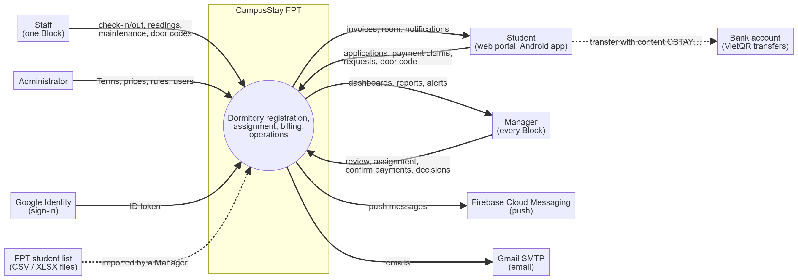
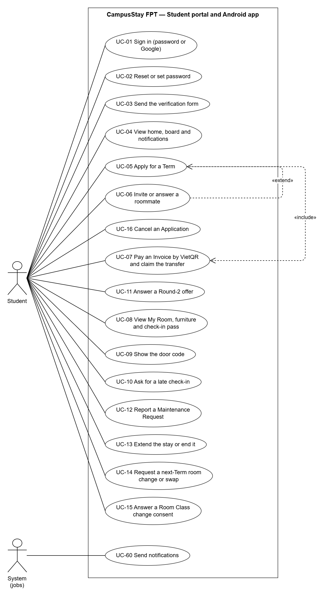
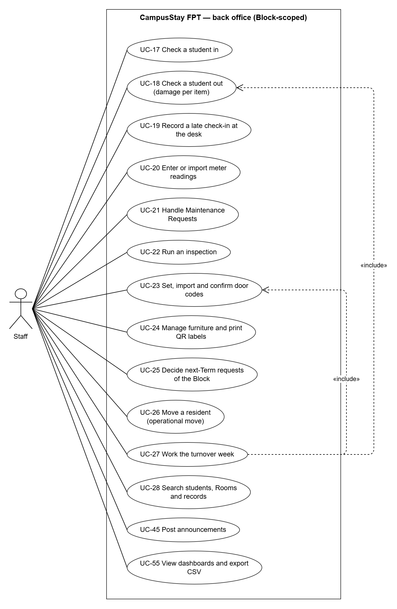
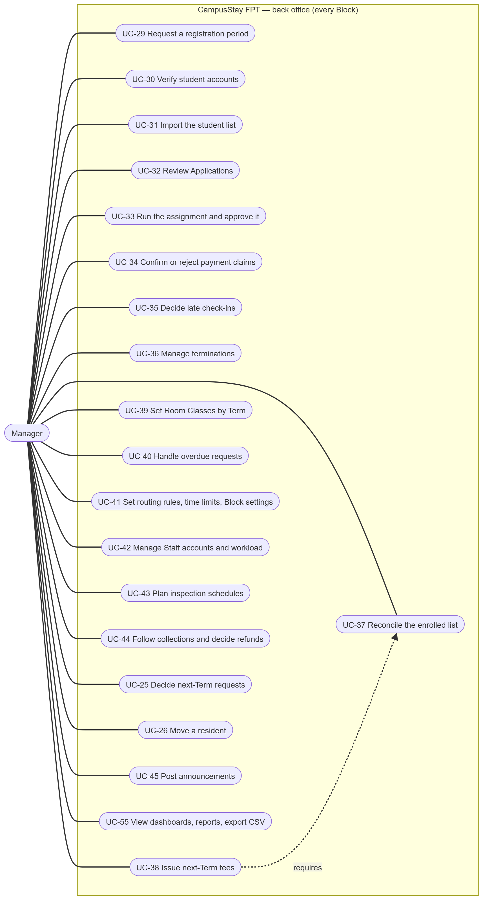
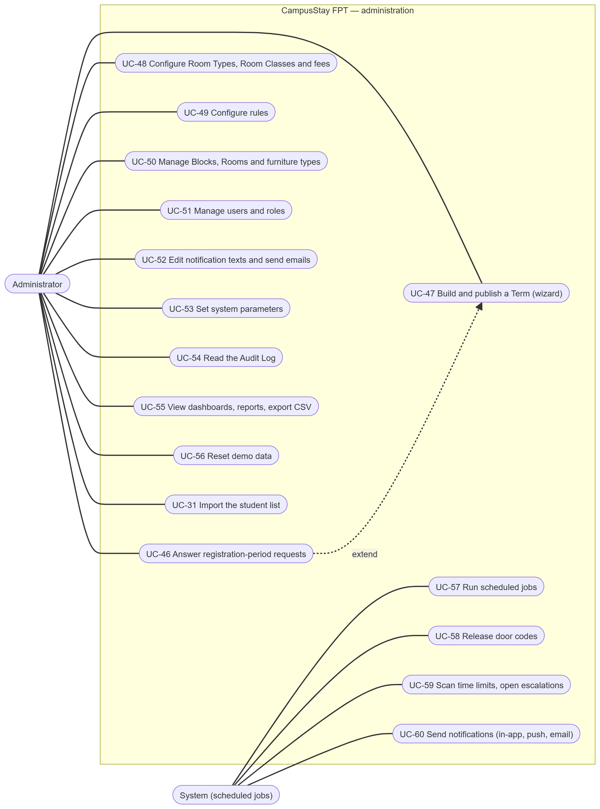
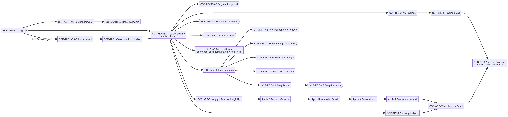
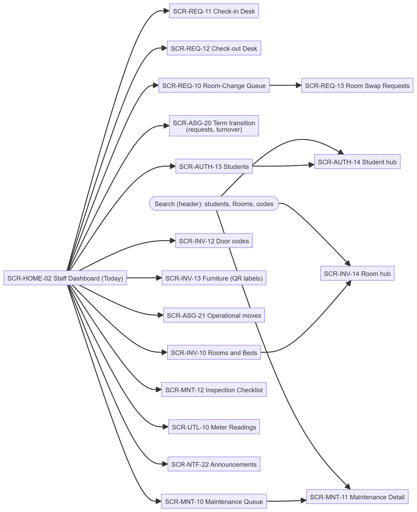
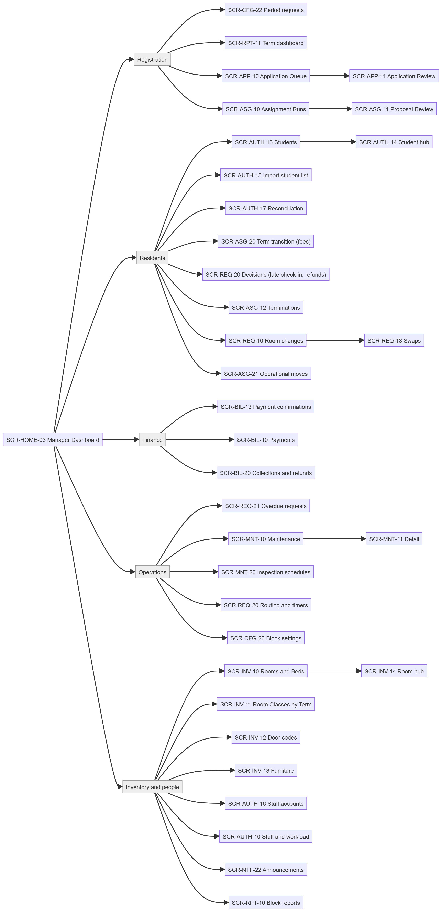
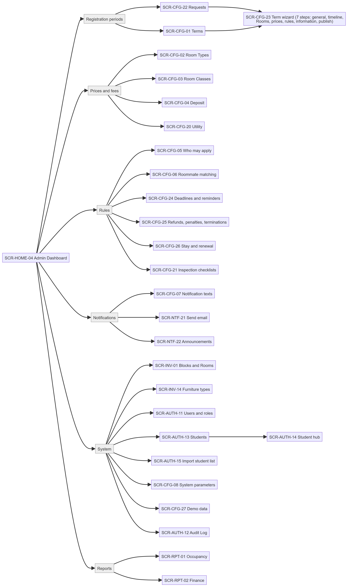
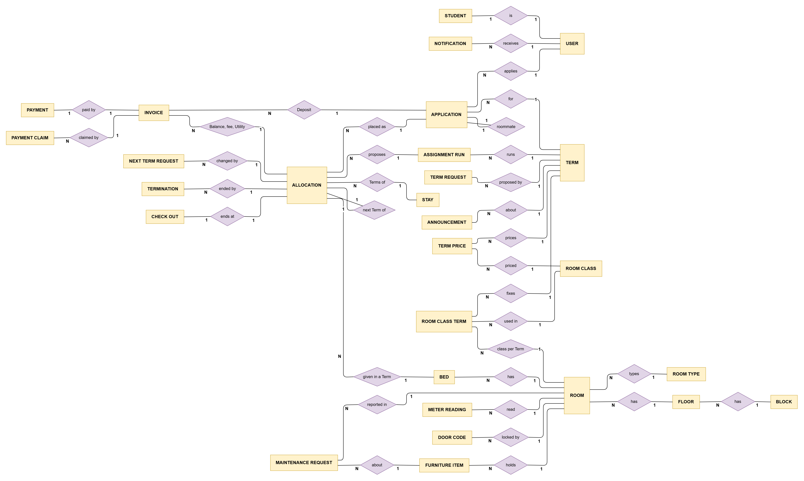

# II. Software Requirement Specification

## 1. Product Overview

CampusStay FPT is a new system for the dormitory of FPT University's Tân Uyên campus. It takes a student from sign-in to a Bed and through every Term of their stay, and gives the dormitory office one place to run registration periods, assignment, payments, the Block desks, Term transitions, maintenance and reports. It replaces nothing: the campus has no dormitory system yet. It works beside FPT's student information system (the student list is imported from files) and the dormitory's bank account (students transfer with a VietQR code and Managers confirm the transfers).

The users are students (web portal and Android app), Staff of one Block, Managers of the dormitory (every Block) and the Administrator. The context diagram shows the boundary of the system and the data that crosses it.

| External entity | Data in | Data out |
|---|---|---|
| Student | Applications, payment claims, requests, Maintenance Requests, consents | Invoices, Room and Bed, door code, check-in pass, notifications |
| Staff | Check-in and check-out, meter readings, door codes, furniture, decisions on Block requests, inspections | Queues, dashboards, Room hub |
| Manager | Registration-period requests, reviews, assignment approvals, payment confirmations, reconciliations, decisions | Dashboards, reports, alerts, escalations |
| Administrator | Terms, prices, rules, users, notification texts | Reports, Audit Log |
| Google Identity | ID token of an FPT Google account | — |
| Firebase Cloud Messaging | — | Push messages to the Android app |
| Gmail SMTP | — | Emails |
| VietQR image service | — | QR image request (account, amount, transfer content) |
| FPT student list | CSV or XLSX files imported by a Manager | — |
| Bank account | Transfers by students (outside the system) | — |

Glossary used in every report: **Term**, **Block** (Building), **Floor**, **Room**, **Room Type** (number of Beds), **Room Class** (Basic, Standard, Premium), **Bed**, **Application**, **Allocation** (a student's Bed in a Term), **Stay** (Terms a student lives in a row), **Stay length** (Terms a student commits to), **Invoice** (Deposit, Balance, next-Term fee, Utility, charge), **Payment claim** ("I have transferred"), **requests window** (M2–M7 of the next Term), **next-Term Allocation**, **Maintenance Request**, **check-in**, **check-out**.

## 2. User Requirements

### 2.1 Actors

| # | Actor | Description |
|---|---|---|
| 1 | Student | An FPT University student. Signs in with a password or the FPT Google account (a new account is verified by a Manager), applies for a Term, pays by VietQR transfer and claims it, lives in the dormitory (My Room, door code, check-in pass, furniture), files Maintenance Requests and next-Term requests. Uses the web portal or the Android app. Sees only their own records. |
| 2 | Staff | Dormitory staff of one or more Blocks. Runs the check-in and check-out desk, meter readings, door codes, furniture, inspections and Maintenance Requests, decides the next-Term requests of the Block, moves residents for operational reasons. Sees only the Blocks assigned to them. |
| 3 | Manager | Dormitory manager working for every Block (added after Review 1). Requests registration periods, verifies student accounts, imports the student list, reviews Applications, runs and approves the assignment, confirms payment claims, decides late check-ins, terminations and refunds, reconciles the enrolled list, issues next-Term fees, handles escalations, sets routing rules and Block settings, manages Staff accounts, reads reports. |
| 4 | Administrator | Configures the system: answers registration-period requests and builds and publishes Terms, sets Room Types, Room Classes, fees, Utility, rules and system parameters, manages Blocks, Rooms, furniture types and users, edits notification texts, sends emails, reads the Audit Log and reports, resets demo data on the demo server. |
| 5 | System (scheduled jobs) | Time-driven work: Deposit expiry, Balance forfeit, door code release, requests-window milestones (M2, M3, M4, M7), overdue Invoices and Utility warnings, payment reminders, time-limit scans and escalations, swap expiry, inspection runs, email dispatch. |
| 6 | Google Identity, Firebase Cloud Messaging, Gmail SMTP, VietQR image service | External services: sign-in, push, email and the QR picture of a transfer (section 4.1). |

### 2.2 Use Cases

#### 2.2.1 Diagrams

#### 2.2.2 Descriptions

| ID | Use Case | Actors | Use Case Description |
|---|---|---|---|
| UC-01 | Sign in (password or Google) | All | Signs in with email and password, or with an FPT Google account; the first Google sign-in of an unknown student creates the account. Five wrong passwords lock the account for a while. (FR-AUTH-01, FR-AUTH-02) |
| UC-02 | Reset or set password | All | Asks for a reset link by email, sets a password from an invitation link, or sets the first password after a Google sign-up. (FR-AUTH-03) |
| UC-03 | Send the verification form | Student | A new Google account fills the sign-up form (student code, gender, major, contact); a Manager verifies it before the student can apply. (FR-AUTH-04) |
| UC-04 | View home, board and notifications | Student | Home with the Term timeline, the dormitory board (announcements), the Room, the Invoice due and notifications. (FR-NTF-01, FR-NTF-03) |
| UC-05 | Apply for a Term | Student | Checks eligibility, chooses Room Type and Room Class, a roommate mode, a stay length and contact, accepts the rules and submits; a Deposit Invoice is issued. (FR-APP-01, FR-APP-02) |
| UC-06 | Invite or answer a roommate | Student | For a 2-bed Room, invites another student by code or answers an invitation within the roommate window. (FR-APP-03) |
| UC-07 | Pay an Invoice by VietQR and claim the transfer | Student | Opens the payment page (QR image, account, amount, transfer content), transfers in a banking app and presses "I have transferred" with the reference. (FR-BIL-01, FR-BIL-02) |
| UC-08 | View My Room, furniture and check-in pass | Student | Room, Bed, roommates, furniture, check-in pass (QR), Stay and next-Term state. (FR-ASG-04, FR-INV-03) |
| UC-09 | Show the door code | Student | Reveals the Room's door code once it is released; every view is audited. (FR-INV-04) |
| UC-10 | Ask for a late check-in | Student | Asks to arrive after the check-in window with a reason, the day and evidence. (FR-ASG-05) |
| UC-11 | Answer a Round-2 offer | Student | A waitlisted student accepts one held Bed or declines. (FR-APP-07) |
| UC-12 | Report a Maintenance Request | Student | Reports a problem with category, location, urgency, photos and the furniture item. (FR-MNT-01) |
| UC-13 | Extend the stay or end it | Student | In the requests window, extends the stay length or ends the stay after this Term. (FR-REQ-04) |
| UC-14 | Request a next-Term room change or swap | Student | Asks for another Room for the next Term, a direct swap or a swap from the board. (FR-REQ-01, FR-REQ-02) |
| UC-15 | Answer a Room Class change consent | Student | Agrees or declines when a roommate asks to change the Room's class from the next Term. (FR-REQ-03) |
| UC-16 | Cancel an Application | Student | Cancels before the assignment; an unpaid Deposit is voided, a paid one is refunded by rule. (FR-APP-04) |
| UC-17 | Check a student in | Staff | Finds the student by code, name or check-in pass; checks the Balance is paid and records the hand-over items. (FR-ASG-04) |
| UC-18 | Check a student out | Staff | Records meter readings, key, condition and damage per furniture item; the Utility Deposit is settled and the refund goes to a Manager. (FR-ASG-06) |
| UC-19 | Record a late check-in at the desk | Staff | Records a student's late arrival request with evidence. (FR-ASG-05) |
| UC-20 | Enter or import meter readings | Staff | Enters or imports (CSV) the month's electricity and water readings and closes the period. (FR-BIL-04) |
| UC-21 | Handle Maintenance Requests | Staff | Takes, plans, updates and resolves requests of the Block. (FR-MNT-02) |
| UC-22 | Run an inspection | Staff | Answers the checklist and the Room's checks; failed items create Maintenance Requests. (FR-MNT-04) |
| UC-23 | Set, import and confirm door codes | Staff | Proposes a code (random, typed or imported), sets it on the lock and confirms it. (FR-INV-04) |
| UC-24 | Manage furniture and print QR labels | Staff | Moves items between Rooms and the Block store, changes status, prints QR labels. (FR-INV-03) |
| UC-25 | Decide next-Term requests | Staff, Manager | One list of room changes, swaps, Room Class changes, extensions and ends of stay; bulk decisions by M4. (FR-REQ-05) |
| UC-26 | Move a resident (operational move) | Staff, Manager | Moves a resident to another Bed for an operational reason, without charge. (FR-ASG-10) |
| UC-27 | Work the turnover week | Staff | Leavers to check out, movers, arriving students, Rooms needing a reading and a new door code. (FR-ASG-10) |
| UC-28 | Search students, Rooms and records | Staff, Manager, Admin | Header search by student code or name, Room code, Invoice or request code inside the user's Blocks; Room and student hubs. (FR-RPT-04, FR-INV-05) |
| UC-29 | Request a registration period | Manager | Proposes dates, milestones, Blocks, Rooms left out (imported from Excel or CSV), places and prices to the Admin. (FR-CFG-04) |
| UC-30 | Verify student accounts | Manager | Verifies or rejects new Google accounts against the student list. (FR-AUTH-04) |
| UC-31 | Import the student list | Manager, Admin | Uploads a CSV or XLSX list, previews each line and confirms. (FR-AUTH-05) |
| UC-32 | Review Applications | Manager | Approves or rejects Applications, one by one or in bulk; a rejection needs a reason. (FR-APP-05) |
| UC-33 | Run the assignment and approve it | Manager | Runs a dry or real assignment, resolves conflicts and approves each Block. (FR-ASG-01, FR-ASG-02, FR-ASG-03) |
| UC-34 | Confirm or reject payment claims | Manager | Confirms claims (one or in bulk with count and total) or rejects with a reason. (FR-BIL-03) |
| UC-35 | Decide late check-ins | Manager | Approves with a new deadline or rejects with a reason. (FR-ASG-05) |
| UC-36 | Manage terminations | Manager | Starts a termination with a reason and move-out date, follows overdue ones, cancels. (FR-ASG-09) |
| UC-37 | Reconcile the enrolled list | Manager | Uploads the enrolled (or leavers) list of a Term and resolves groups 1–2 with a note. (FR-AUTH-08) |
| UC-38 | Issue next-Term fees | Manager | Issues the next-Term fees once requests are decided and the list is reconciled. (FR-ASG-08) |
| UC-39 | Set Room Classes by Term | Manager | Sets a Room's class from a Term on, before the Term starts and before its Beds are given. (FR-INV-02) |
| UC-40 | Handle overdue requests | Manager | Acts on escalations: reassign, note the action. (FR-REQ-07) |
| UC-41 | Set routing rules, time limits and Block settings | Manager | Rules that assign requests to Staff, urgent and normal time limits, desk and quiet hours. (FR-REQ-06, FR-CFG-06) |
| UC-42 | Manage Staff accounts and workload | Manager | Creates Staff accounts for Blocks, edits handles and duty, sees the workload. (FR-AUTH-07) |
| UC-43 | Plan inspection schedules | Manager | Schedules recurring inspections per Block with a checklist. (FR-MNT-04) |
| UC-44 | Follow collections and decide refunds | Manager | Overdue Invoices, reminders, Utility warnings, refunds to decide. (FR-BIL-05, FR-BIL-06) |
| UC-45 | Post announcements | Staff, Manager, Admin | Announcements on the dormitory board for all students or the residents of a Block. (FR-NTF-03) |
| UC-46 | Answer registration-period requests | Admin | Comments, asks for changes, rejects, or builds the Term from a request. (FR-CFG-04) |
| UC-47 | Build and publish a Term | Admin | Seven-step wizard; publication fixes prices, Deposit and rules for the Term. (FR-CFG-05) |
| UC-48 | Configure Room Types, Room Classes and fees | Admin | Base prices, surcharges, Deposit, Utility prices and Utility Deposit. (FR-CFG-01, FR-CFG-02) |
| UC-49 | Configure rules | Admin | Eligibility, priority groups, matching, deadlines, refunds, stay and renewal, inspection checklists. (FR-CFG-03, FR-MNT-03) |
| UC-50 | Manage Blocks, Rooms and furniture types | Admin | Blocks, Floors, bulk Room generation, out of service, furniture types and Room Class requirements. (FR-INV-01, FR-INV-03) |
| UC-51 | Manage users and roles | Admin | Back-office users, roles, Blocks, the permission matrix. (FR-AUTH-06) |
| UC-52 | Edit notification texts and send emails | Admin | Notification templates in both languages; emails to student groups. (FR-NTF-04, FR-NTF-05) |
| UC-53 | Set system parameters | Admin | Typed parameters (limits, windows, timers). (FR-CFG-07) |
| UC-54 | Read the Audit Log | Admin | Every configuration change, irreversible action, export and door-code view. (FR-AUTH-09) |
| UC-55 | View dashboards, reports and export CSV | Staff, Manager, Admin | Dashboards per role, Term dashboard, occupancy, finance, Block reports, CSV export of every list. (FR-RPT-01..03) |
| UC-56 | Reset demo data | Admin | On the demo server only: replace business data by a demo stage. (FR-CFG-08) |
| UC-57 | Run scheduled jobs | System | Deposit expiry, forfeit, requests-window milestones, overdue and reminders, swap expiry, inspections. (section 3.1.4) |
| UC-58 | Release door codes | System | Releases the Room's code to paid students from the check-in start. (FR-ASG-04) |
| UC-59 | Scan time limits and open escalations | System | Every 15 minutes, opens escalations for overdue or unassigned requests. (FR-REQ-07) |
| UC-60 | Send notifications | System | In-app, push and email after each business event. (FR-NTF-01, FR-NTF-02) |

## 3. Functional Requirements

### 3.1 System Functional Overview

#### 3.1.1 Screens Flow

The web app has one portal per role; the Android app follows the student portal (Home, My Room, Payments, Activity). Rounded shapes are screens opened from a link or notification rather than the menu.

#### 3.1.2 Screen Descriptions

The tables list every route of the web app (generated from the router, `docs/web/01_Screen_Map.md`) with the API calls the screen makes. A screen code shared by two roles is the same page with the role's scope.

@include _screens.md

#### 3.1.3 Screen Authorization

X = the role opens the screen; the bracket gives the data it sees. Own data = the student's own records (another student's record answers 404). Own Blocks = the Blocks assigned to the Staff account. Every API call checks the same rule on the server (`Permission`, `BlockScope`).

@include _authorization.md

Activities inside screens that need more than the screen's role:

| Activity | Student | Staff | Manager | Admin |
|---|---|---|---|---|
| Approve or reject Applications, run and approve the assignment | | | X | |
| Confirm or reject payment claims, decide refunds | | | X | |
| Decide next-Term requests of a Block | | X (own Blocks) | X | |
| Decide a swap across Blocks | | | X | |
| Set Room Classes by Term, transfer furniture between Blocks | | | X | |
| Reveal a Room's door code | X (own Room, once released) | X (own Blocks) | X | |
| Publish a Term, change prices or rules | | | | X |
| Export a list as CSV | | X (own Blocks) | X | X |
| Reset demo data | | | | X (demo server only) |

#### 3.1.4 Non-Screen Functions

| # | Feature | System Function | Description |
|---|---|---|---|
| 1 | Applications | Deposit and offer expiry (every 5 min) | An Application Awaiting Deposit whose window ended without a claim becomes Expired and its Invoice Void; roommate invitations and Round-2 offers not answered in time expire. |
| 2 | Assignment | Forfeit (every 5 min) | A Balance past its deadline with no claim waiting is forfeited: Allocation cancelled, Application Forfeited, Deposit kept by rule. |
| 3 | Assignment | Door code release (every 15 min) | Releases the Room's door code to students whose Balance is paid, whose check-in start has come and whose Room code is active; they become residents. Terminations past their move-out date become Overdue. |
| 4 | Term transition | Requests window jobs (every 15 min) | M2 opens the window (next-Term Allocations), M3 closes filing and releases Beds not extended, M4 − 48 h alerts Managers, M7 cancels unpaid next-Term fees. |
| 5 | Billing | Overdue and Utility debt (hourly) | Unpaid charges past due become Overdue; Utility warnings (first, final) and the termination when the rule is met. |
| 6 | Billing | Payment reminders (hourly) | Reminders before Balance and next-Term fee deadlines (days set by the Admin); hourly summary of waiting claims to Managers. |
| 7 | Requests | Time-limit scan (every 15 min) | Opens escalations for requests past their deadline or unassigned too long; closes them when back on track. |
| 8 | Requests | Swap expiry (every 5 min) | Swap invitations not answered in time expire. |
| 9 | Maintenance | Inspection runs (daily 06:00) | Starts the scheduled inspection runs of each Block. |
| 10 | Notifications | Email dispatch (every 30 s) | Sends queued emails; demo accounts' emails go to the demo mailbox. |
| 11 | Notifications | Push after commit | Sends push messages to the user's Android devices after the transaction commits; disables expired tokens. |
| 12 | Accounts | Session cleanup (daily 03:15) | Removes expired sessions. |
| 13 | All | REST API `/api` | JSON API used by the web app and the Android app (contract `docs/api-contract.md`); bearer token sessions. |

#### 3.1.5 Entity Relationship Diagram

The main entities and their relationships (the full logical ERD of 98 tables is in Report 4, section 2).

| # | Entity | Description |
|---|---|---|
| 1 | User (auth_user) | Every account: student, Staff, Manager, Admin; email, password hash or Google subject, role, status, language. |
| 2 | Student (auth_student) | Directory record of a student: code, gender, major, cohort, region, enrollment, priority groups, verification. |
| 3 | Block (inv_building) | A dormitory building with its gender. |
| 4 | Room (inv_room) | A Room of a Floor with its Room Type and the Room Class per Term. |
| 5 | Bed (inv_bed) | A Bed of a Room. |
| 6 | Furniture item (inv_furniture_item) | An item with an asset code in a Room or a Block store. |
| 7 | Door code (inv_door_code) | A Room's code, encrypted; proposed, active, retired. |
| 8 | Term (cfg_term) | A Term with its stay dates, registration and renewal milestones, prices and rules fixed at publication. |
| 9 | Room Type, Room Class, Term price | Bed count and base price; surcharge and amenities; the Term's price per combination. |
| 10 | Registration-period request (cfg_term_request) | A Manager's proposal of a Term, answered by the Admin. |
| 11 | Application (app_application) | A student's Application for a Term. |
| 12 | Assignment run (asg_run) | A run of the assignment engine with its proposal. |
| 13 | Allocation (asg_allocation) | A student's Bed in a Term (current or next Term). |
| 14 | Stay (asg_stay) | Terms committed and used by a student. |
| 15 | Check-out, termination | The end of an Allocation at the desk; a stay terminated for a reason. |
| 16 | Invoice, payment claim, payment | Money owed, the student's claim of a transfer, the confirmed payment. |
| 17 | Meter reading | A Room's monthly electricity and water readings. |
| 18 | Room change, swap, stay request, Room Class change | Next-Term requests of residents. |
| 19 | Maintenance Request | A reported problem with its assignee and time limit. |
| 20 | Notification, announcement | In-app messages and dormitory-board posts. |

@include r3-fr.md

## 4. Non-Functional Requirements

### 4.1 External Interfaces

**User interfaces.** A responsive web app (React) for the four roles: the student portal works on phones, tablets and desktops; the back office is designed for desktop (1280 px and wider). An Android app (Kotlin, Jetpack Compose, Android 8.0 / API 26 or later) for students. Both are in Vietnamese and English, chosen by the user (web) or the phone's language (Android); the API answers in the same language (`Accept-Language`). Screen layouts follow the Figma file *CampusStay-FPT*; the screen flows are in section 3.1.1 and the routes in section 3.1.2.

**Software interfaces.**

| Interface | Purpose | Data exchanged | Protocol |
|---|---|---|---|
| Google Identity Services | Sign in with an FPT Google account | ID token (email, subject, hosted domain) verified by the API | HTTPS, OAuth 2.0 / OpenID Connect |
| Firebase Cloud Messaging | Push to the Android app | Device token, title, body, link (never a door code) | HTTPS, FCM HTTP v1 with a service account |
| Gmail SMTP | Email (password reset, invitations, warnings, campaigns) | Recipient, subject, HTML body | SMTP over TLS |
| VietQR image service (qr.sepay.vn) | QR image of a transfer | Bank, account number, amount, transfer content | HTTPS image URL |
| PostgreSQL 17 (Azure Database for PostgreSQL) | Persistence | All business data | JDBC over TLS |
| Student list files | Import and reconciliation | CSV (UTF-8, comma, semicolon or tab) or XLSX | File upload |

**Communication interfaces.** All clients call the REST API over HTTPS with JSON bodies and a bearer token (`Authorization: Bearer …`); files are uploaded as multipart and downloaded through short-lived signed links. IDs are JSON strings; money is an integer number of VND; times are ISO-8601 in UTC; calendar days are `YYYY-MM-DD` in the campus time zone (Asia/Ho_Chi_Minh).

### 4.2 Quality Attributes

Each attribute has a metric, a threshold and a measurement method; NFR-01…NFR-06 are the ones agreed for Defense 1.1 (Design Brief section 7, Report 5 section 4.4).

#### 4.2.1 Usability

- **NFR-05 Two languages:** every screen of the web app and the Android app and every API message is available in Vietnamese and English. Metric: share of user-facing texts with a Vietnamese translation. Threshold: 100 % of API messages and of the web texts. Method: the catalogue `i18n/messages_vi.txt` translated by `Messages` (unit test `MessagesTest`) and a scan of every web route in Vietnamese for English left on screen, run before each release.
- A student completes an Application in at most 5 screens (wizard steps) and a payment claim in 2 actions from the Invoice.
- Every list has search, filters, paging and CSV export; every request shows the time left to its deadline (green, amber in the last hours, red when overdue).
- The student portal works at 375 px width without horizontal scrolling.

#### 4.2.2 Reliability

- **NFR-04 Availability during the demo period:** the production API answers `GET /api/actuator/health` = UP. Threshold ≥ 99 % of 5-minute checks from 01/11/2026 to the final defense. Method: an external uptime check every 5 minutes; deployments use a readiness check and can roll back to the previous image.
- **NFR-03 Integrity:** a Bed is never given twice in a Term and a student never holds two active Allocations in a Term. Threshold: 0 violations. Method: partial unique indexes in the database plus row locks (`SELECT … FOR UPDATE`) when Beds change hands; a concurrency test that sends parallel commits for the same Bed (planned, Report 5 TC-NFR-03).
- Money: Invoice amounts cannot change once issued and a Paid or Void Invoice never goes back (database trigger); every payment, refund and decision is in the Audit Log.

#### 4.2.3 Performance

- **NFR-01 Response time:** with the base data (8 Blocks, 3,680 Beds, 6,200 students) and 200 concurrent users, the p95 response time of the 10 most used read endpoints is ≤ 1 s and the error rate < 1 %. Method: load test script against a local server with the production configuration.
- The assignment of a whole Term (about 3,000 Applications) completes in ≤ 60 s. Method: timed integration run.

#### 4.2.4 Security

- **NFR-02 Access control:** every endpoint requires a signed-in role except sign-in, password reset and health; Staff are limited to their Blocks; a student reaching another student's record gets 404. Threshold: 100 % of permission and scope tests pass. Method: the permission/scope integration tests (Report 5).
- Passwords are stored with BCrypt; five wrong attempts lock the account; session tokens are random and stored hashed; door codes are stored encrypted (AES-GCM) and every view is audited.
- Personal data are processed according to Vietnam's Personal Data Protection Law 91/2025/QH15 (in force from 01/01/2026): only data needed for the dormitory, access by role, no personal data in URLs or logs, fictional data in seeds and tests, demo emails redirected to the team mailbox.

#### 4.2.5 Maintainability and deployability

- **NFR-06 Delivery:** a change merged to `main` reaches production automatically after the full test suite passes. Threshold: ≤ 15 minutes from push to a healthy production API; rollback to the previous image in ≤ 5 minutes. Method: GitHub Actions run times and the runbook rollback command.
- Layered architecture checked by `LayeringTest`; database changes only through new Flyway migrations; every business value is configuration (no hard-coded prices, windows or limits).

## 5. Requirement Appendix

### 5.1 Business Rules

| ID | Rule Definition |
|---|---|
| BR-01 | One Application covers exactly one Term; a student has at most one open Application per Term. |
| BR-02 | Only a verified, enrolled student who passes every enabled eligibility check may apply; a pending Google account cannot apply. |
| BR-03 | Students do not choose a Room or Bed; they choose a Room Type and a Room Class, and the assignment places them in a Block of their gender. |
| BR-04 | Roommate invitations exist only for 2-bed Room Types; both students must accept within `roommateHours` and each pays their own Deposit; 4-, 6- and 8-bed Rooms are matched automatically. |
| BR-05 | The stay length (Terms committed) is from 1 to `stay.max_terms`, capped by the semesters the student has left. |
| BR-06 | The Deposit is `depositPercent` of the Term price of the chosen Room Type and Room Class, rounded; it must be claimed within the Deposit window (`depositHours`) or the Application expires. |
| BR-07 | A claim ("I have transferred") stops every deadline of its Invoice; a rejected claim gives back the time that was left (at least `payment.rejected_claim_min_hours`); a second rejection cancels a Deposit or Balance. Only a confirmed claim counts as payment. |
| BR-08 | The Balance is the Term price minus the Deposit plus the Utility Deposit; a Balance not paid by its deadline is forfeited: the Bed is released and the Deposit kept by the refund rule. |
| BR-09 | Prices, the Deposit percentage, the Utility Deposit and the rules of a Term are fixed when it is published; a published deadline can only be extended; prices of a Term never change after Invoices exist. |
| BR-10 | The Term price per Bed = base price of the Room Type × (1 + surcharge of the Room Class), rounded by the system parameter; the Room Class of a Room is set per Term. |
| BR-11 | A Room's class can change for a Term only before the Term starts and only if none of its Beds is given for that Term; the class follows the furniture the Room Class requires. |
| BR-12 | The assignment respects hard constraints (gender of the Block, Room Type and Room Class applied for, invited pairs together, capacity) and then the ordered matching criteria and weights of the Term's snapshot; conflicts are shown, never resolved silently; the same input gives the same proposal. |
| BR-13 | A real assignment run of a Term cannot start before M3 or while next-Term requests are open, because continuing residents' Beds are not settled yet. |
| BR-14 | The door code is released only when the Balance is paid, the check-in start has come and the Room's code is confirmed on the lock; the student is then a resident. |
| BR-15 | The door code of a Room must change whenever a resident leaves it (check-out, move, termination); codes are 6 digits, stored encrypted, never sent in push texts; every view is audited. |
| BR-16 | A late check-in must be asked before the check-in end plus `late_check_in.max_days`; an approved one moves the Balance deadline to the new date. |
| BR-17 | Requests window: at M2 every resident not leaving gets a next-Term Allocation on the same Bed (Continuing, or Awaiting extension in the last Term of the Stay); requests are filed until M3 and decided by M4; a Bed Awaiting extension at M3 is released. |
| BR-18 | Next-Term requests (room change, swap, Room Class change, extension, end of stay) act on the next-Term Allocation, never on the current Term, and carry no price difference within the current Term. |
| BR-19 | A Room Class change needs the consent of every continuing resident of the Room (a resident in the last Term of the Stay is not asked) and the furniture of the new class. |
| BR-20 | A swap across Blocks is decided by Staff and then a Manager; a swap not answered before it expires ends; after next-Term fees are issued no swap is carried out. |
| BR-21 | An extension is automatic when the student is enrolled and has nothing overdue; otherwise Staff decide it. |
| BR-22 | Next-Term fees are issued only when filing is closed, every request is decided and the enrolled list is reconciled (groups 1–2 resolved); a fee unpaid at M7 with no claim waiting is voided and the Bed released. |
| BR-23 | Reconciliation groups: (1) someone of the Term not enrolled, (2) someone of the Term missing from the list, (3) a code no student has, (4) an enrollment status that changed; groups 1–2 are resolved one by one with a note, and "Not enrolled" ends what the student holds. |
| BR-24 | Check-out settles the Utility Deposit: the student's Utility share since the last reading and the damage per furniture item are deducted; the rest is refunded by a Manager, a shortfall is invoiced. |
| BR-25 | Utility of a Room is split between its residents by the days each lived there between meter readings (meter cuts when someone leaves or moves); totals are rounded up by the Admin's rounding rule. |
| BR-26 | Utility debt: one overdue Utility Invoice gives warning 1; a second overdue month, or debt reaching the Utility Deposit, gives the final warning with a termination day; from that day the stay is terminated. Paying closes the warnings. |
| BR-27 | A terminated resident must move out by the move-out date; past it the termination is Overdue and the Room's code must change. |
| BR-28 | Refunds follow the Admin's refund rules (trigger, percentage, approver); an Invoice is refunded at most once. |
| BR-29 | A Maintenance Request gets its deadline from the Block's urgent or normal time limit when it is routed; routing rules choose the assignee by request type and condition, with a fallback when the assignee is off duty. |
| BR-30 | A request past its deadline, or unassigned longer than `sla.unassigned_max_hours`, opens one escalation for Managers; it closes when the request is back on track. |
| BR-31 | A failed inspection item creates a Maintenance Request; a Room's inspection is done only when its own checks (people, furniture) are answered. |
| BR-32 | Staff act only on their Blocks; Managers act on every Block; the Admin configures but does not run desk operations. |
| BR-33 | Announcements to residents of a Block are written by its Staff or a Manager; money or policy changes create change announcements with the old and new values automatically. |
| BR-34 | Every configuration change, irreversible action, export, door-code view and demo reset is written to the Audit Log, which nobody can edit. |
| BR-35 | A new Google account of an `@fpt.edu.vn` address is created as a student without a password; it must set a password and send the verification form, and a Manager verifies or rejects it. |

### 5.2 Common Requirements

- Every list: search, filters, sort, paging (`page`, `pageSize`), totals and CSV export with the screen's columns.
- Every form: validation on the server with a message per field (`details.fields`), shown under the field in red; required fields marked with `*`.
- Every irreversible action asks for confirmation with what will happen (count and total for bulk actions).
- Every request and Invoice shows its deadline and the time left; overdue items are marked.
- Every date and time is shown in the campus time zone; money in VND with thousands separators.
- Every notification event creates an in-app notification, and push and email when the template says so, in the recipient's language.
- Every back-office page shows the Blocks in scope; the Term selector chooses the Term the data belongs to.

### 5.3 Application Messages List

The messages the API returns, with their Vietnamese text (the catalogue `backend/src/main/resources/i18n/messages_vi.txt`, checked by `MessagesTest`). Type: *Field* = shown in red under the field; *Refused* = an action the user may not do now, shown in a dialog; *Dialog* = other errors and information, shown in a dialog or a toast. Values in braces are filled in by the server.

@include _messages.md
