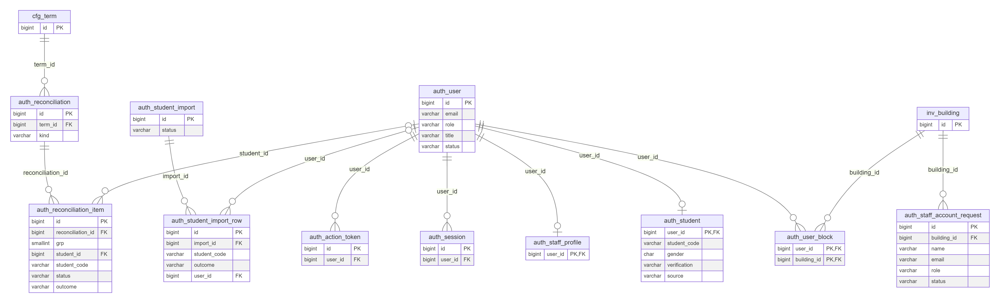
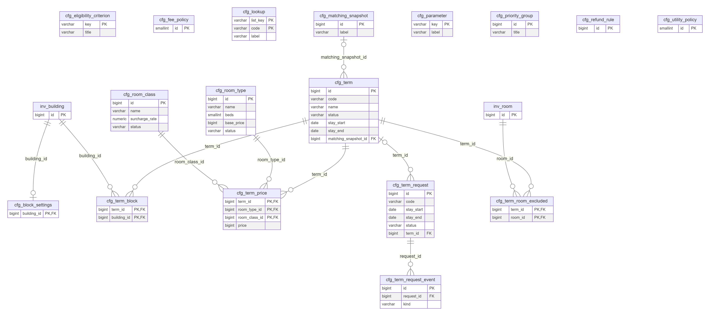
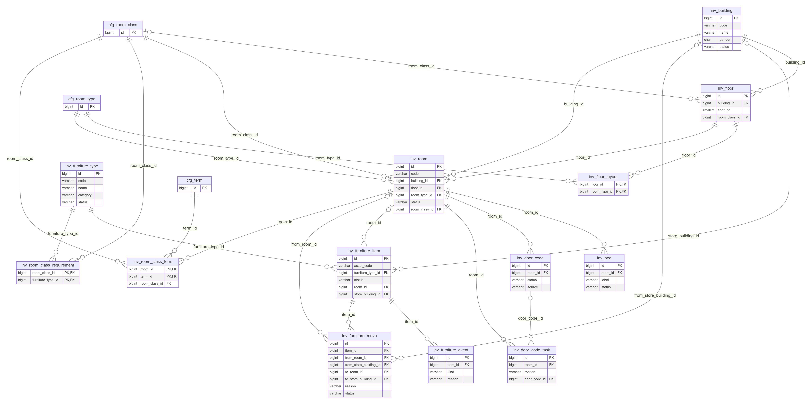
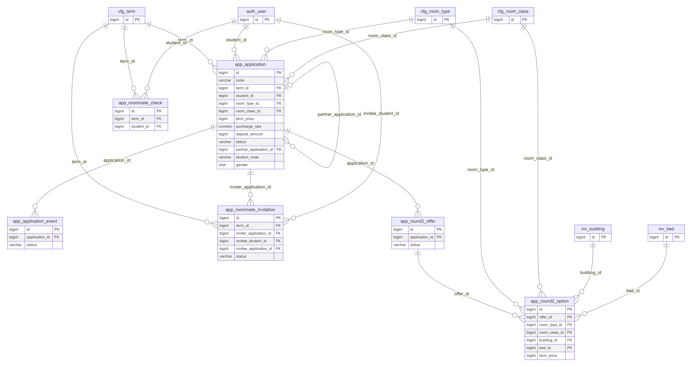
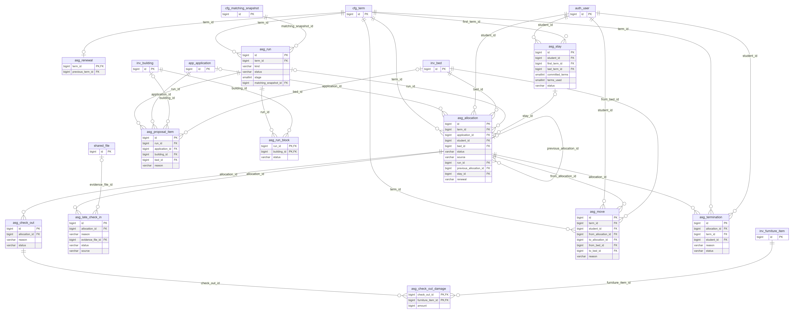
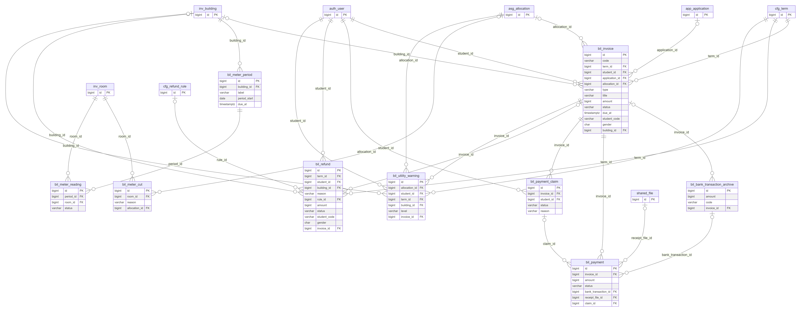
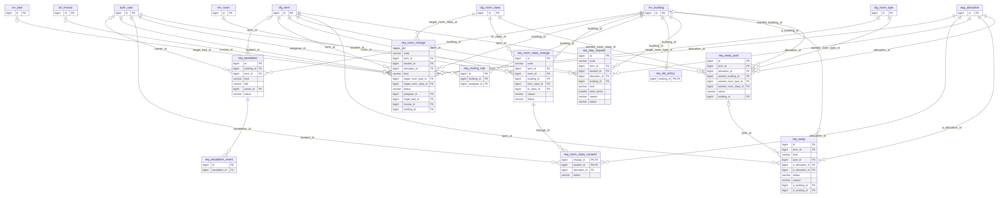
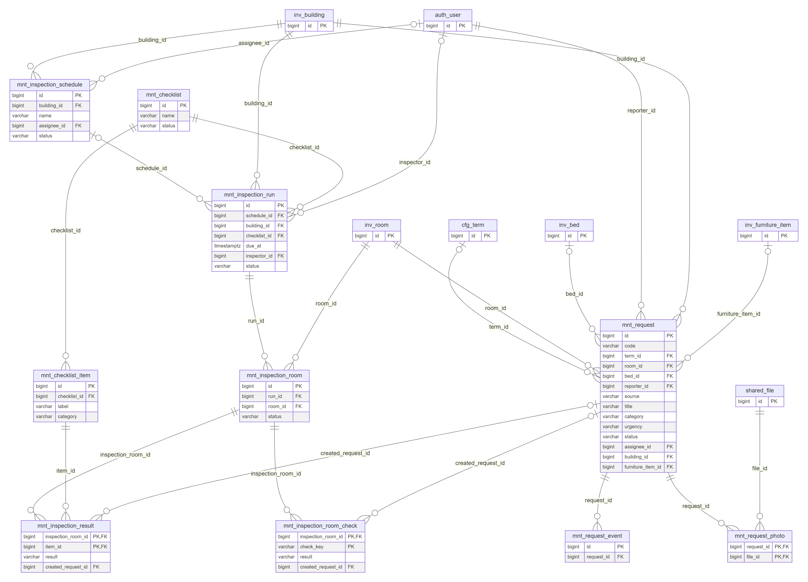
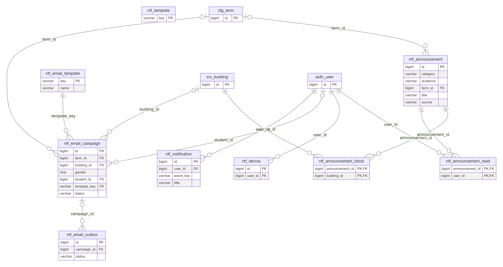
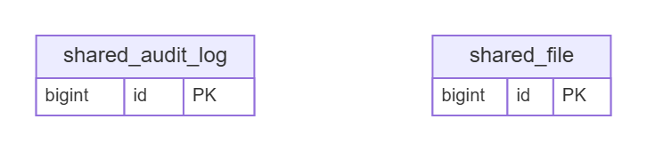

### 2.2 Accounts and access (AUTH)

| No | Table | Description | Keys |
|---|---|---|---|
| 01 | auth_action_token | One-time tokens (hashed) for password reset and account invitation links. | PK: id FK: user_id → auth_user |
| 02 | auth_reconciliation | An enrollment reconciliation run of a Term: the uploaded enrolled list or leavers list. | PK: id FK: term_id → cfg_term created_by → auth_user |
| 03 | auth_reconciliation_item | One difference found by a reconciliation (groups 1-4) with its resolution and note. | PK: id FK: reconciliation_id → auth_reconciliation student_id → auth_user resolved_by → auth_user |
| 04 | auth_session | Sign-in sessions (hashed bearer token, method, expiry, revocation). | PK: id FK: user_id → auth_user |
| 05 | auth_staff_account_request | A Manager's request to create a Staff account for a Block. | PK: id FK: building_id → inv_building requested_by → auth_user decided_by → auth_user |
| 06 | auth_staff_profile | Staff handles (request types they take) and on-duty flag, used by routing and workload. | PK: user_id FK: user_id → auth_user |
| 07 | auth_student | Student directory record: student code, gender, major, cohort, region, enrollment status, priority groups, contact and verification state. | PK: user_id FK: user_id → auth_user verified_by → auth_user |
| 08 | auth_student_import | A student list import (CSV or XLSX): preview counts and the applied result. | PK: id FK: uploaded_by → auth_user applied_by → auth_user |
| 09 | auth_student_import_row | One line of a student list import with its outcome (new, updated, unchanged, error). | PK: id FK: import_id → auth_student_import user_id → auth_user |
| 10 | auth_user | Every account (student, Staff, Manager, Admin): email, password hash or Google subject, role, status, lock, locale, demo flag. | PK: id |
| 11 | auth_user_block | Blocks a Staff account works for (Block scope). | PK: user_id, building_id FK: user_id → auth_user building_id → inv_building |

### 2.3 Settings and Terms (CFG)

| No | Table | Description | Keys |
|---|---|---|---|
| 01 | cfg_block_settings | Per-Block desk hours, visiting hours, quiet hours and house rules (within the Admin limits). | PK: building_id FK: building_id → inv_building edited_by → auth_user |
| 02 | cfg_eligibility_criterion | Eligibility checks the Admin switches on or off (e.g. enrolled, verified, no debt). | PK: key |
| 03 | cfg_fee_policy | Default Deposit percentage, Deposit window and Balance days for new Terms. | PK: id FK: updated_by → auth_user |
| 04 | cfg_lookup | Option lists (majors, regions, out-of-service reasons, request categories...). | PK: list_key, code |
| 05 | cfg_matching_snapshot | Versioned roommate-matching settings (hard constraints, criteria order, weights) used by assignment runs. | PK: id FK: created_by → auth_user |
| 06 | cfg_parameter | System parameters (limits, windows, timers) grouped by settings page. | PK: key FK: updated_by → auth_user |
| 07 | cfg_priority_group | Priority groups (first year, far from campus, scholarship, policy beneficiary) and whether they apply. | PK: id |
| 08 | cfg_refund_rule | Refund rules per trigger: percentage and approver role. | PK: id |
| 09 | cfg_room_class | Room Classes (Basic, Standard, Premium): surcharge rate and amenities. | PK: id |
| 10 | cfg_room_type | Room Types (2, 4, 6, 8 Beds): base price per Bed and roommate selection rule. | PK: id |
| 11 | cfg_term | A Term (FA26, SP27...): stay dates, registration milestones, renewal milestones M1-M7, Deposit and Utility Deposit fixed at publication, rules. | PK: id FK: matching_snapshot_id → cfg_matching_snapshot |
| 12 | cfg_term_block | Blocks a Term uses. | PK: term_id, building_id FK: term_id → cfg_term building_id → inv_building |
| 13 | cfg_term_price | The Term's price per Bed for each Room Type and Room Class, fixed when the Term is published. | PK: term_id, room_type_id, room_class_id FK: term_id → cfg_term room_type_id → cfg_room_type room_class_id → cfg_room_class |
| 14 | cfg_term_request | A Manager's registration-period request to the Admin (dates, Blocks, Rooms left out, places, prices); status Submitted to Done. | PK: id FK: requested_by → auth_user term_id → cfg_term |
| 15 | cfg_term_request_event | History and comments of a registration-period request. | PK: id FK: request_id → cfg_term_request actor_id → auth_user |
| 16 | cfg_term_room_excluded | Rooms a Term leaves out of the assignment and Round 2. | PK: term_id, room_id FK: term_id → cfg_term room_id → inv_room |
| 17 | cfg_utility_policy | Utility prices per kWh and m3, reading day, payment days, rounding, reminders and the Utility Deposit estimate. | PK: id FK: updated_by → auth_user |

### 2.4 Inventory: Blocks, Rooms, Beds, furniture, door codes (INV)

| No | Table | Description | Keys |
|---|---|---|---|
| 01 | inv_bed | A Bed of a Room (label A, B...), in service or not. | PK: id FK: room_id → inv_room |
| 02 | inv_building | A Block (Building): code, name, gender, status. | PK: id |
| 03 | inv_door_code | Door codes of a Room, stored encrypted: proposed, active (confirmed on the lock) or retired. | PK: id FK: room_id → inv_room proposed_by → auth_user confirmed_by → auth_user |
| 04 | inv_door_code_task | A door code to change after someone left the Room. | PK: id FK: room_id → inv_room door_code_id → inv_door_code |
| 05 | inv_floor | A Floor of a Block with the Room Class new Rooms start with. | PK: id FK: building_id → inv_building room_class_id → cfg_room_class |
| 06 | inv_floor_layout | How many Rooms of each Room Type a Floor has (used to generate Rooms). | PK: floor_id, room_type_id FK: floor_id → inv_floor room_type_id → cfg_room_type |
| 07 | inv_furniture_event | History of a furniture item (status changes, repairs, damage, moves). | PK: id FK: item_id → inv_furniture_item by_user → auth_user |
| 08 | inv_furniture_item | A furniture item with its asset code, type, status and place (a Room or a Block store). | PK: id FK: furniture_type_id → inv_furniture_type room_id → inv_room store_building_id → inv_building |
| 09 | inv_furniture_move | A move of a furniture item between Rooms and stores. | PK: id FK: item_id → inv_furniture_item from_room_id → inv_room from_store_building_id → inv_building to_room_id → inv_room to_store_building_id → inv_building created_by → auth_user closed_by → auth_user |
| 10 | inv_furniture_type | Furniture types (bed, wardrobe, desk, air conditioner, fridge...) and whether they define a Room Class. | PK: id |
| 11 | inv_room | A Room: code, Block, Floor, Room Type, the Room Class it was built with, out-of-service state. | PK: id FK: building_id → inv_building floor_id → inv_floor room_type_id → cfg_room_type oos_by → auth_user room_class_id → cfg_room_class |
| 12 | inv_room_class_requirement | Furniture a Room Class requires (type and quantity). | PK: room_class_id, furniture_type_id FK: furniture_type_id → inv_furniture_type room_class_id → cfg_room_class |
| 13 | inv_room_class_term | A Room's Room Class from a given Term on. | PK: room_id, term_id FK: room_id → inv_room term_id → cfg_term room_class_id → cfg_room_class set_by → auth_user |

### 2.5 Applications (APP)

| No | Table | Description | Keys |
|---|---|---|---|
| 01 | app_application | A student's Application for one Term: chosen Room Type and Room Class, price and Deposit fixed at submission, roommate mode, Gia hạn (stay_terms), status from Awaiting Deposit to Allocated, Forfeited, Rejected, Expired or Cancelled. | PK: id FK: term_id → cfg_term student_id → auth_user room_type_id → cfg_room_type room_class_id → cfg_room_class partner_application_id → app_application reviewed_by → auth_user |
| 02 | app_application_event | History of an Application (status changes and notes) shown on the student's Application page. | PK: id FK: application_id → app_application actor_id → auth_user |
| 03 | app_roommate_check | Rate limit for roommate code checks (privacy: the same answer for every unusable code, limited attempts). | PK: id FK: term_id → cfg_term student_id → auth_user |
| 04 | app_roommate_invitation | Invitation of a 2-bed roommate by student code: pending, accepted, declined or expired within roommate_hours. | PK: id FK: term_id → cfg_term inviter_application_id → app_application invitee_student_id → auth_user invitee_application_id → app_application |
| 05 | app_round2_offer | Round-2 offer to a Waitlisted Application: up to three held Beds, accepted or declined before it expires. | PK: id FK: application_id → app_application |
| 06 | app_round2_option | One held Bed (Room Type, Room Class, Block, price difference) of a Round-2 offer. | PK: id FK: offer_id → app_round2_offer room_type_id → cfg_room_type room_class_id → cfg_room_class building_id → inv_building bed_id → inv_bed |

### 2.6 Assignment and residence (ASG)

| No | Table | Description | Keys |
|---|---|---|---|
| 01 | asg_allocation | A student's Bed in a Term: from the assignment, a Round-2 offer, a renewal (next-Term Allocation) or a move. Status Active, Ended or Cancelled; resident_at and code_released_at mark residence; renewal = Awaiting extension or Continuing. | PK: id FK: term_id → cfg_term application_id → app_application student_id → auth_user bed_id → inv_bed run_id → asg_run previous_allocation_id → asg_allocation allocated_by → auth_user checked_in_by → auth_user stay_id → asg_stay |
| 02 | asg_check_out | Check-out at the desk: meter readings, key, condition, damage charge, Utility Deposit settlement and refund. | PK: id FK: allocation_id → asg_allocation completed_by → auth_user draft_by → auth_user |
| 03 | asg_check_out_damage | Damage recorded per furniture item at a check-out (amount and note). | PK: check_out_id, furniture_item_id FK: check_out_id → asg_check_out furniture_item_id → inv_furniture_item |
| 04 | asg_late_check_in | Late check-in asked online or recorded at the desk: requested date, evidence, decision and the new Balance deadline. | PK: id FK: allocation_id → asg_allocation received_by → auth_user evidence_file_id → shared_file decided_by → auth_user |
| 05 | asg_move | Operational move between Beds (or Rooms) by Staff or a Manager, with reason, meter cut and no price difference. | PK: id FK: term_id → cfg_term student_id → auth_user from_allocation_id → asg_allocation to_allocation_id → asg_allocation from_bed_id → inv_bed to_bed_id → inv_bed moved_by → auth_user |
| 06 | asg_proposal_item | One proposed placement of an assignment run: Application, Bed, fit score, conflict code and resolution. | PK: id FK: run_id → asg_run application_id → app_application building_id → inv_building bed_id → inv_bed |
| 07 | asg_renewal | The requests window of a Term (M2 to M7): when it opened, closed filing, alerted Managers, issued and closed next-Term fees. | PK: term_id FK: term_id → cfg_term previous_term_id → cfg_term fees_issued_by → auth_user |
| 08 | asg_run | An assignment run of a Term (dry run or real): matching snapshot used, counts, average fit and status. | PK: id FK: term_id → cfg_term matching_snapshot_id → cfg_matching_snapshot started_by → auth_user |
| 09 | asg_run_block | Per-Block review state of a real run: submitted, approved or returned, committed. | PK: run_id, building_id FK: run_id → asg_run building_id → inv_building submitted_by → auth_user decided_by → auth_user |
| 10 | asg_stay | A student's continuous stay: Terms committed (Gia hạn, grown by extensions) and used, Active or Ended. | PK: id FK: student_id → auth_user first_term_id → cfg_term last_term_id → cfg_term |
| 11 | asg_termination | Termination of a stay (Utility debt, discipline, not enrolled): notice sent, move-out date, overdue, checked out or cancelled. | PK: id FK: allocation_id → asg_allocation term_id → cfg_term student_id → auth_user started_by → auth_user ended_by → auth_user |

### 2.7 Billing and Utility (BIL)

| No | Table | Description | Keys |
|---|---|---|---|
| 01 | bil_bank_transaction_archive | Archive of bank transactions received from SePay before payment claims replaced it (read only since v2 phase 5). | PK: id FK: invoice_id → bil_invoice |
| 02 | bil_invoice | An Invoice: Deposit, Balance (with the Utility Deposit), next-Term fee, Utility, charge or credit; amount fixed once issued; status Unpaid, Awaiting confirmation, Paid, Overdue, Void or Refunded. | PK: id FK: term_id → cfg_term student_id → auth_user application_id → app_application allocation_id → asg_allocation building_id → inv_building |
| 03 | bil_meter_cut | Meter values recorded when a resident leaves or moves mid-period, to split Utility by time. | PK: id FK: room_id → inv_room allocation_id → asg_allocation recorded_by → auth_user |
| 04 | bil_meter_period | A monthly meter-reading period of a Block (open, then closed when readings are confirmed and Utility Invoices issued). | PK: id FK: building_id → inv_building closed_by → auth_user |
| 05 | bil_meter_reading | Electricity and water readings of one Room in a period (missing, entered, check value, confirmed). | PK: id FK: confirmed_by → auth_user period_id → bil_meter_period room_id → inv_room entered_by → auth_user |
| 06 | bil_payment | A confirmed payment of an Invoice (method, reference, receipt file, who confirmed it, its claim). | PK: id FK: invoice_id → bil_invoice bank_transaction_id → bil_bank_transaction_archive receipt_file_id → shared_file confirmed_by → auth_user claim_id → bil_payment_claim |
| 07 | bil_payment_claim | A student's 'I have transferred' claim: stops the Invoice's clock; confirmed or rejected by a Manager. | PK: id FK: invoice_id → bil_invoice student_id → auth_user claimed_by → auth_user decided_by → auth_user |
| 08 | bil_refund | A refund to decide or pay (Deposit, Balance, check-out, termination) with the rule and the amount. | PK: id FK: term_id → cfg_term student_id → auth_user building_id → inv_building rule_id → cfg_refund_rule decided_by → auth_user invoice_id → bil_invoice |
| 09 | bil_utility_warning | Utility debt warnings (first, final with termination date) of an Allocation and how they closed. | PK: id FK: allocation_id → asg_allocation student_id → auth_user term_id → cfg_term building_id → inv_building invoice_id → bil_invoice |

### 2.8 Requests, routing and escalations (REQ)

| No | Table | Description | Keys |
|---|---|---|---|
| 01 | req_escalation | An escalation opened by the SLA scan (overdue or unassigned request) and how it was handled. | PK: id FK: building_id → inv_building term_id → cfg_term owner_id → auth_user handled_by → auth_user |
| 02 | req_escalation_event | History of an escalation. | PK: id FK: escalation_id → req_escalation |
| 03 | req_room_change | A next-Term room change request (same Block, other Block or Room Class) with its decision and target Bed. | PK: id FK: term_id → cfg_term student_id → auth_user allocation_id → asg_allocation target_room_type_id → cfg_room_type target_room_class_id → cfg_room_class assignee_id → auth_user target_bed_id → inv_bed decided_by → auth_user invoice_id → bil_invoice building_id → inv_building |
| 04 | req_room_class_change | A request to change a Room's Room Class from the next Term, with every continuing resident's consent and the furniture check. | PK: id FK: to_class_id → cfg_room_class requested_by → auth_user decided_by → auth_user term_id → cfg_term room_id → inv_room building_id → inv_building from_class_id → cfg_room_class |
| 05 | req_room_class_consent | One continuing resident's answer to a Room Class change. | PK: change_id, student_id FK: change_id → req_room_class_change student_id → auth_user allocation_id → asg_allocation |
| 06 | req_routing_rule | Rules that assign requests of a Block to Staff by type and condition. | PK: id FK: building_id → inv_building assignee_id → auth_user fallback_id → auth_user |
| 07 | req_sla_policy | Per-Block time limits: urgent and normal maintenance, room changes. | PK: building_id FK: building_id → inv_building updated_by → auth_user |
| 08 | req_stay_request | Extension (more Terms) or end-of-stay request for the next Term. | PK: id FK: term_id → cfg_term student_id → auth_user allocation_id → asg_allocation building_id → inv_building decided_by → auth_user |
| 09 | req_swap | A swap of two residents' next-Term Beds (direct or from the swap board) with both agreements and Staff's decision. | PK: id FK: term_id → cfg_term post_id → req_swap_post a_allocation_id → asg_allocation b_allocation_id → asg_allocation decided_by → auth_user a_building_id → inv_building b_building_id → inv_building staff_decided_by → auth_user |
| 10 | req_swap_post | A swap board post: what Bed a resident wants in exchange. | PK: id FK: term_id → cfg_term allocation_id → asg_allocation wanted_building_id → inv_building wanted_room_type_id → cfg_room_type wanted_room_class_id → cfg_room_class building_id → inv_building |

### 2.9 Maintenance and inspections (MNT)

| No | Table | Description | Keys |
|---|---|---|---|
| 01 | mnt_checklist | Inspection checklists (versioned): draft, published, archived. | PK: id |
| 02 | mnt_checklist_item | One item of an inspection checklist (category, severity). | PK: id FK: checklist_id → mnt_checklist |
| 03 | mnt_inspection_result | The answer to a checklist item for one Room of an inspection run. | PK: inspection_room_id, item_id FK: inspection_room_id → mnt_inspection_room item_id → mnt_checklist_item created_request_id → mnt_request |
| 04 | mnt_inspection_room | One Room of an inspection run and its state. | PK: id FK: run_id → mnt_inspection_run room_id → inv_room |
| 05 | mnt_inspection_room_check | The Room's own checks of an inspection (number of people, each required furniture item). | PK: inspection_room_id, check_key FK: inspection_room_id → mnt_inspection_room created_request_id → mnt_request |
| 06 | mnt_inspection_run | An inspection run of a Block on a date by an inspector. | PK: id FK: schedule_id → mnt_inspection_schedule building_id → inv_building checklist_id → mnt_checklist inspector_id → auth_user |
| 07 | mnt_inspection_schedule | A recurring inspection schedule of a Block (scope, floors, repeat, assignee). | PK: id FK: building_id → inv_building assignee_id → auth_user |
| 08 | mnt_request | A Maintenance Request: Room, reporter, category, urgency, furniture item, assignee, SLA deadline, status Submitted to Closed. | PK: id FK: term_id → cfg_term room_id → inv_room bed_id → inv_bed reporter_id → auth_user assignee_id → auth_user building_id → inv_building furniture_item_id → inv_furniture_item |
| 09 | mnt_request_event | History and messages of a Maintenance Request. | PK: id FK: request_id → mnt_request actor_id → auth_user |
| 10 | mnt_request_photo | Photos attached to a Maintenance Request. | PK: request_id, file_id FK: request_id → mnt_request file_id → shared_file |

### 2.10 Notifications and announcements (NTF)

| No | Table | Description | Keys |
|---|---|---|---|
| 01 | ntf_announcement | Announcements of the dormitory board (Term published, price changes, operations), in English and Vietnamese. | PK: id FK: term_id → cfg_term created_by → auth_user |
| 02 | ntf_announcement_block | Blocks an announcement is shown to. | PK: announcement_id, building_id FK: announcement_id → ntf_announcement building_id → inv_building |
| 03 | ntf_announcement_read | Which student read which announcement. | PK: announcement_id, user_id FK: announcement_id → ntf_announcement user_id → auth_user |
| 04 | ntf_device | Push device tokens (FCM) per user. | PK: id FK: user_id → auth_user |
| 05 | ntf_email_campaign | Emails the Admin sends to a group of students. | PK: id FK: created_by → auth_user term_id → cfg_term building_id → inv_building student_id → auth_user template_key → ntf_email_template |
| 06 | ntf_email_outbox | Outgoing emails (queued, sent, failed) dispatched every 30 seconds. | PK: id FK: campaign_id → ntf_email_campaign |
| 07 | ntf_email_template | Email templates (English and Vietnamese). | PK: key |
| 08 | ntf_notification | In-app notifications of a user (read state). | PK: id FK: user_id → auth_user |
| 09 | ntf_template | Notification texts per event (push, in-app; English and Vietnamese). | PK: key FK: updated_by → auth_user |

### 2.11 Shared: Audit Log and files

| No | Table | Description | Keys |
|---|---|---|---|
| 01 | shared_audit_log | Audit Log of every configuration change, irreversible action, export and door-code view. | PK: id |
| 02 | shared_file | Uploaded files (photos, receipts, evidence) stored on the server volume and served through signed links. | PK: id |

