### 3.3 Accounts, sign-in and sessions (AUTH)

Covers FR-AUTH-01 … FR-AUTH-04. The same structure (controller → service → interface implemented in another feature, events for side effects) is used by every other feature; the following sections show only their own classes.

#### 3.3.1 Class Diagram

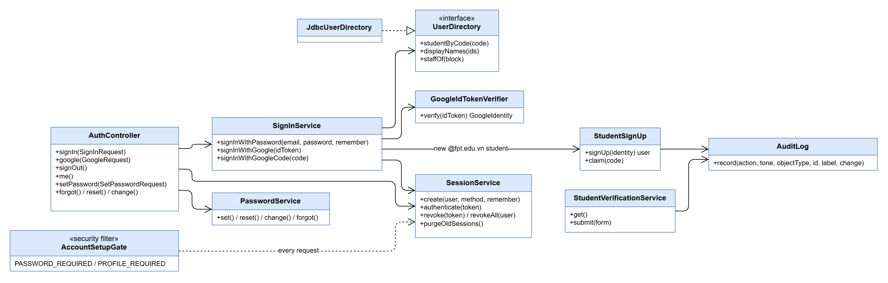

| Class | Responsibility |
|---|---|
| `AuthController` | Endpoints `/auth/sign-in`, `/auth/google`, `/auth/sign-out`, `/auth/me`, `/auth/password/*`. |
| `SignInService` | Password sign-in with lockout (5 failures, 15 minutes, counters in their own transaction) and Google sign-in by ID token (Android) or authorization code (web). |
| `GoogleIdTokenVerifier` | Checks the token's signature with Google's public keys, issuer, audience, expiry, `email_verified` and `hd = fpt.edu.vn`. |
| `StudentSignUp` | Creates a student account without a password for an unknown FPT address, or links an imported unused record whose code ends the address. |
| `SessionService` | Creates a 256-bit random token (only its SHA-256 stored), authenticates it on every request (sliding idle timeout), revokes one or all sessions, purges old ones nightly. |
| `PasswordService` | Set, reset (one-use 30-minute links), change and forgot; password rules. |
| `AccountSetupGate` | Until an account has a password and, for a student, a directory record, every other endpoint answers 403 `PASSWORD_REQUIRED` / `PROFILE_REQUIRED`. |
| `StudentVerificationService` | The student's sign-up form; the account becomes Pending verification. |
| `UserDirectory` / `JdbcUserDirectory` | Names, student profiles and staff of Blocks for the other features (they never read `auth_*` tables). |
| `AuditLog` | Writes `shared_audit_log` entries (who, what, object, old and new values). |

#### 3.3.2 Sequence Diagram: sign in with Google

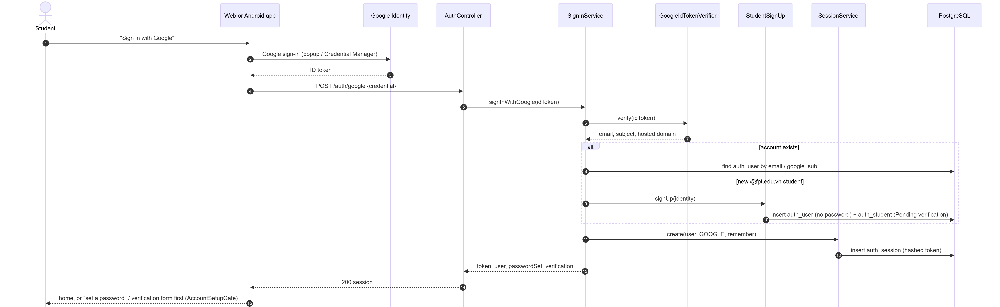

### 3.4 Applications and payments (APP, BIL)

Covers FR-APP-01 … FR-APP-05 and FR-BIL-01 … FR-BIL-03.

#### 3.4.1 Class Diagram

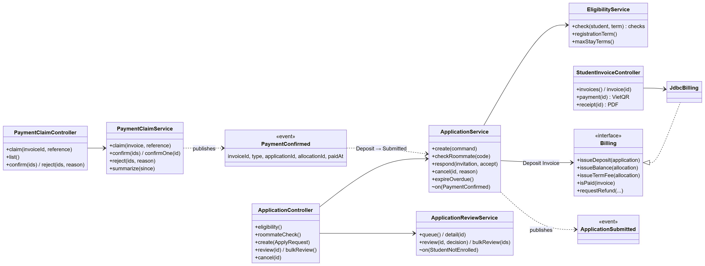

| Class | Responsibility |
|---|---|
| `ApplicationController` | Eligibility, roommate code check, create, review (one and bulk), cancel. |
| `ApplicationService` | Creates the Application with its Deposit Invoice in one transaction; roommate invitations and answers; cancellation; expiry job; listens to `PaymentConfirmed` (Deposit paid → Submitted, or Awaiting Roommate) and publishes `ApplicationSubmitted`. |
| `EligibilityService` | Runs the Term's enabled eligibility checks for a student (verified account, enrolled, gender, not a continuing resident …) and the *Gia hạn* maximum. |
| `ApplicationReviewService` | Review queue, approve or reject (note required); rejects live Applications when a student is not enrolled. |
| `Billing` / `JdbcBilling` | The billing interface other features call: issue Deposit, Balance and next-Term fee Invoices, check payment, refunds by rule. |
| `StudentInvoiceController` | The student's Invoices, the payment page (VietQR data, transfer content) and receipts. |
| `PaymentClaimController`, `PaymentClaimService` | "I have transferred" (claim with time left kept), the Managers' queue, bulk confirm (one Payment and one audit entry per Invoice) or reject with a reason; hourly summary. |
| `PaymentConfirmed` | Event read by APP (Application Submitted), ASG (door code release, Stay) and NTF (notification). |

#### 3.4.2 Sequence Diagram: apply, claim the Deposit, Manager confirms

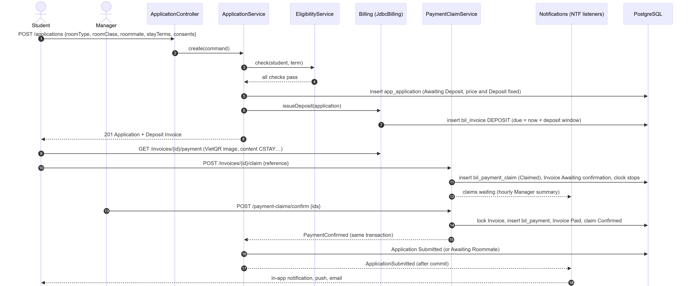

### 3.5 Assignment and residence (ASG)

Covers FR-ASG-01 … FR-ASG-06, FR-ASG-11 and FR-INV-04.

#### 3.5.1 Class Diagram

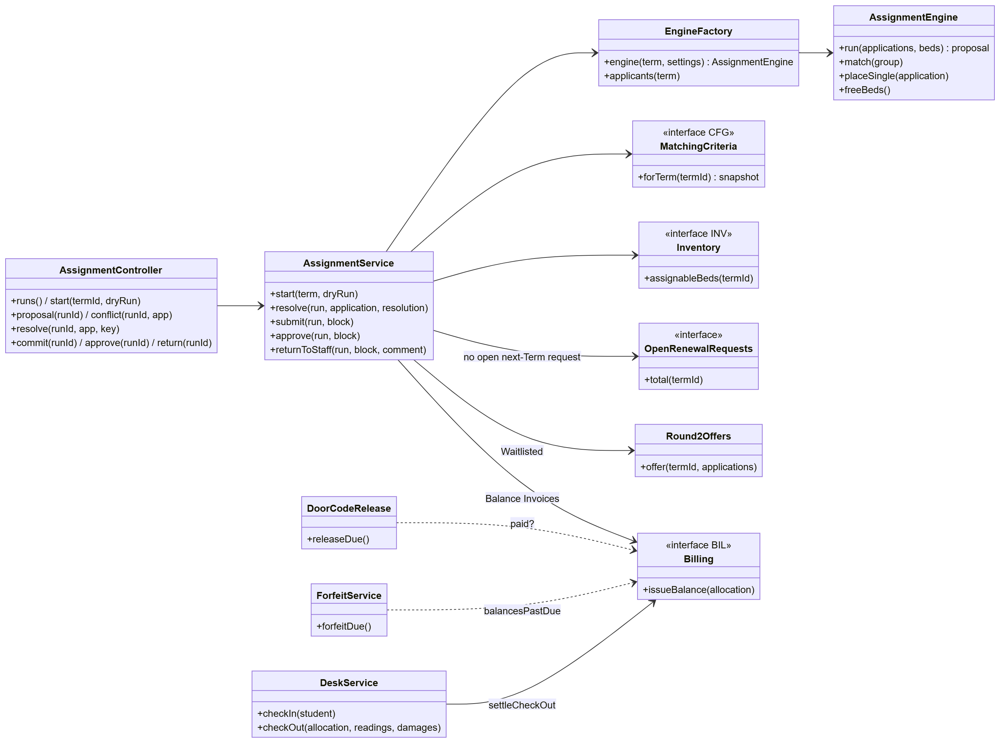

| Class | Responsibility |
|---|---|
| `AssignmentController`, `AssignmentService` | Start a dry or real run, list the proposal, resolve a conflict, approve a Block (commit: Allocations, Applications Allocated or Waitlisted, Balance Invoices, `AllocationCreated`, one transaction per Block). Refuses a real run while next-Term requests are open. |
| `EngineFactory` | Feeds the engine from the other features' interfaces: approved Applications, assignable Beds of the Term (`Inventory`), the Term's matching snapshot (`MatchingCriteria`), student attributes. |
| `AssignmentEngine` | Pure, deterministic placement (no database): pairs first, then each student into the free Bed with the best fit among Rooms of the requested Room Type and Class in a Block of their gender; conflicts `NO_BED`, `PARTNER_NOT_READY`, `NOT_ELIGIBLE`, `LOW_FIT`. Unit-tested alone. |
| `Round2Offers` | Offers freed Beds to Waitlisted students; accept or decline. |
| `DoorCodeRelease` | Job (15 min): releases the Room's code to paid students from the check-in start; the student becomes a resident. |
| `ForfeitService` | Job (5 min): forfeits Balances past their deadline with no claim and no approved late check-in. |
| `DeskService` | Check-in and check-out at the desk: hand-over items, meter reading, damage per furniture item, Utility Deposit settlement through `Billing`. |

#### 3.5.2 Sequence Diagram: assignment run and approval

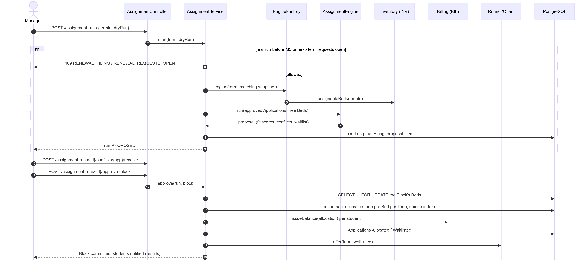

#### 3.5.3 Sequence Diagram: door code set, released and revealed

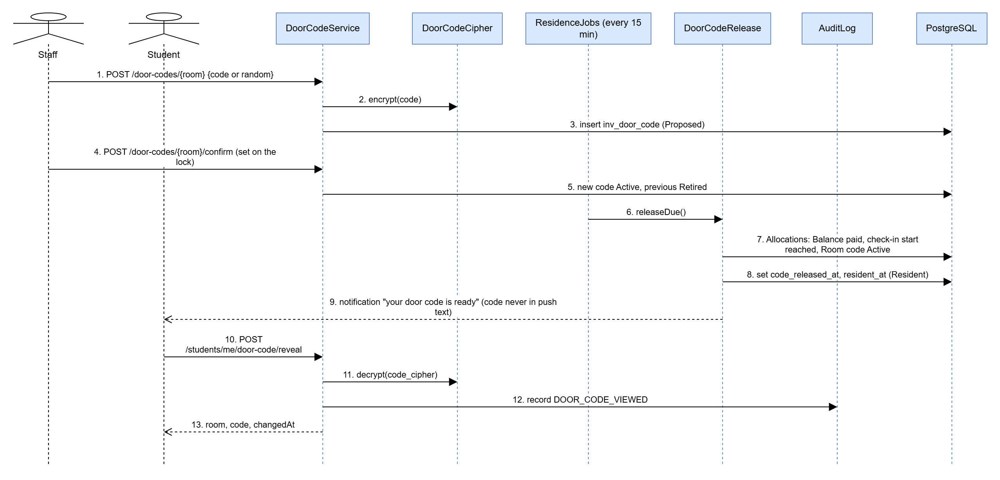

### 3.6 Term transition (ASG, REQ, AUTH)

Covers FR-ASG-07, FR-ASG-08, FR-ASG-10, FR-REQ-01 … FR-REQ-05 and FR-AUTH-08.

#### 3.6.1 Class Diagram

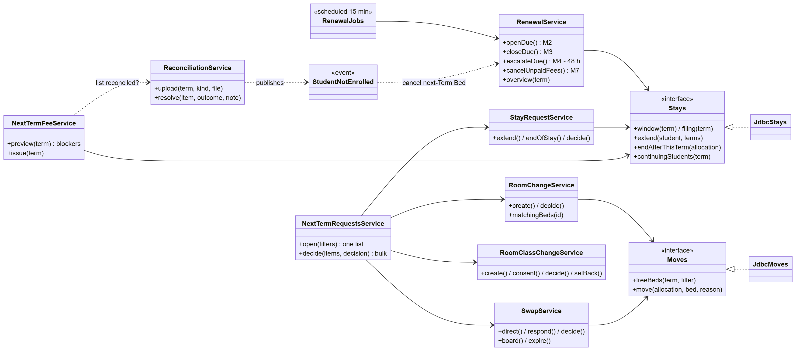

| Class | Responsibility |
|---|---|
| `RenewalJobs`, `RenewalService` | Job (15 min) running each milestone once: M2 creates the next-Term Allocations, M3 closes filing and releases Beds awaiting extension, before M4 alerts Managers, M7 cancels unpaid next-Term fees. |
| `Stays` / `JdbcStays` | Stays and next-Term Allocations: extend, end, cancel (with the fee settled once). |
| `Moves` / `JdbcMoves` | Free Beds of the next Term and the moves and swaps of next-Term Allocations, with Bed locks. |
| `NextTermRequestsService` | The requests window in one list for Staff and Managers; bulk decisions. |
| `RoomChangeService`, `SwapService`, `StayRequestService`, `RoomClassChangeService` | One service per request type: filing rules, consents, decisions and their effect on the next-Term Allocation or the Room's next-Term class. |
| `ReconciliationService` | Compares the enrolled or leavers list with the Term; groups 1–4; resolutions with a note; publishes `StudentNotEnrolled`. |
| `NextTermFeeService` | Preview with blockers, issue of the next-Term fees (one `TERM_FEE` per continuing resident). |

#### 3.6.2 Sequence Diagram: room change, decision and next-Term fees

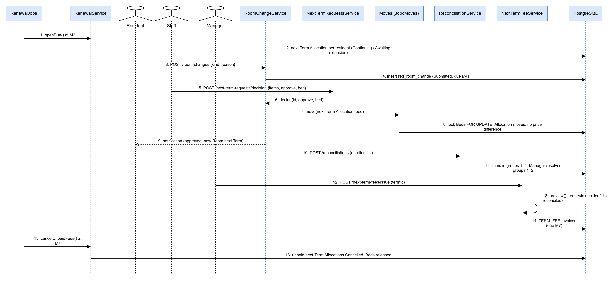

### 3.7 Maintenance, routing and time limits (MNT, REQ)

Covers FR-MNT-01, FR-MNT-02, FR-REQ-06 and FR-REQ-07.

#### 3.7.1 Class Diagram

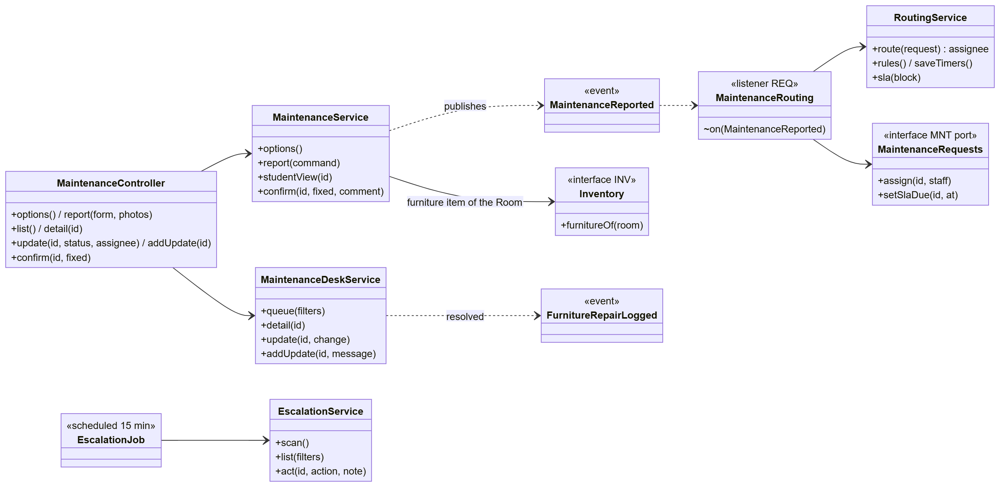

| Class | Responsibility |
|---|---|
| `MaintenanceController`, `MaintenanceService` | Report a request with photos and the furniture item; the student's list, confirm or reopen; publishes `MaintenanceReported`. |
| `MaintenanceDeskService` | Staff side: assign, plan, update, start, resolve, close; the state machine of section 3.1.7. |
| `MaintenanceRouting`, `RoutingService` | Listens to `MaintenanceReported`; chooses the assignee from the Block's routing rules (category first, then all, fallback when off duty) and sets the deadline from the urgent or normal time limit. |
| `MaintenanceRequests` | Interface through which REQ reads and assigns Maintenance Requests without reading `mnt_*` tables. |
| `EscalationJob`, `EscalationService` | Job (15 min): opens one escalation per overdue or unassigned request, closes it when back on track; the Manager's reassignment. |
| `FurnitureRepairLogged` | Event that adds a repair entry to the furniture item's history. |

#### 3.7.2 Sequence Diagram: report, routing and escalation

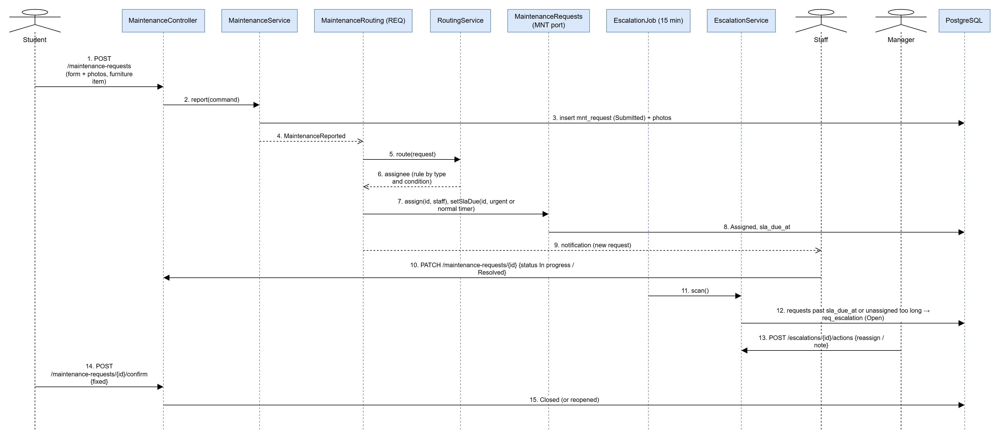

### 3.8 Utility billing and the Term wizard (BIL, CFG)

Covers FR-BIL-04, FR-BIL-05, FR-ASG-09, FR-CFG-04 and FR-CFG-05.

#### 3.8.1 Class Diagram

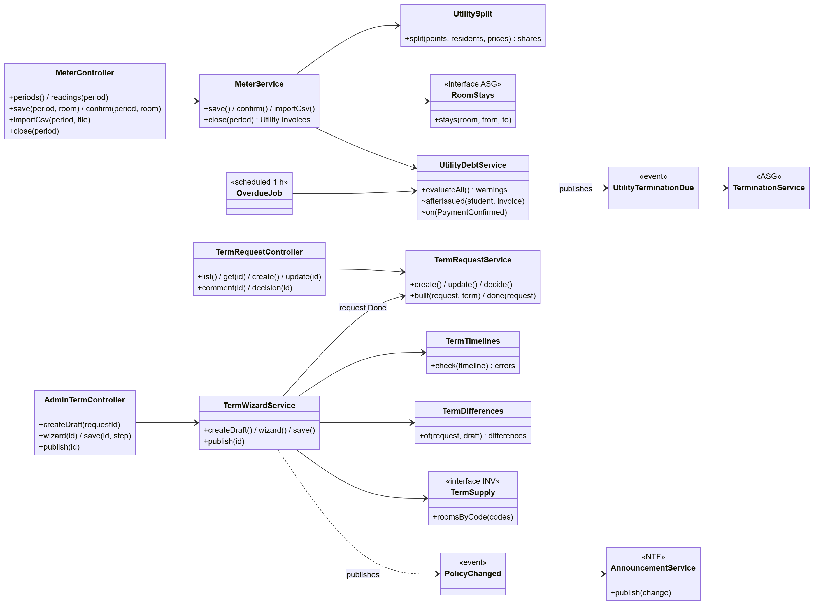

| Class | Responsibility |
|---|---|
| `MeterController`, `MeterService` | Meter periods per Block, readings entered or imported (CSV), checks (no going back, unusual jumps), closing the month. |
| `UtilitySplit` | Splits a Room's consumption between residents by the days each lived there between meter cuts (`RoomStays` from ASG); rounding. |
| `UtilityDebtService`, `OverdueJob` | Hourly: Overdue Invoices, warning 1, the final warning with the termination day, `UtilityTerminationDue`. |
| `TerminationService` | Notice with move-out date, cancel (Manager), Overdue past the date, end of the Allocations. |
| `TermRequestController`, `TermRequestService` | Managers' registration-period requests, comments and the Admin's answers. |
| `AdminTermController`, `TermWizardService` | The seven-step wizard saved as a Draft; publication fixes prices and rules and publishes `TermPublished`. |
| `TermTimelines`, `TermDifferences`, `TermSupply` | Milestone order checks; the differences from the Manager's request (each needs a reason); Beds offered per Room Type × Room Class × gender. |
| `PolicyChanged`, `AnnouncementService` | Change announcements with old and new values after money or policy changes. |

#### 3.8.2 Sequence Diagram: Utility Invoices and debt

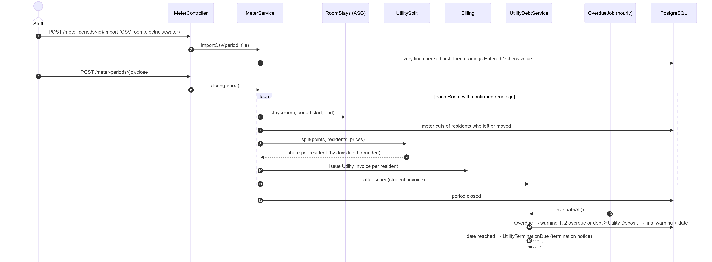

#### 3.8.3 Sequence Diagram: registration-period request and publication

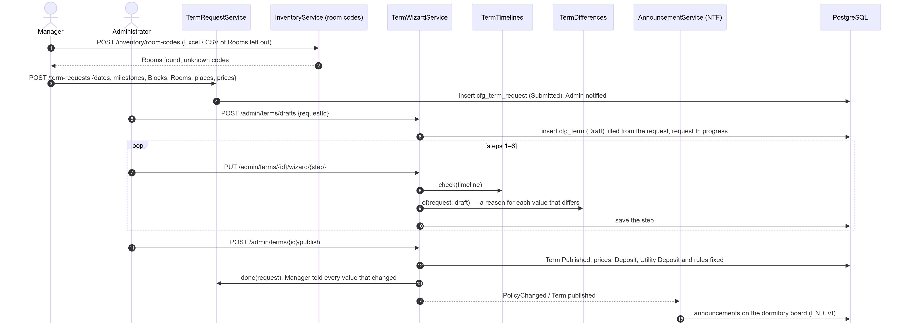
