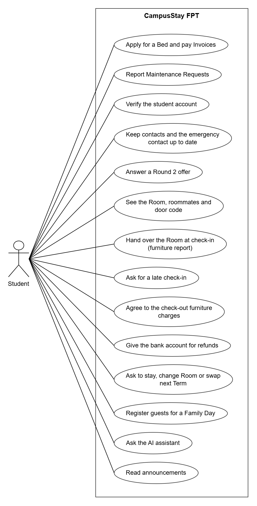
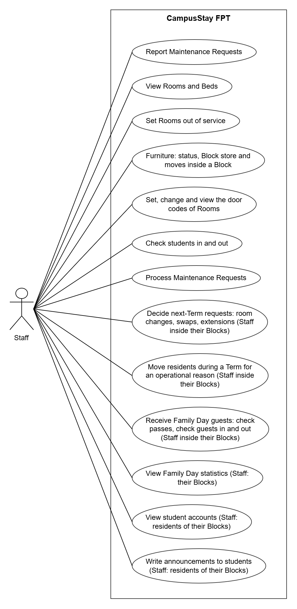
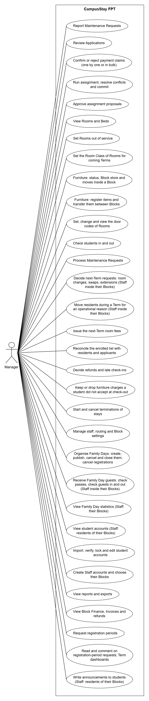
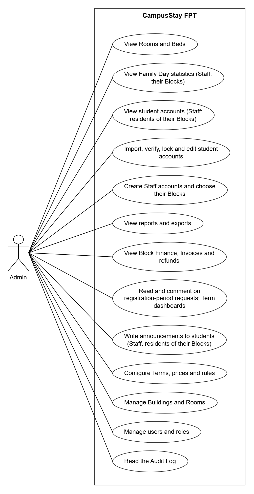
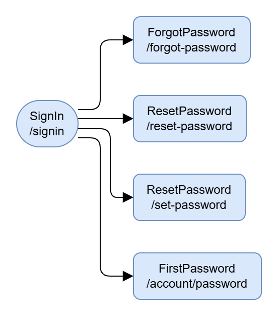
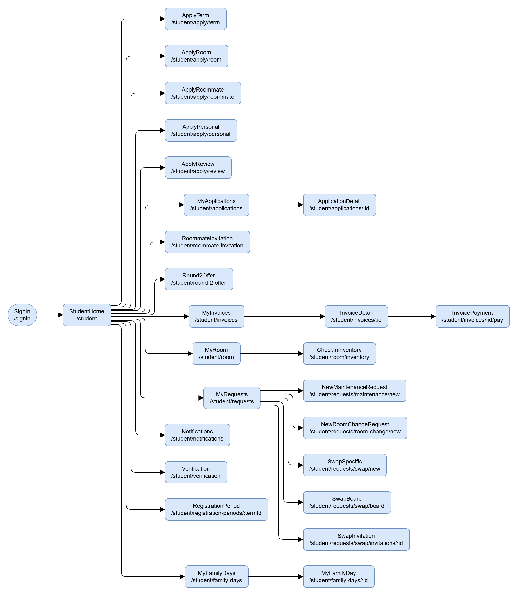
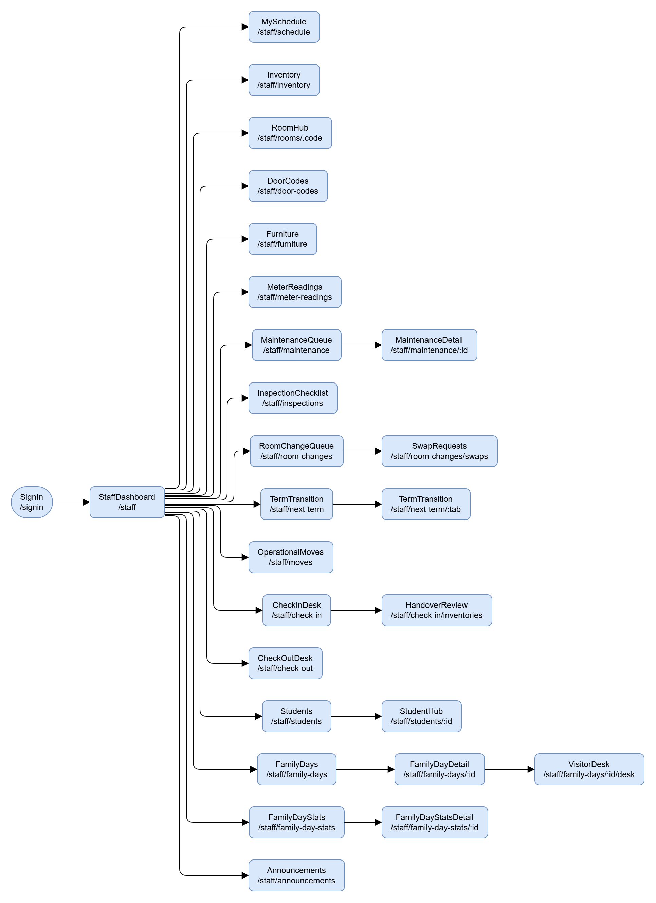
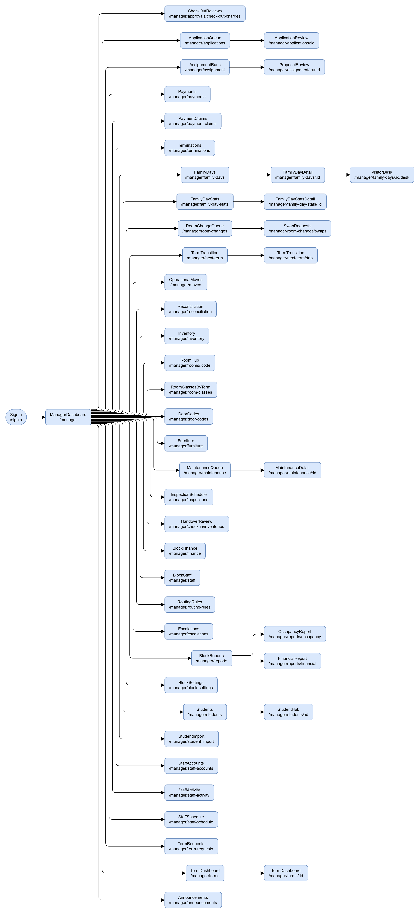
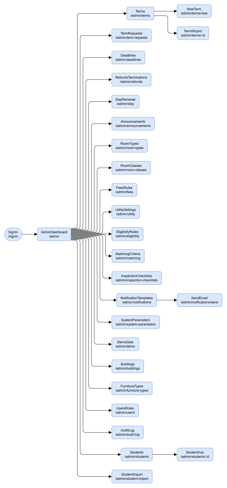
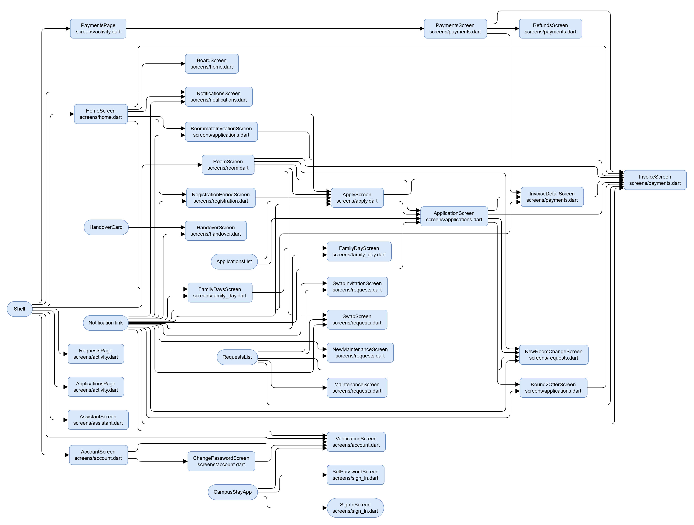

# II. Software Requirement Specification

## 1. Product Overview

CampusStay FPT runs the dormitory of FPT University's Tân Uyên campus: registration of students with roommate wishes, assignment of Beds by rule, payment by bank transfer, hand-over of the Room, the stay (maintenance, inspections, utilities, visitors), the move to the next Term and check-out. Report 1 gives the background, the vision and the 13 major features; this document specifies them as they are built.

**Parts of the system.**
- A **REST API** (Java 21, Spring Boot, PostgreSQL), 63 controllers and 353 endpoints under the base path `/api`, documented in OpenAPI (Swagger UI).
- A **web application** (React): a student portal, a Staff portal, a Manager portal, an Admin portal and the public sign-in pages: 133 routed pages.
- An **Android application** for students (Flutter): 30 screens, push notifications and links from notifications to screens.
- Scheduled **jobs** and **event listeners** that run the work no screen starts (section 3.1.4).

**Operating environment.** The API and PostgreSQL 17 run in Docker on an Azure virtual machine behind Caddy (HTTPS); the web application is a static build on Vercel; the Android app runs on Android 8.0 and later. See Report 4 for the architecture.

**Constraints and assumptions.**
- Every business value (prices, percentages, deadlines, timers, rules) is a setting that the Administrator changes; the base values in 5.1 are assumptions, because the rules of the dormitory were not fixed when the system was built.
- Payments are made by bank transfer to one account and confirmed by a Manager against the bank statement; there is no bank connection.
- Enrolled students come from lists the Managers upload; there is no link with the school's student information system.
- All texts the system produces exist in Vietnamese and in English.

## 2. User Requirements

### 2.1 Actors

@include _r3-actors.md

External actors and systems: **Google** (sign-in), **Firebase Cloud Messaging** (push), an **SMTP server** (emails), the public **VietQR image service** (the QR code of an Invoice), an **Ollama server** (the AI assistant), the **school** (the list of enrolled students, uploaded by a Manager), the **bank** (students transfer money to its account), **Family Day guests** (carry a pass), and the **system** itself (the scheduled jobs). Report 4 shows them in the context diagram.

### 2.2 Use Cases

#### 2.2.1 Diagram(s)

#### 2.2.2 Descriptions

The 37 permissions of the system, and the roles that hold them, are listed in section 3.1.3. The workflows that need more than one screen are described below, one use case each; each has a sequence diagram in Report 4.

@include _r3-usecases.md

## 3. Functional Requirements

### 3.1 System Functional Overview

#### 3.1.1 Screens Flow

Each portal is a tree: the home page of the portal, then its pages, then the pages those open. The student mobile app has its own flow.

#### 3.1.2 Screen Descriptions

Every routed page of the web application (the not-found page and a developer page are left out) and every screen of the mobile app. *Fields* counts the input components of the page and *Transactions* its actions that write data; they are the numbers used to rate the pages in the Project Tracking workbook.

@include _r3-screens.md

#### 3.1.3 Screen Authorization

A portal is reserved for one role: the server checks the role of every call and, inside the role, the permission and the Block (a Staff member works only in their Blocks; a student sees only their own records, and asking for someone else's record gives 404).

@include _r3-authz.md

**Permissions and the roles that hold them**

@include _r3-permissions.md

#### 3.1.4 Non-Screen Functions

@include _r3-nonscreen.md

#### 3.1.5 Entity Relationship Diagram

The data model has 118 tables and 33 views, created by 100 migrations. The diagrams show the tables of each feature (Chen notation); tables of other features appear as dashed boxes. Every foreign key is drawn. Report 4 describes the tables in detail.

@include _r3-erd.md

@include _r3-features.md

## 4. Non-Functional Requirements

### 4.1 External Interfaces

**User interfaces.** The web application is responsive: the student portal works on a phone and a tablet, and the back-office portals on a desktop. Every screen is in Vietnamese or English according to the user's language setting. The Android app has a phone-first layout and the same texts.

**Software interfaces.**

| System | Used for | Protocol |
|---|---|---|
| Google Sign-In | verify the identity of a student or a code exchanged by the web app (domain `fpt.edu.vn`) | OAuth 2.0 / OpenID Connect, JWK set `www.googleapis.com/oauth2/v3/certs` |
| Firebase Cloud Messaging | push notifications to Android | HTTPS (FCM v1) |
| SMTP server | emails (outbox with retries) | SMTP, timeouts of 10 seconds |
| VietQR image service (`qr.sepay.vn/img`) | the QR code of an Invoice's transfer | HTTPS image URL, no key |
| Ollama server | the AI assistant | HTTPS, timeout 90 seconds |

**Communication interfaces.** Web and mobile call the API over HTTPS with JSON; ids are strings; errors have a stable code and a message in the caller's language. The API is described by OpenAPI at `/api/v3/api-docs` and by Swagger UI; a Postman collection of every endpoint is generated from it.

### 4.2 Quality Attributes

#### 4.2.1 Usability

- Every text of the product exists in Vietnamese and English; the build fails when a web text or an API message has no Vietnamese version (`i18n:check`, `MessagesTest`).
- Dates, numbers and money are formatted from one source on the web and in the app; money is in VND.
- Destructive actions ask for confirmation in a native dialog; tooltips explain the important figures and actions.
- The page of an Application tells the student the next step (what to pay, what to do before which date).

#### 4.2.2 Reliability

- The database schema belongs to Flyway migrations; an applied migration is never edited, and a migration must pass the integration tests before it can be deployed.
- Rules that must never break are database constraints: a Bed is never given twice in a Term; the money of an issued Invoice never changes, and Paid or Void never goes back.
- Side effects between features are domain events; the ones that must commit with the change run in the same transaction, the others after commit.
- Emails go through an outbox: up to 5 attempts with growing delays; a mail server that does not answer cannot block a request.
- The API shuts down gracefully, reports its readiness (`/api/actuator/health`) and restarts by itself; a database backup is taken before each deployment.

#### 4.2.3 Performance

- The API uses virtual threads and a pool of 10 database connections; lists are paged (`items` and `total`).
- Uploads are limited to 5 MB a file and 30 MB a request.
- The web application loads each page on its first visit.
- The scheduled jobs run every 5 minutes to every hour (section 3.1.4) and handle the work in batches.

#### 4.2.4 Security

- Sessions: idle timeout of 12 hours (30 days with "remember me"), at most 30 days after sign-in; the session token is stored hashed.
- An account is locked for 15 minutes after 5 wrong passwords; sign-in requests are also limited per client; at most 3 password-reset requests an hour; reset links are valid for 30 minutes and invitation links for 72 hours.
- Google sign-in accepts only `@fpt.edu.vn` accounts; fictional back-office accounts cannot use it.
- Roles and permissions are checked on the server for every endpoint, then the scope (Block, own records).
- Door codes are stored encrypted (AES-256) and every viewing by Staff is audited; the assistant never reads a door code.
- File links are signed and valid for 30 minutes; a bearer token is never put in an image address.
- Staff changes outside their shift or kind of work need a confirmation and are recorded; every change made by Staff, Managers and Admins and every export is written to the audit log.
- Secrets are never in the repository; production settings are on the server.

#### 4.2.5 Maintainability

- The backend is layered (controller → service → repository); `LayeringTest` fails the build when a controller uses a repository or an entity, and a table is written only by the feature that owns its prefix.
- 380 test ids cover the features: 46 backend unit tests, 343 integration tests, 7 web tests and 30 mobile tests (Report 5).
- Every business value is a setting; every document is generated from the code (`tools/docs`).

## 5. Requirement Appendix

### 5.1 Business Rules

The rules are enforced by the services (the error codes in section 5.3 name each refusal), by database constraints, and by the settings below.

@include _r3-rules.md

**Status columns.** A row of these tables moves through the listed states; the transitions that the code writes are drawn in the 46 state diagrams of Report 4 (folder `08_State_Machine`).

@include _r3-states.md

### 5.2 Common Requirements

- **Identifiers.** Ids are `BIGINT` in the database and **strings** in JSON. Applications, Invoices and runs are addressed by their code (`APP-…`, `INV-…`, `RUN-n`).
- **Money.** Whole VND as integers; rates as decimal fractions; never floating point. Prices are fixed per Term when it is published.
- **Time.** Instants in UTC; calendar days as `YYYY-MM-DD`; "today" is the campus day in Asia/Ho_Chi_Minh.
- **Language.** The caller's language (header `Accept-Language`, and the account's language) selects error messages, notifications and emails.
- **Errors.** A refusal carries a stable `UPPER_SNAKE` code and a message written for the user; field errors name the field.
- **Lists.** Paged, `{ items, total }`; lists can be exported to CSV and every export is audited.
- **Audit.** Every state change by Staff, Managers or Admins, and every export, is recorded with who, what and when.
- **Concurrency.** Rules are checked first and the database constraint decides a race; Beds are locked when students are moved; aggregates carry a version.

### 5.3 Application Messages List

Every message of an API error (code, English, Vietnamese) and the class that raises it. The text of a message is also its key for the translation; `MessagesTest` checks that none is missing.

@include _r3-messages.md

### 5.4 Other Requirements

**Configuration the deployment needs.** The server reads its settings from environment variables (`infra/prod/.env.example` lists them); a blank value switches the matching function off.

| Setting | Effect |
|---|---|
| `GOOGLE_CLIENT_ID`, `GOOGLE_CLIENT_SECRET` | Google sign-in (blank: off; blank secret: only Android ID tokens) |
| `PAYMENT_BANK_NAME`, `PAYMENT_BANK_CODE`, `PAYMENT_ACCOUNT_NUMBER`, `PAYMENT_ACCOUNT_NAME` | the account students transfer to and the VietQR image (blank: no image) |
| `SPRING_MAIL_*`, `MAIL_FROM`, `MAIL_REDIRECT_TO` | emails; on a demo server every email goes to one mailbox |
| `FIREBASE_CREDENTIALS_FILE` | push notifications (blank: off) |
| `ASSISTANT_BASE_URL`, `ASSISTANT_MODEL`, `ASSISTANT_API_KEY` | the AI assistant (blank: off) |
| `DOOR_CODE_KEY` | the key that encrypts door codes (blank: door codes off) |
| `FILES_DIR`, `FILES_LINK_SECRET` | where uploads are kept; the key that signs file links |
| `CORS_ALLOWED_ORIGINS`, `WEB_BASE_URL` | the web origins allowed to call the API; the base of emailed links |
| `DEMO_TOOLS` | the demo reset tool (never on a real server) |
