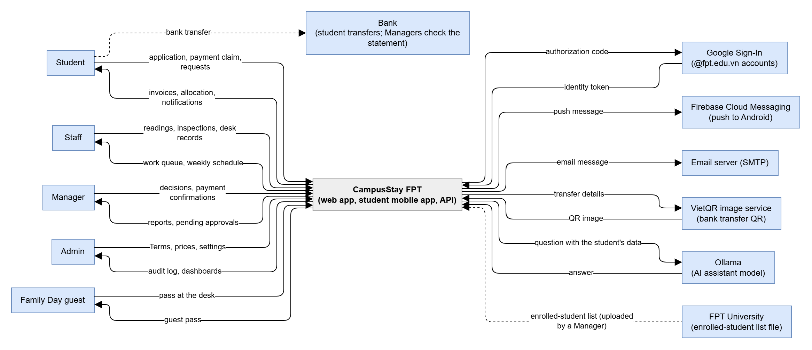
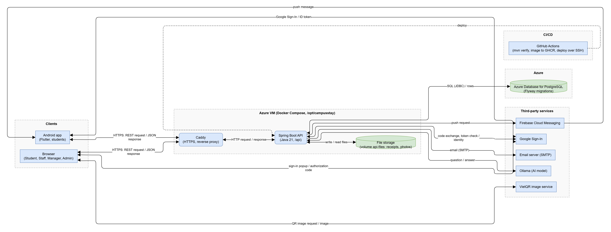
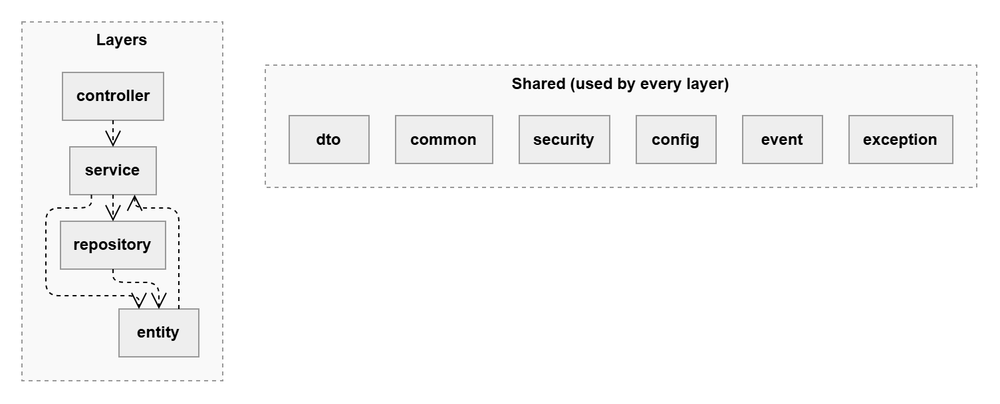

# II. Software Design Document

Every diagram of this document is a draw.io file in `docs/Diagrams` (one folder per type) with its PNG beside it, generated or checked against the code by `tools/docs/diagrams/build.mjs`.

## 1. System Design

### 1.1 System Architecture

**Components.**
- **Web application** (React, built by Vite): one application with five portals (public, Student, Staff, Manager, Admin). Vercel serves the static build and builds a preview for every pull request.
- **Android application** (Flutter): the student features of the web, push notifications from Firebase Cloud Messaging, and links from a notification to its screen.
- **REST API** (Spring Boot, Java 21), in a Docker container on an Azure virtual machine, behind **Caddy** (HTTPS). The base path is `/api`; OpenAPI and Swagger UI describe it.
- **PostgreSQL 17**: Azure Database for PostgreSQL in production (a container in the local stack); Flyway applies the migrations when the API starts.
- **Scheduled jobs and listeners** inside the API (Report 3, section 3.1.4).
- **External services**: Google Sign-In, Firebase Cloud Messaging, an SMTP server, the VietQR image service and an Ollama server for the AI assistant.

**Delivery.** A merge into `main` runs `mvn verify` and the web checks; the backend workflow builds the image, pushes it to GHCR, deploys it to the VM over SSH after a database backup, and waits for the readiness check; Vercel builds the web.

**Technologies** (from `backend/pom.xml`, `web/package.json` and `mobile/pubspec.yaml`):

@include _r4-tech.md

**Design decisions.**
- **Layers.** Controller → service → repository or entity; controllers never touch the database (checked by `LayeringTest`).
- **Features own their tables.** A table is written only by the services of the feature that owns its prefix (`bil_*` by billing). Another feature asks through that feature's port (an interface such as `Billing`, `Inventory`, `Moves`) or listens to its events. Reports read only the `rpt_v_*` views.
- **Domain events** carry side effects between features: in the same transaction when they must commit together, after commit for notifications and pushes.
- **SQL with `JdbcClient`** for most features, JPA entities for accounts, sessions, Terms and the catalogue (the class diagram of section 3.1).
- **Configuration over code**: every business value is a setting (`cfg_parameter`, the Term wizard); prices are fixed per Term when it is published.
- **Data rules in the database**: constraints keep a Bed from being given twice in a Term and the money of an issued Invoice from changing.

### 1.2 Package Diagram

The backend is `vn.fpt.campusstay`. The four layers carry the dependencies: `controller` (63 REST controllers, one folder per feature), `service` (one folder per feature: `auth`, `setting`, `inventory`, `application`, `assignment`, `billing`, `request`, `maintenance`, `notification`, `report`, `visitor`, `assistant`), `repository` (SQL stores per feature, JPA repositories) and `entity`. The shared packages are used by every layer: `common` (audit log, exports, files, search, demo data, i18n), `dto`, `event` (the domain events), `exception` (`ApiException` and the error codes), `config` and `security` (roles, permissions, sessions, the shift gate).

One dependency goes against the layers: `TermEntity.apply` takes `AdminTermService.TermValues`, a record declared in a service. It is drawn as the `entity → service` edge.

The web application is organised by portal (`web/src/pages/<portal>`), with shared components, the API client and the translations in `web/src/components`, `api`, `lib` and `i18n`. The mobile app keeps its screens in `mobile/lib/screens`.

## 2. Database Design

The schema is created by 100 Flyway migrations (V1–V103): 118 tables and 33 views. Tables are named with the prefix of the feature that owns them. Below, first the ERD of the whole system with its 27 main entities and their relationships (Chen notation, keys only; the columns recording who decided or created a row are left to the detailed ERDs). Then the ERD of each feature, with up to eight attributes per entity, every foreign key as a relationship and the tables of other features dashed. Last, every table with its columns, keys and constraints, read from the migrated database.

@include _r4-erd.md

@include _r4-db.md

## 3. Detailed Design

One section per feature: its classes (the ports it offers to other features), the sequence diagrams of its workflows, the state diagrams of its status columns (only the transitions the code writes; the states a CHECK allows but no code sets are named), and its endpoints.

@include _r4-detailed.md
