### 3.1 Accounts, staff and audit (AUTH)

#### 3.1.1 Class Diagram

The JPA entities (the rest of the data is read and written with SQL through the stores of each feature):

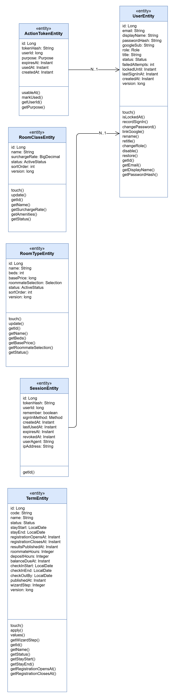

The ports this feature declares (interfaces) and the classes that implement them; other features call it only through these.

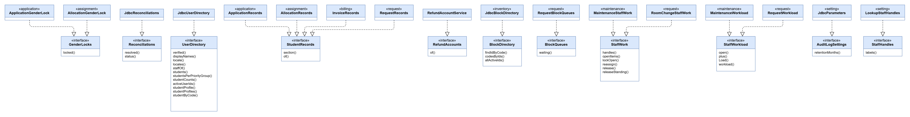

#### 3.1.2 Sequence Diagrams

UC-01 Sign in with Google or password.

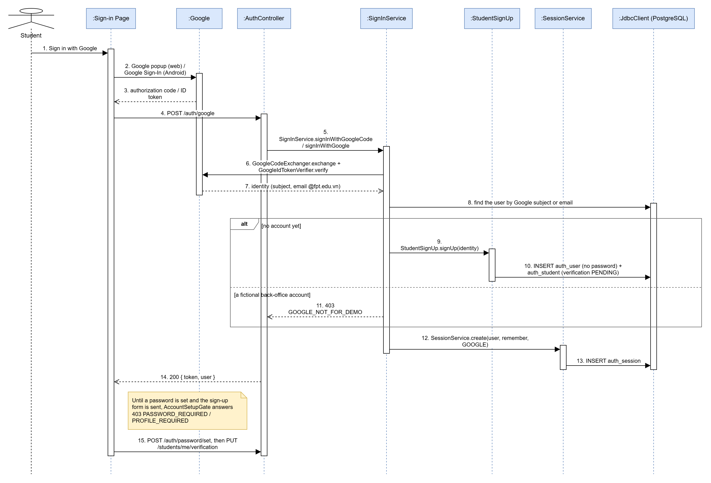

UC-17 Reconcile enrollment.

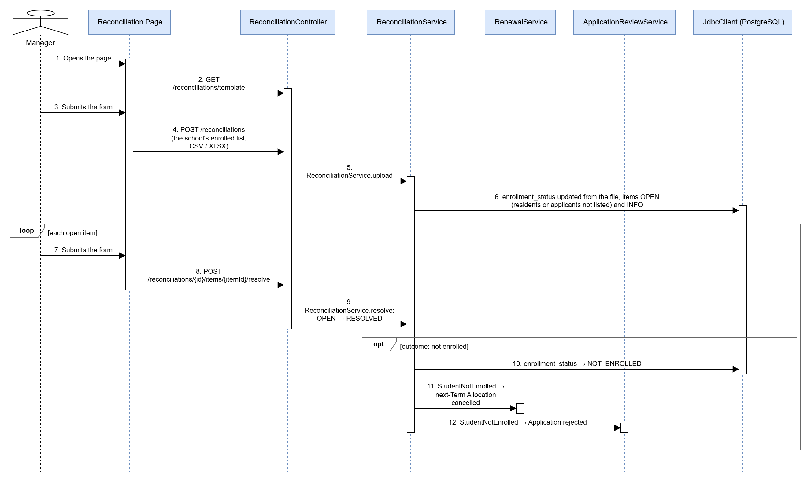

UC-21 Work within a shift.

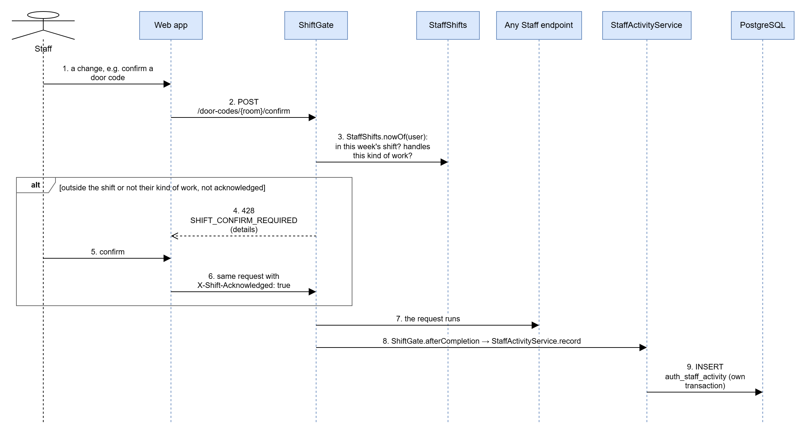

#### 3.1.3 State Diagrams

State machine: auth_reconciliation_item.status.

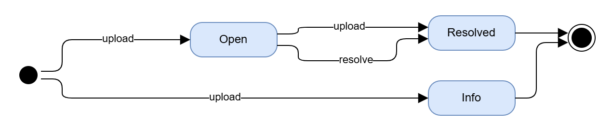

State machine: auth_student.enrollment_status.

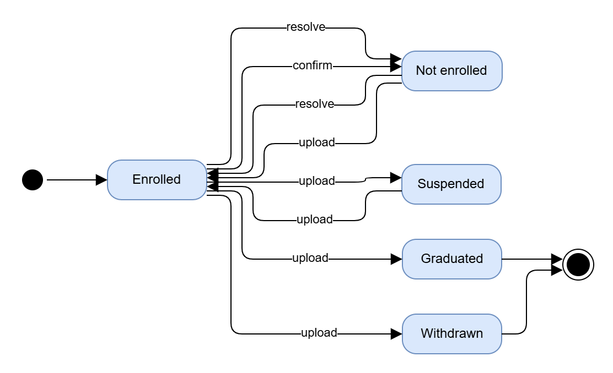

State machine: auth_student_import.status.

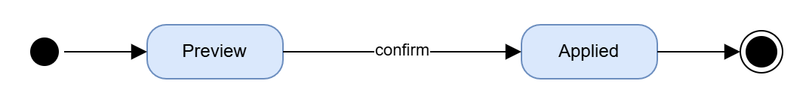

State machine: auth_user.status.

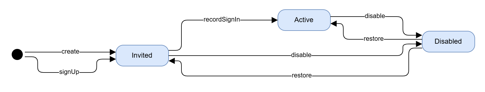

#### 3.1.4 API

61 endpoints (request and error details in Report 3).

| Method | Path | Access | Controller |
|---|---|---|---|
| GET | `/admin/users` | ADMIN | AdminUserController |
| POST | `/admin/users` | ADMIN | AdminUserController |
| PUT | `/admin/users/{id}` | ADMIN | AdminUserController |
| GET | `/admin/permissions` | ADMIN | AdminUserController |
| GET | `/admin/audit-log` | ADMIN | AdminUserController |
| POST | `/auth/sign-in` | public | AuthController |
| POST | `/auth/google` | public | AuthController |
| POST | `/auth/sign-out` | signed in | AuthController |
| GET | `/auth/me` | signed in | AuthController |
| PUT | `/auth/me/locale` | signed in | AuthController |
| POST | `/auth/password/forgot` | public | AuthController |
| POST | `/auth/password/reset` | public | AuthController |
| POST | `/auth/password/set` | signed in | AuthController |
| POST | `/auth/password/change` | signed in | AuthController |
| GET | `/block-staff` | signed in | BlockStaffController |
| GET | `/block-staff/me` | signed in | BlockStaffController |
| PUT | `/block-staff/{id}` | signed in | BlockStaffController |
| GET | `/block-staff/{id}/work` | signed in | BlockStaffController |
| POST | `/block-staff/{id}/work/reassign` | signed in | BlockStaffController |
| PUT | `/block-staff/{id}/shifts` | signed in | BlockStaffController |
| GET | `/week-schedule` | signed in | BlockStaffController |
| GET | `/week-schedule/plan` | signed in | BlockStaffController |
| PUT | `/week-schedule/plan/{staffId}` | signed in | BlockStaffController |
| DELETE | `/week-schedule/plan/{staffId}` | signed in | BlockStaffController |
| GET | `/week-schedule/me` | signed in | BlockStaffController |
| POST | `/week-schedule/send` | signed in | BlockStaffController |
| GET | `/staff-activity` | signed in | BlockStaffController |
| POST | `/staff-account-requests` | signed in | BlockStaffController |
| GET | `/reconciliations` | signed in | ReconciliationController |
| GET | `/reconciliations/template` | signed in | ReconciliationController |
| POST | `/reconciliations` | signed in | ReconciliationController |
| GET | `/reconciliations/{id}` | signed in | ReconciliationController |
| POST | `/reconciliations/{id}/items/{itemId}/resolve` | signed in | ReconciliationController |
| GET | `/students/me/refund-account` | STUDENT | RefundAccountController |
| PUT | `/students/me/refund-account` | STUDENT | RefundAccountController |
| GET | `/banks` | signed in | RefundAccountController |
| GET | `/staff-accounts` | signed in | StaffAccountController |
| POST | `/staff-accounts` | signed in | StaffAccountController |
| PUT | `/staff-accounts/{id}` | signed in | StaffAccountController |
| POST | `/staff-accounts/{id}/invitation` | signed in | StaffAccountController |
| GET | `/student-accounts` | signed in | StudentAccountController |
| GET | `/student-accounts/{id}` | signed in | StudentAccountController |
| PUT | `/student-accounts/{id}` | signed in | StudentAccountController |
| POST | `/student-accounts/{id}/verify` | signed in | StudentAccountController |
| POST | `/student-accounts/{id}/reject` | signed in | StudentAccountController |
| POST | `/student-accounts/{id}/lock` | signed in | StudentAccountController |
| POST | `/student-accounts/{id}/unlock` | signed in | StudentAccountController |
| GET | `/students/me/contacts` | STUDENT | StudentContactController |
| PUT | `/students/me/contacts` | STUDENT | StudentContactController |
| POST | `/students/me/contacts/emergency` | STUDENT | StudentContactController |
| PUT | `/students/me/contacts/emergency/{id}` | STUDENT | StudentContactController |
| POST | `/students/me/contacts/emergency/{id}/primary` | STUDENT | StudentContactController |
| DELETE | `/students/me/contacts/emergency/{id}` | STUDENT | StudentContactController |
| GET | `/student-imports` | signed in | StudentImportController |
| GET | `/student-imports/template` | signed in | StudentImportController |
| POST | `/student-imports` | signed in | StudentImportController |
| GET | `/student-imports/{id}` | signed in | StudentImportController |
| POST | `/student-imports/{id}/confirm` | signed in | StudentImportController |
| GET | `/students/me/verification` | STUDENT | StudentVerificationController |
| PUT | `/students/me/verification` | STUDENT | StudentVerificationController |
| GET | `/files/{id}` | signed in | FileLinkController |

### 3.2 Terms and settings (CFG)

#### 3.2.1 Class Diagram

The ports this feature declares (interfaces) and the classes that implement them; other features call it only through these.

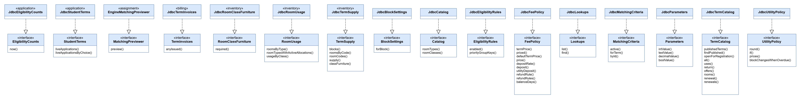

#### 3.2.2 Sequence Diagrams

UC-13 Open a registration period.

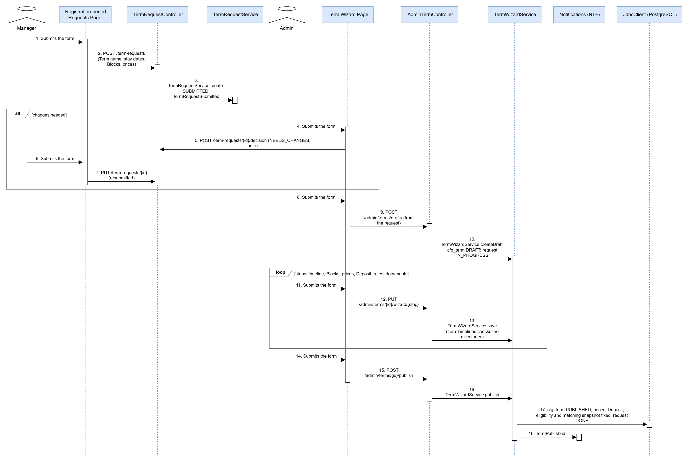

#### 3.2.3 State Diagrams

State machine: cfg_room_class.status.

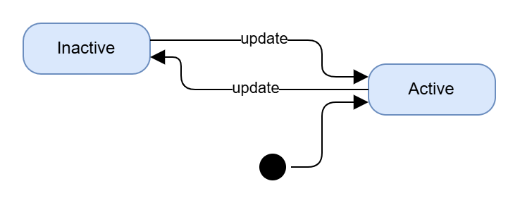

State machine: cfg_room_type.status.

State machine: cfg_term.status. Values allowed by the database but not set by the code: CLOSED.

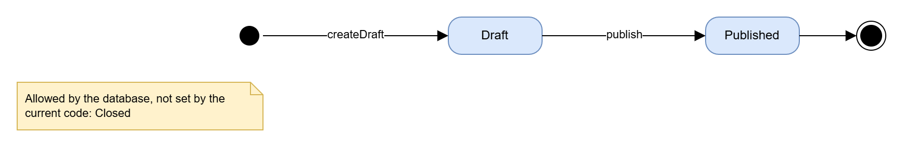

State machine: cfg_term_request.status.

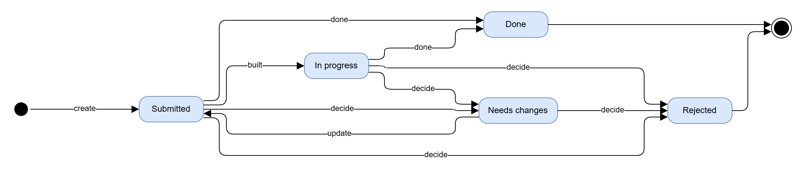

#### 3.2.4 API

40 endpoints (request and error details in Report 3).

| Method | Path | Access | Controller |
|---|---|---|---|
| GET | `/admin/room-types` | ADMIN | AdminCatalogController |
| POST | `/admin/room-types` | ADMIN | AdminCatalogController |
| PUT | `/admin/room-types/{id}` | ADMIN | AdminCatalogController |
| GET | `/admin/room-classes` | ADMIN | AdminCatalogController |
| POST | `/admin/room-classes` | ADMIN | AdminCatalogController |
| PUT | `/admin/room-classes/{id}` | ADMIN | AdminCatalogController |
| GET | `/admin/settings/{group}` | ADMIN | AdminPolicyController |
| PUT | `/admin/settings/{group}` | ADMIN | AdminPolicyController |
| GET | `/admin/utility` | ADMIN | AdminPolicyController |
| PUT | `/admin/utility` | ADMIN | AdminPolicyController |
| GET | `/admin/fees` | ADMIN | AdminPolicyController |
| PUT | `/admin/fees` | ADMIN | AdminPolicyController |
| GET | `/admin/eligibility` | ADMIN | AdminPolicyController |
| PUT | `/admin/eligibility` | ADMIN | AdminPolicyController |
| GET | `/admin/matching` | ADMIN | AdminPolicyController |
| PUT | `/admin/matching` | ADMIN | AdminPolicyController |
| POST | `/admin/matching/preview` | ADMIN | AdminPolicyController |
| GET | `/admin/system-parameters` | ADMIN | AdminPolicyController |
| PUT | `/admin/system-parameters` | ADMIN | AdminPolicyController |
| GET | `/admin/terms` | ADMIN | AdminTermController |
| POST | `/admin/terms/drafts` | ADMIN | AdminTermController |
| GET | `/admin/terms/{id}/wizard` | ADMIN | AdminTermController |
| PUT | `/admin/terms/{id}/wizard/{step}` | ADMIN | AdminTermController |
| POST | `/admin/terms/{id}/publish` | ADMIN | AdminTermController |
| GET | `/block-settings` | signed in | BlockSettingsController |
| PUT | `/block-settings` | signed in | BlockSettingsController |
| GET | `/catalog` | signed in | CatalogController |
| GET | `/admin/demo` | ADMIN | DemoController |
| GET | `/admin/demo/files/{kind}` | ADMIN | DemoController |
| POST | `/admin/demo/reset` | ADMIN | DemoController |
| GET | `/registration-periods/current` | signed in | RegistrationPeriodController |
| GET | `/registration-periods/{termId}` | signed in | RegistrationPeriodController |
| GET | `/terms` | signed in | TermController |
| GET | `/term-requests` | signed in | TermRequestController |
| GET | `/term-requests/defaults` | signed in | TermRequestController |
| GET | `/term-requests/{id}` | signed in | TermRequestController |
| POST | `/term-requests` | signed in | TermRequestController |
| PUT | `/term-requests/{id}` | signed in | TermRequestController |
| POST | `/term-requests/{id}/comments` | signed in | TermRequestController |
| POST | `/term-requests/{id}/decision` | signed in | TermRequestController |

### 3.3 Inventory (INV)

#### 3.3.1 Class Diagram

The ports this feature declares (interfaces) and the classes that implement them; other features call it only through these.

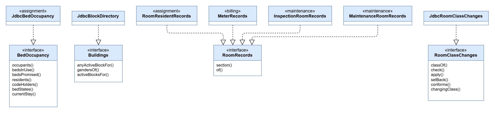

#### 3.3.2 Sequence Diagrams

UC-08 Set and release door codes.

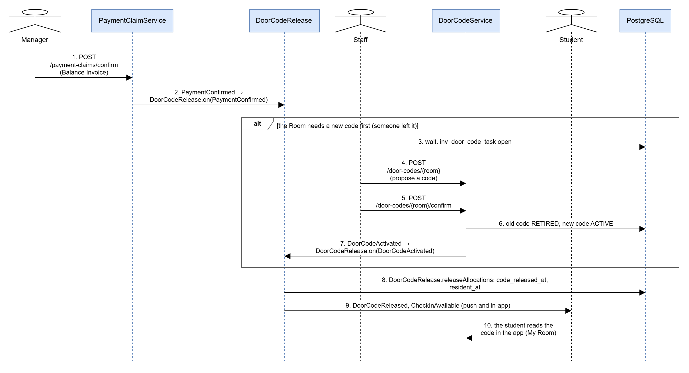

#### 3.3.3 State Diagrams

State machine: inv_bed.status. Values allowed by the database but not set by the code: OUT_OF_SERVICE.

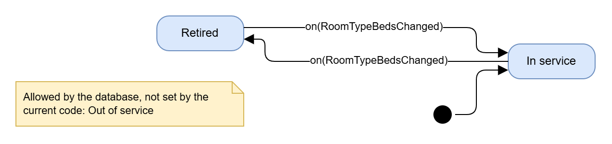

State machine: inv_building.status.

State machine: inv_door_code.status.

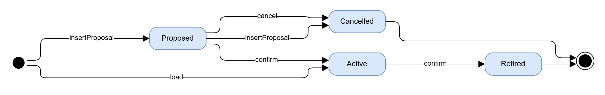

State machine: inv_furniture_item.status.

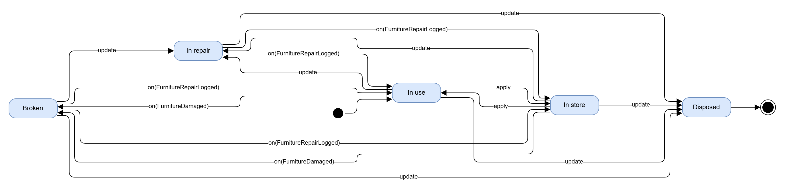

State machine: inv_furniture_move.status.

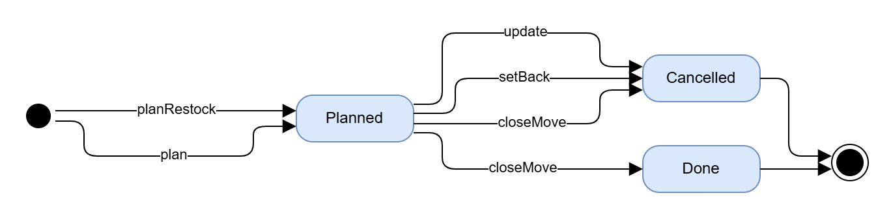

State machine: inv_furniture_type.status.

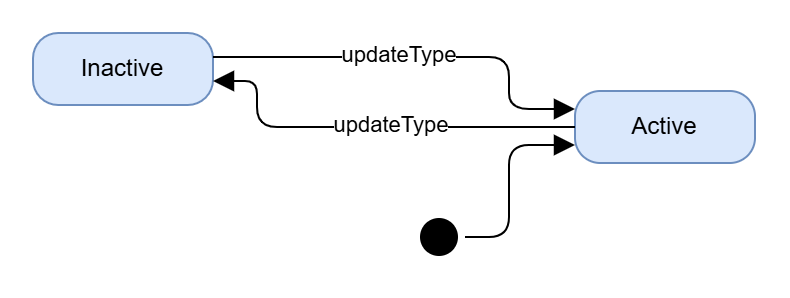

State machine: inv_room.status. Values allowed by the database but not set by the code: RETIRED.

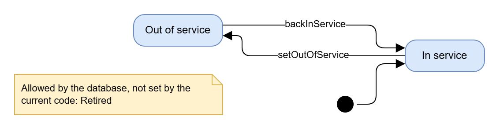

#### 3.3.4 API

40 endpoints (request and error details in Report 3).

| Method | Path | Access | Controller |
|---|---|---|---|
| GET | `/admin/buildings` | ADMIN | AdminBuildingController |
| POST | `/admin/buildings` | ADMIN | AdminBuildingController |
| PUT | `/admin/buildings/{id}` | ADMIN | AdminBuildingController |
| POST | `/admin/buildings/{id}/rooms/bulk` | ADMIN | AdminBuildingController |
| GET | `/admin/buildings/{id}/floors/{floor}/rooms` | ADMIN | AdminBuildingController |
| GET | `/admin/furniture-types` | ADMIN | AdminFurnitureController |
| POST | `/admin/furniture-types` | ADMIN | AdminFurnitureController |
| PUT | `/admin/furniture-types/{id}` | ADMIN | AdminFurnitureController |
| PUT | `/admin/furniture-conditions` | ADMIN | AdminFurnitureController |
| GET | `/admin/room-class-requirements` | ADMIN | AdminFurnitureController |
| PUT | `/admin/room-class-requirements/{roomClassId}` | ADMIN | AdminFurnitureController |
| GET | `/door-codes` | signed in | DoorCodeController |
| POST | `/door-codes/import` | signed in | DoorCodeController |
| POST | `/door-codes/{room}` | signed in | DoorCodeController |
| POST | `/door-codes/{room}/confirm` | signed in | DoorCodeController |
| POST | `/door-codes/{room}/cancel` | signed in | DoorCodeController |
| POST | `/door-codes/{room}/reveal` | signed in | DoorCodeController |
| GET | `/furniture` | signed in | FurnitureController |
| GET | `/furniture/{id}` | signed in | FurnitureController |
| POST | `/furniture` | signed in | FurnitureController |
| PUT | `/furniture/{id}` | signed in | FurnitureController |
| GET | `/furniture/stock` | signed in | FurnitureController |
| GET | `/furniture/moves` | signed in | FurnitureController |
| POST | `/furniture/moves` | signed in | FurnitureController |
| POST | `/furniture/moves/{id}/done` | signed in | FurnitureController |
| POST | `/furniture/moves/{id}/cancel` | signed in | FurnitureController |
| GET | `/inventory/structure` | signed in | InventoryController |
| GET | `/inventory/rooms` | signed in | InventoryController |
| POST | `/inventory/room-codes` | signed in | InventoryController |
| GET | `/inventory/rooms/{code}` | signed in | InventoryController |
| GET | `/inventory/rooms/{code}/details` | signed in | InventoryController |
| GET | `/inventory/rooms/{code}/hub` | signed in | InventoryController |
| POST | `/inventory/rooms/{code}/out-of-service` | signed in | InventoryController |
| POST | `/inventory/rooms/{code}/back-in-service` | signed in | InventoryController |
| GET | `/inventory/room-classes` | signed in | RoomClassController |
| PUT | `/inventory/room-classes` | signed in | RoomClassController |
| GET | `/students/me/door-code` | STUDENT | StudentRoomController |
| POST | `/students/me/door-code/reveal` | STUDENT | StudentRoomController |
| GET | `/students/me/furniture` | STUDENT | StudentRoomController |
| PUT | `/students/me/furniture/report` | STUDENT | StudentRoomController |

### 3.4 Applications (APP)

#### 3.4.1 Class Diagram

The ports this feature declares (interfaces) and the classes that implement them; other features call it only through these.

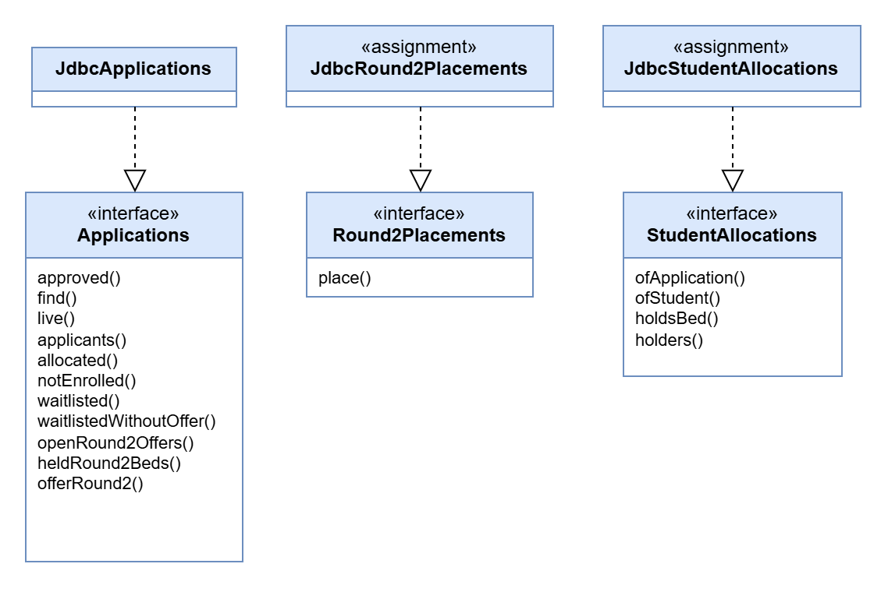

#### 3.4.2 Sequence Diagrams

UC-02 Apply for a Bed and pay the Deposit.

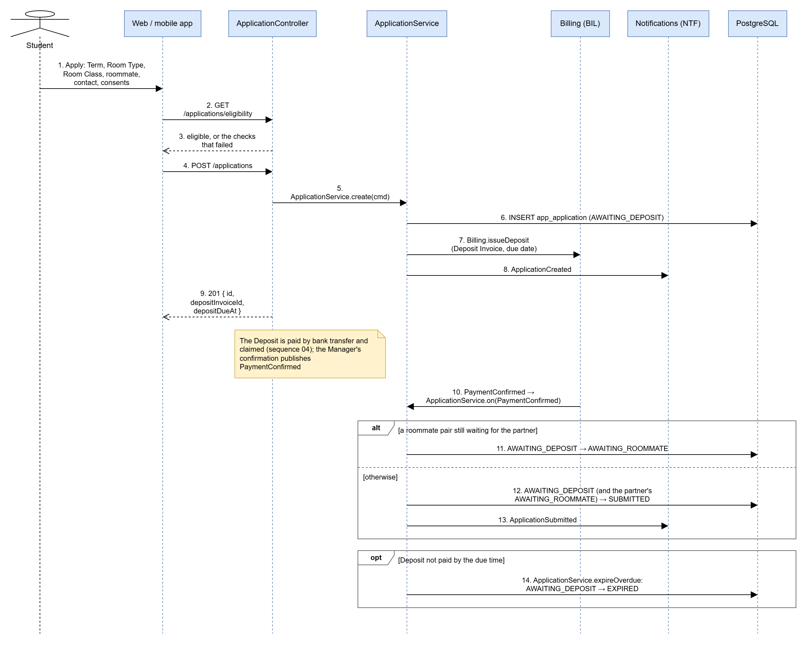

UC-03 Invite a roommate.

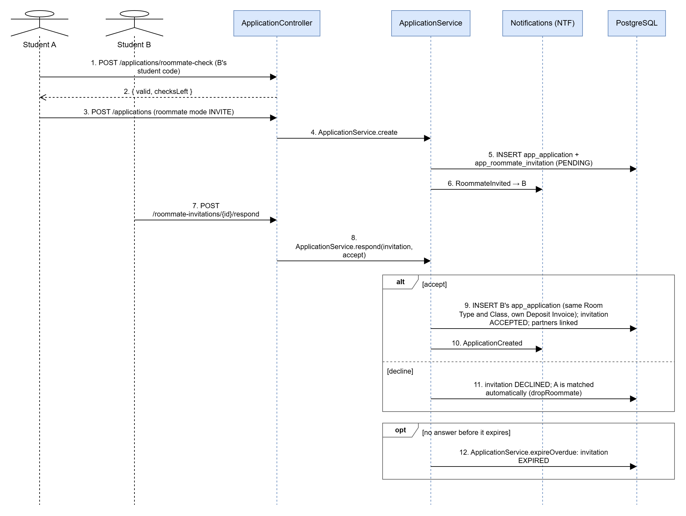

#### 3.4.3 State Diagrams

State machine: app_application.status. Values allowed by the database but not set by the code: DRAFT.

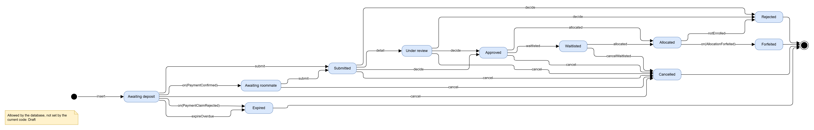

State machine: app_roommate_invitation.status.

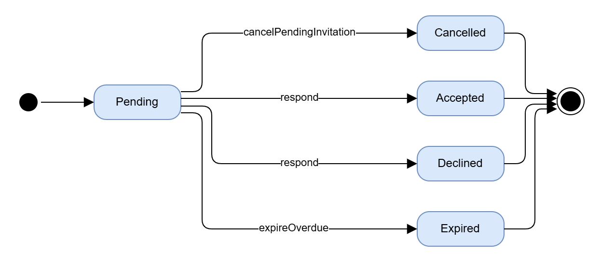

State machine: app_round2_offer.status.

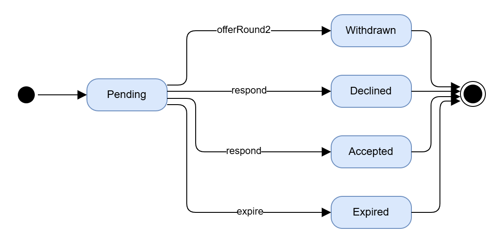

#### 3.4.4 API

17 endpoints (request and error details in Report 3).

| Method | Path | Access | Controller |
|---|---|---|---|
| GET | `/applications/eligibility` | signed in | ApplicationController |
| POST | `/applications/roommate-check` | signed in | ApplicationController |
| POST | `/applications` | signed in | ApplicationController |
| GET | `/applications/{id}` | signed in | ApplicationController |
| GET | `/applications` | signed in | ApplicationController |
| POST | `/applications/{id}/review` | signed in | ApplicationController |
| POST | `/applications/bulk-review` | signed in | ApplicationController |
| POST | `/applications/{id}/cancel` | signed in | ApplicationController |
| POST | `/roommate-invitations/{id}/respond` | signed in | ApplicationController |
| GET | `/round2/offers` | signed in | Round2Controller |
| POST | `/applications/{id}/withdraw` | signed in | Round2Controller |
| GET | `/students/me/round2-offer` | STUDENT | Round2Controller |
| POST | `/round2-offers/{id}/respond` | signed in | Round2Controller |
| GET | `/students/me/home` | STUDENT | StudentController |
| GET | `/students/me/profile` | STUDENT | StudentController |
| GET | `/students/me/applications` | STUDENT | StudentController |
| GET | `/students/me/roommate-invitation` | STUDENT | StudentController |

### 3.5 Assignment and residence (ASG)

#### 3.5.1 Class Diagram

The ports this feature declares (interfaces) and the classes that implement them; other features call it only through these.

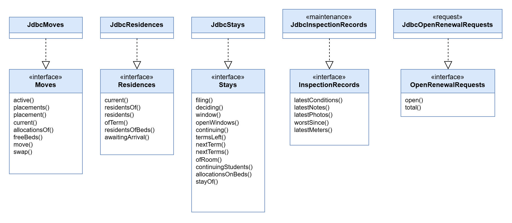

#### 3.5.2 Sequence Diagrams

UC-05 Run the assignment and commit it.

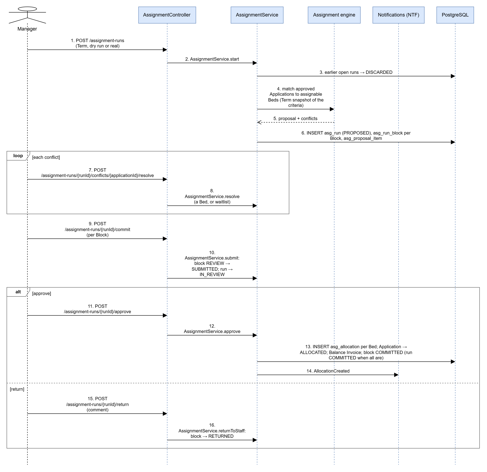

UC-06 Answer a Round 2 offer.

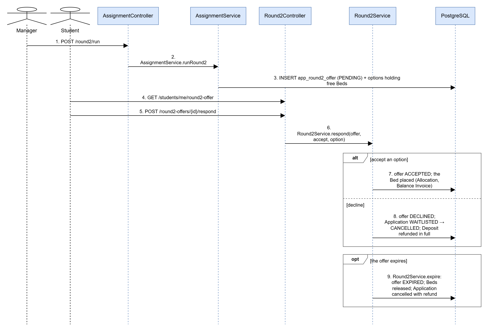

UC-07 Check in with the hand-over report.

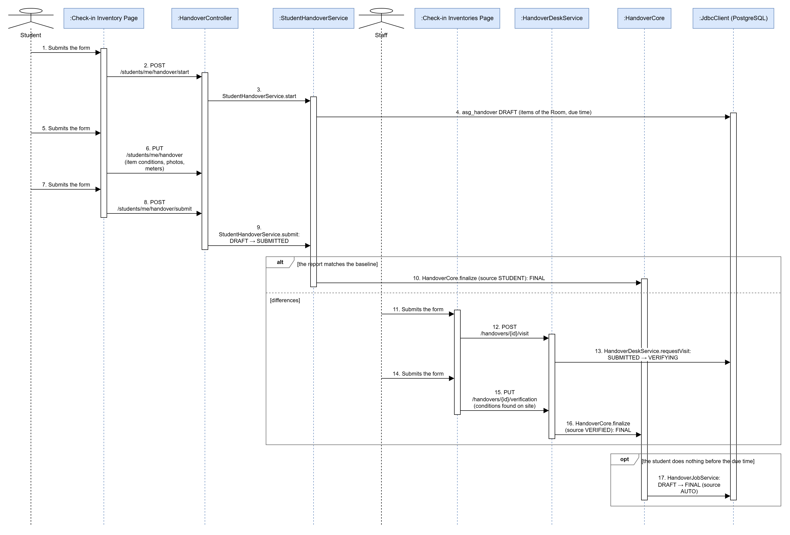

UC-14 Renew a stay and pay the next-Term fee.

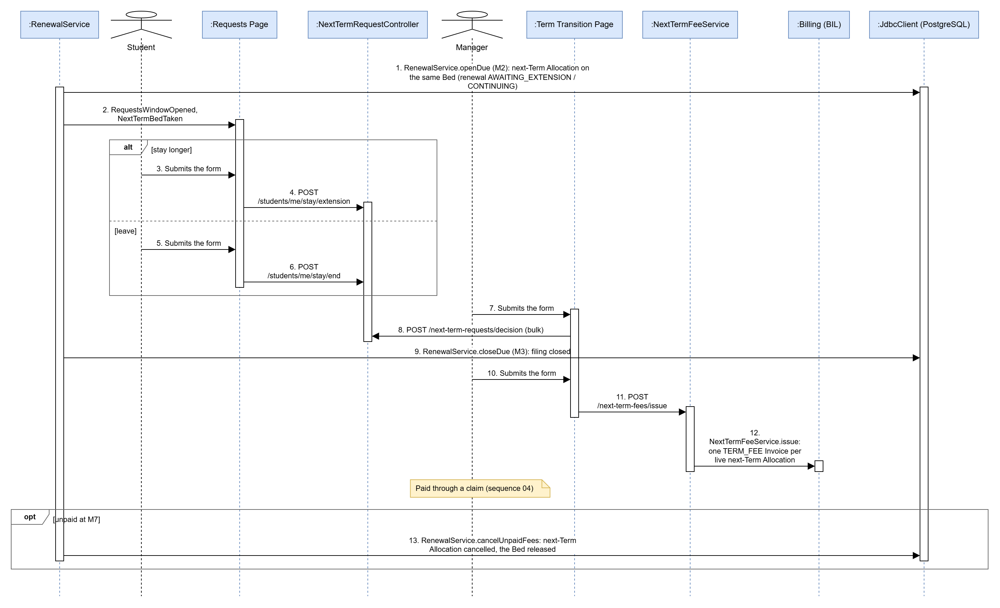

UC-16 Terminate a stay.

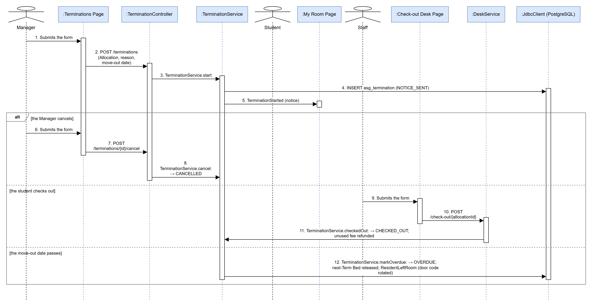

#### 3.5.3 State Diagrams

State machine: asg_allocation.status.

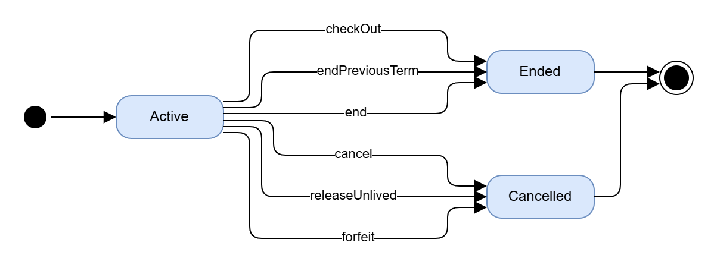

State machine: asg_check_out.refund_status. Values allowed by the database but not set by the code: APPROVED, PAID, REJECTED.

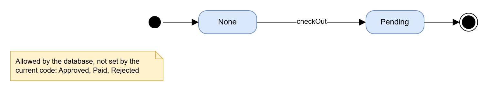

State machine: asg_check_out.status.

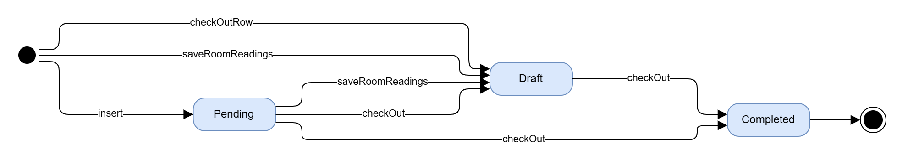

State machine: asg_damage_claim.status. Values allowed by the database but not set by the code: SETTLED.

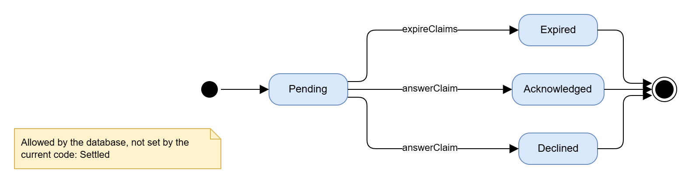

State machine: asg_handover.status.

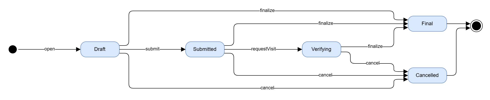

State machine: asg_late_check_in.status.

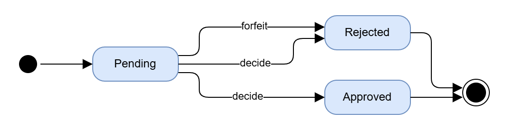

State machine: asg_run.status. Values allowed by the database but not set by the code: RUNNING, FAILED.

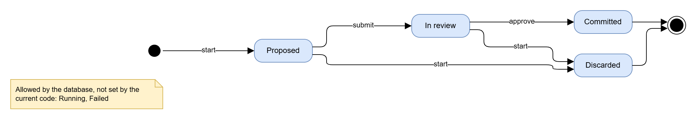

State machine: asg_run_block.status. Values allowed by the database but not set by the code: APPROVED.

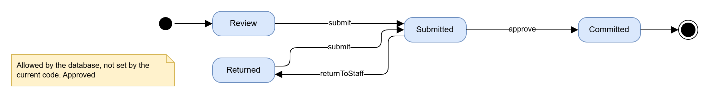

State machine: asg_stay.status.

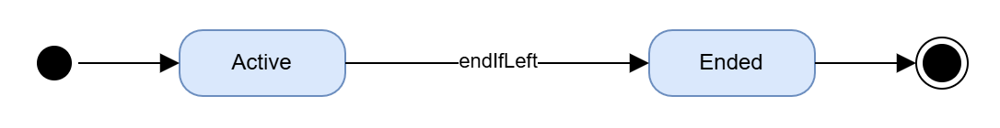

State machine: asg_termination.status.

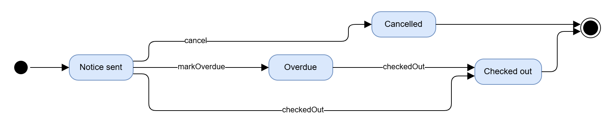

#### 3.5.4 API

63 endpoints (request and error details in Report 3).

| Method | Path | Access | Controller |
|---|---|---|---|
| GET | `/assignment-runs` | signed in | AssignmentController |
| POST | `/assignment-runs` | signed in | AssignmentController |
| GET | `/round2` | signed in | AssignmentController |
| POST | `/round2/run` | signed in | AssignmentController |
| GET | `/assignment-runs/{runId}/proposal` | signed in | AssignmentController |
| GET | `/assignment-runs/{runId}/conflicts/{applicationId}` | signed in | AssignmentController |
| POST | `/assignment-runs/{runId}/conflicts/{applicationId}/resolve` | signed in | AssignmentController |
| POST | `/assignment-runs/{runId}/commit` | signed in | AssignmentController |
| GET | `/assignment-runs/{runId}/rooms` | signed in | AssignmentController |
| POST | `/assignment-runs/{runId}/approve` | signed in | AssignmentController |
| POST | `/assignment-runs/{runId}/return` | signed in | AssignmentController |
| GET | `/approvals/assignment` | signed in | AssignmentController |
| GET | `/check-outs/{allocationId}/furniture` | signed in | CheckOutFurnitureController |
| PUT | `/check-outs/{allocationId}/furniture` | signed in | CheckOutFurnitureController |
| POST | `/check-outs/{allocationId}/damage-claims` | signed in | CheckOutFurnitureController |
| GET | `/check-out-reviews` | signed in | CheckOutFurnitureController |
| POST | `/check-out-reviews/{allocationId}/{itemId}` | signed in | CheckOutFurnitureController |
| GET | `/students/me/check-out` | STUDENT | CheckOutFurnitureController |
| POST | `/students/me/check-out/agree` | STUDENT | CheckOutFurnitureController |
| POST | `/students/me/damage-claims/{id}` | STUDENT | CheckOutFurnitureController |
| GET | `/check-in/today` | signed in | DeskController |
| GET | `/check-in/lookup` | signed in | DeskController |
| POST | `/check-in` | signed in | DeskController |
| GET | `/check-out` | signed in | DeskController |
| GET | `/check-out/{allocationId}` | signed in | DeskController |
| POST | `/check-out/{allocationId}` | signed in | DeskController |
| GET | `/check-out/readings` | signed in | DeskController |
| PUT | `/check-out/readings` | signed in | DeskController |
| GET | `/check-out/readings/template` | signed in | DeskController |
| POST | `/check-out/readings` | signed in | DeskController |
| GET | `/students/me/handover` | STUDENT | HandoverController |
| POST | `/students/me/handover/start` | STUDENT | HandoverController |
| PUT | `/students/me/handover` | STUDENT | HandoverController |
| POST | `/students/me/handover/photos` | STUDENT | HandoverController |
| DELETE | `/students/me/handover/photos/{id}` | STUDENT | HandoverController |
| POST | `/students/me/handover/submit` | STUDENT | HandoverController |
| POST | `/students/me/handover/agree` | STUDENT | HandoverController |
| POST | `/students/me/handover/late` | STUDENT | HandoverController |
| GET | `/handovers` | signed in | HandoverController |
| GET | `/handovers/{id}` | signed in | HandoverController |
| POST | `/handovers/{id}/confirm` | signed in | HandoverController |
| POST | `/handovers/{id}/visit` | signed in | HandoverController |
| PUT | `/handovers/{id}/verification` | signed in | HandoverController |
| POST | `/handovers/{id}/cancel` | signed in | HandoverController |
| POST | `/handovers/{id}/late` | signed in | HandoverController |
| POST | `/late-check-ins` | signed in | LateCheckInController |
| GET | `/students/me/late-check-in` | STUDENT | LateCheckInController |
| POST | `/students/me/late-check-in` | STUDENT | LateCheckInController |
| GET | `/late-check-ins` | signed in | LateCheckInController |
| POST | `/late-check-ins/{id}/decision` | signed in | LateCheckInController |
| GET | `/operational-moves/options` | signed in | OperationalMoveController |
| POST | `/operational-moves` | signed in | OperationalMoveController |
| GET | `/operational-moves` | signed in | OperationalMoveController |
| GET | `/renewals` | signed in | RenewalController |
| GET | `/renewals/overview` | signed in | RenewalController |
| GET | `/next-term-fees` | signed in | RenewalController |
| POST | `/next-term-fees/issue` | signed in | RenewalController |
| GET | `/turnover` | signed in | RenewalController |
| POST | `/turnover/meter-cuts` | signed in | RenewalController |
| GET | `/students/me/allocation` | STUDENT | StudentAllocationController |
| GET | `/terminations` | signed in | TerminationController |
| POST | `/terminations` | signed in | TerminationController |
| POST | `/terminations/{id}/cancel` | signed in | TerminationController |

### 3.6 Billing (BIL)

#### 3.6.1 Class Diagram

The ports this feature declares (interfaces) and the classes that implement them; other features call it only through these.

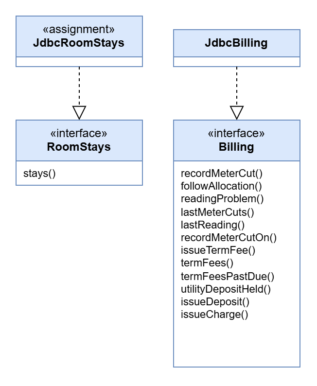

#### 3.6.2 Sequence Diagrams

UC-04 Claim a payment and confirm it.

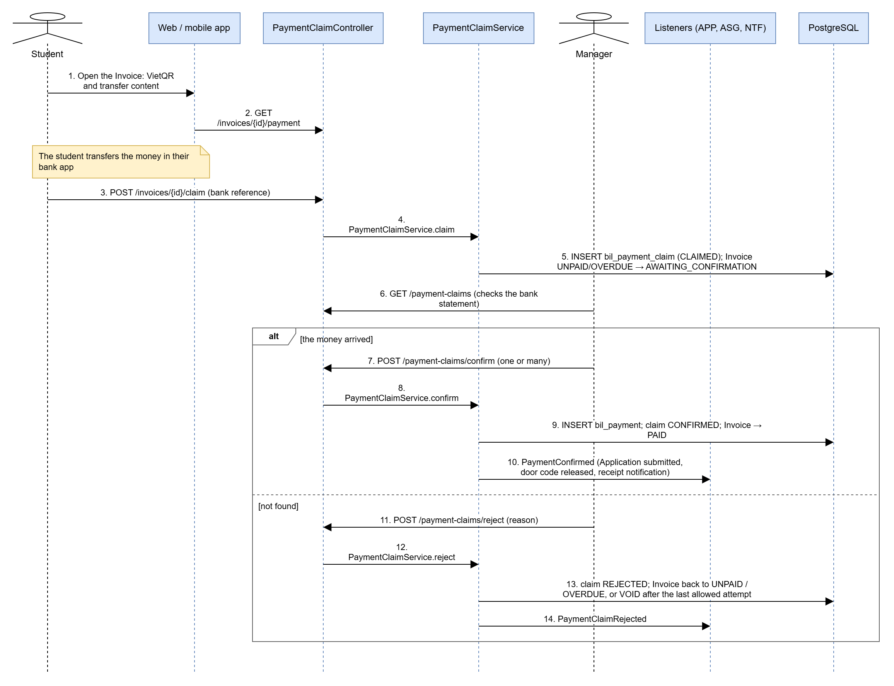

UC-15 Bill utilities.

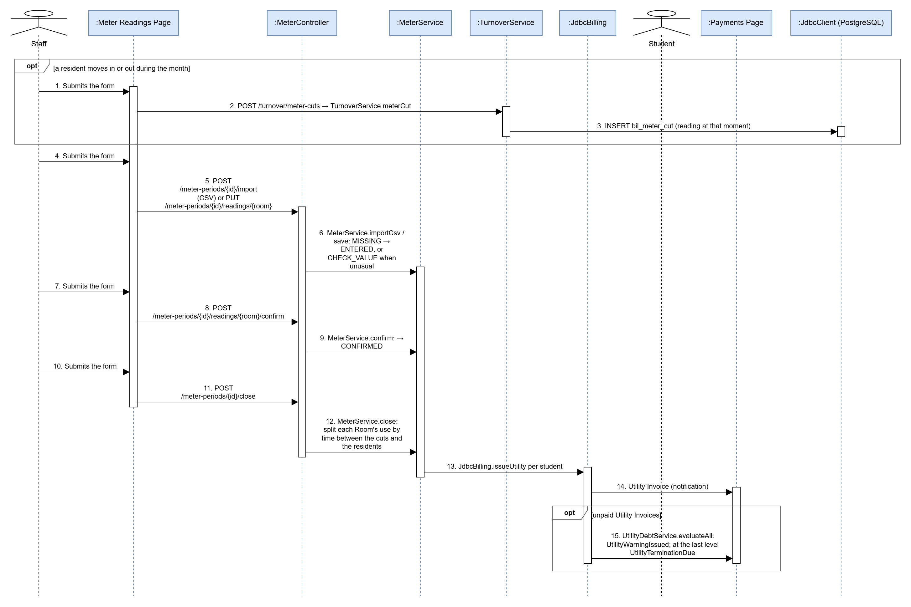

#### 3.6.3 State Diagrams

State machine: bil_invoice.status. Values allowed by the database but not set by the code: UPCOMING.

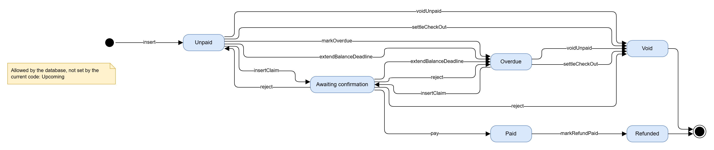

State machine: bil_meter_reading.status.

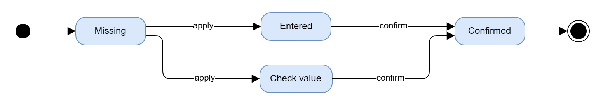

State machine: bil_payment_claim.status.

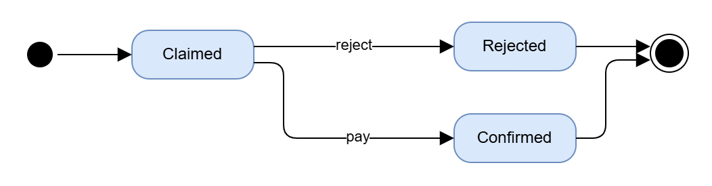

State machine: bil_refund.status.

#### 3.6.4 API

30 endpoints (request and error details in Report 3).

| Method | Path | Access | Controller |
|---|---|---|---|
| GET | `/finance/summary` | signed in | FinanceController |
| GET | `/finance/overdue` | signed in | FinanceController |
| POST | `/finance/reminders` | signed in | FinanceController |
| GET | `/invoices` | signed in | FinanceController |
| GET | `/refunds` | signed in | FinanceController |
| POST | `/refunds/{id}/account-reminder` | signed in | FinanceController |
| GET | `/students/me/refunds` | STUDENT | FinanceController |
| POST | `/refunds/{id}/decision` | signed in | FinanceController |
| POST | `/refunds/{id}/paid` | signed in | FinanceController |
| GET | `/meter-periods` | signed in | MeterController |
| GET | `/meter-periods/{id}/readings` | signed in | MeterController |
| GET | `/meter-periods/{id}/readings/{room}` | signed in | MeterController |
| PUT | `/meter-periods/{id}/readings/{room}` | signed in | MeterController |
| POST | `/meter-periods/{id}/readings/{room}/confirm` | signed in | MeterController |
| GET | `/meter-periods/{id}/template` | signed in | MeterController |
| POST | `/meter-periods/{id}/import` | signed in | MeterController |
| POST | `/meter-periods/{id}/close` | signed in | MeterController |
| POST | `/invoices/{id}/claim` | signed in | PaymentClaimController |
| GET | `/payment-claims` | signed in | PaymentClaimController |
| POST | `/payment-claims/{invoiceId}/receipt` | signed in | PaymentClaimController |
| POST | `/payment-claims/confirm` | signed in | PaymentClaimController |
| POST | `/payment-claims/reject` | signed in | PaymentClaimController |
| GET | `/payments` | signed in | PaymentDeskController |
| POST | `/payments/{invoiceId}/confirm` | signed in | PaymentDeskController |
| GET | `/payments/{invoiceId}/receipt-file` | signed in | PaymentDeskController |
| GET | `/students/me/invoices` | STUDENT | StudentInvoiceController |
| GET | `/invoices/{id}` | signed in | StudentInvoiceController |
| GET | `/invoices/{id}/payment` | signed in | StudentInvoiceController |
| POST | `/invoices/{id}/payment/refresh` | signed in | StudentInvoiceController |
| GET | `/invoices/{id}/receipt` | signed in | StudentInvoiceController |

### 3.7 Requests and Term transition (REQ)

#### 3.7.1 Class Diagram

This feature declares no port: its services are called by its own controllers and it reaches other features through their ports and events.

#### 3.7.2 Sequence Diagrams

UC-11 Request a room change.

UC-12 Swap Beds with another student.

#### 3.7.3 State Diagrams

State machine: req_escalation.status.

State machine: req_room_change.status. Values allowed by the database but not set by the code: PENDING.

State machine: req_stay_request.status.

State machine: req_swap.status.

State machine: req_swap_post.status.

#### 3.7.4 API

26 endpoints (request and error details in Report 3).

| Method | Path | Access | Controller |
|---|---|---|---|
| GET | `/escalations` | signed in | EscalationController |
| POST | `/escalations/{id}/actions` | signed in | EscalationController |
| POST | `/students/me/stay/extension` | STUDENT | NextTermRequestController |
| POST | `/students/me/stay/end` | STUDENT | NextTermRequestController |
| GET | `/stay-requests` | signed in | NextTermRequestController |
| POST | `/stay-requests/{id}/decision` | signed in | NextTermRequestController |
| GET | `/next-term-requests` | signed in | NextTermRequestController |
| POST | `/next-term-requests/decision` | signed in | NextTermRequestController |
| GET | `/room-changes/options` | signed in | RoomChangeController |
| POST | `/room-changes` | signed in | RoomChangeController |
| GET | `/room-changes` | signed in | RoomChangeController |
| GET | `/room-changes/{id}/matching-beds` | signed in | RoomChangeController |
| POST | `/room-changes/{id}/decision` | signed in | RoomChangeController |
| GET | `/routing-rules` | signed in | RoutingController |
| POST | `/routing-rules` | signed in | RoutingController |
| PUT | `/routing-rules/timers` | signed in | RoutingController |
| PUT | `/routing-rules/{id}` | signed in | RoutingController |
| GET | `/students/me/requests` | STUDENT | StudentRequestsController |
| POST | `/swaps` | signed in | SwapController |
| GET | `/swap-board` | signed in | SwapController |
| PUT | `/swap-board/my-post` | signed in | SwapController |
| POST | `/swap-board/posts/{id}/request` | signed in | SwapController |
| GET | `/swap-invitations/{id}` | signed in | SwapController |
| POST | `/swap-invitations/{id}/respond` | signed in | SwapController |
| GET | `/swaps` | signed in | SwapController |
| POST | `/swaps/{id}/decision` | signed in | SwapController |

### 3.8 Maintenance and inspections (MNT)

#### 3.8.1 Class Diagram

The ports this feature declares (interfaces) and the classes that implement them; other features call it only through these.

#### 3.8.2 Sequence Diagrams

UC-09 Report and process a Maintenance Request.

UC-10 Inspect Rooms.

#### 3.8.3 State Diagrams

State machine: mnt_checklist.status.

State machine: mnt_inspection_room.status.

State machine: mnt_inspection_run.status.

State machine: mnt_inspection_schedule.status.

State machine: mnt_request.status.

#### 3.8.4 API

27 endpoints (request and error details in Report 3).

| Method | Path | Access | Controller |
|---|---|---|---|
| GET | `/inspection-checklists` | signed in | InspectionController |
| POST | `/inspection-checklists` | signed in | InspectionController |
| POST | `/inspection-checklists/{id}/publish` | signed in | InspectionController |
| POST | `/inspection-checklists/{id}/archive` | signed in | InspectionController |
| PUT | `/inspection-checklists/{id}` | signed in | InspectionController |
| POST | `/inspection-checklists/{id}/restore` | signed in | InspectionController |
| DELETE | `/inspection-checklists/{id}` | signed in | InspectionController |
| GET | `/inspection-schedules` | signed in | InspectionController |
| POST | `/inspection-schedules` | signed in | InspectionController |
| PUT | `/inspection-schedules/{id}` | signed in | InspectionController |
| GET | `/inspection-runs/current` | signed in | InspectionController |
| GET | `/inspection-runs` | signed in | InspectionController |
| GET | `/inspection-runs/{id:INS-\\d+\|\\d+}` | signed in | InspectionController |
| POST | `/inspection-runs/{id}/rooms/{room}/photos` | signed in | InspectionController |
| DELETE | `/inspection-runs/{id}/rooms/{room}/photos/{photoId}` | signed in | InspectionController |
| GET | `/inspection-runs/upcoming` | signed in | InspectionController |
| GET | `/inspection-runs/{id}/rooms` | signed in | InspectionController |
| PUT | `/inspection-runs/{id}/rooms/{room}` | signed in | InspectionController |
| POST | `/inspection-runs/{id}/rooms/{room}/unreachable` | signed in | InspectionController |
| POST | `/inspection-runs/{id}/submit` | signed in | InspectionController |
| GET | `/maintenance-requests/options` | signed in | MaintenanceController |
| POST | `/maintenance-requests` | signed in | MaintenanceController |
| GET | `/maintenance-requests` | signed in | MaintenanceController |
| GET | `/maintenance-requests/{id}` | signed in | MaintenanceController |
| PATCH | `/maintenance-requests/{id}` | signed in | MaintenanceController |
| POST | `/maintenance-requests/{id}/updates` | signed in | MaintenanceController |
| POST | `/maintenance-requests/{id}/confirm` | signed in | MaintenanceController |

### 3.9 Notifications (NTF)

#### 3.9.1 Class Diagram

The ports this feature declares (interfaces) and the classes that implement them; other features call it only through these.

#### 3.9.2 Sequence Diagrams

UC-20 Receive notifications and push.

#### 3.9.3 State Diagrams

State machine: ntf_email_outbox.status.

#### 3.9.4 API

16 endpoints (request and error details in Report 3).

| Method | Path | Access | Controller |
|---|---|---|---|
| GET | `/admin/notification-templates` | ADMIN | AdminMessagingController |
| PUT | `/admin/notification-templates/{key}` | ADMIN | AdminMessagingController |
| POST | `/admin/notification-templates/{key}/test` | ADMIN | AdminMessagingController |
| GET | `/admin/emails/options` | ADMIN | AdminMessagingController |
| POST | `/admin/emails/preview` | ADMIN | AdminMessagingController |
| POST | `/admin/emails` | ADMIN | AdminMessagingController |
| GET | `/students/me/board` | STUDENT | AnnouncementController |
| GET | `/announcements` | signed in | AnnouncementController |
| GET | `/announcements/options` | signed in | AnnouncementController |
| POST | `/announcements` | signed in | AnnouncementController |
| PUT | `/announcements/{id}` | signed in | AnnouncementController |
| POST | `/devices` | signed in | DeviceController |
| POST | `/devices/unregister` | signed in | DeviceController |
| GET | `/notifications` | signed in | NotificationController |
| POST | `/notifications/read-all` | signed in | NotificationController |
| POST | `/notifications/{id}/read` | signed in | NotificationController |

### 3.10 Reports (RPT)

#### 3.10.1 Class Diagram

This feature declares no port: its services are called by its own controllers and it reaches other features through their ports and events.

#### 3.10.4 API

10 endpoints (request and error details in Report 3).

| Method | Path | Access | Controller |
|---|---|---|---|
| GET | `/dashboards/staff` | signed in | ReportController |
| GET | `/dashboards/manager` | signed in | ReportController |
| GET | `/dashboards/term` | signed in | ReportController |
| GET | `/dashboards/admin` | signed in | ReportController |
| GET | `/approvals/summary` | signed in | ReportController |
| GET | `/reports/occupancy` | signed in | ReportController |
| GET | `/reports/financial` | signed in | ReportController |
| GET | `/reports/block` | signed in | ReportController |
| GET | `/exports/{report}` | signed in | ReportController |
| GET | `/search` | signed in | SearchController |

### 3.11 Family Day (VIS)

#### 3.11.1 Class Diagram

This feature declares no port: its services are called by its own controllers and it reaches other features through their ports and events.

#### 3.11.2 Sequence Diagrams

UC-18 Hold a Family Day.

#### 3.11.3 State Diagrams

State machine: vis_family_day.status.

State machine: vis_registration.status.

State machine: vis_visitor.status.

#### 3.11.4 API

21 endpoints (request and error details in Report 3).

| Method | Path | Access | Controller |
|---|---|---|---|
| GET | `/family-days` | signed in | FamilyDayController |
| POST | `/family-days` | signed in | FamilyDayController |
| GET | `/family-days/{id}` | signed in | FamilyDayController |
| PUT | `/family-days/{id}` | signed in | FamilyDayController |
| POST | `/family-days/{id}/publish` | signed in | FamilyDayController |
| POST | `/family-days/{id}/cancel` | signed in | FamilyDayController |
| POST | `/family-days/{id}/close` | signed in | FamilyDayController |
| GET | `/family-days/{id}/registrations` | signed in | FamilyDayController |
| POST | `/family-day-registrations/{id}/cancel` | signed in | FamilyDayController |
| GET | `/family-day-stats` | signed in | FamilyDayStatsController |
| GET | `/family-days/{id}/stats` | signed in | FamilyDayStatsController |
| GET | `/students/me/family-days` | STUDENT | StudentFamilyDayController |
| GET | `/students/me/family-days/{id}` | STUDENT | StudentFamilyDayController |
| POST | `/students/me/family-days/{id}/registration` | STUDENT | StudentFamilyDayController |
| POST | `/students/me/family-days/{id}/registration/safety-confirmation` | STUDENT | StudentFamilyDayController |
| POST | `/students/me/family-days/{id}/registration/cancel` | STUDENT | StudentFamilyDayController |
| GET | `/family-days/{id}/visitors` | signed in | VisitorDeskController |
| POST | `/family-days/{id}/overdue-reminders` | signed in | VisitorDeskController |
| POST | `/family-day-visitors/verify` | signed in | VisitorDeskController |
| POST | `/family-day-visitors/{id}/check-in` | signed in | VisitorDeskController |
| POST | `/family-day-visitors/{id}/check-out` | signed in | VisitorDeskController |

### 3.12 AI assistant (AST)

#### 3.12.1 Class Diagram

The ports this feature declares (interfaces) and the classes that implement them; other features call it only through these.

#### 3.12.2 Sequence Diagrams

UC-19 Ask the AI assistant.

#### 3.12.4 API

2 endpoints (request and error details in Report 3).

| Method | Path | Access | Controller |
|---|---|---|---|
| GET | `/students/me/assistant` | STUDENT | AssistantController |
| POST | `/students/me/assistant/chat` | STUDENT | AssistantController |
